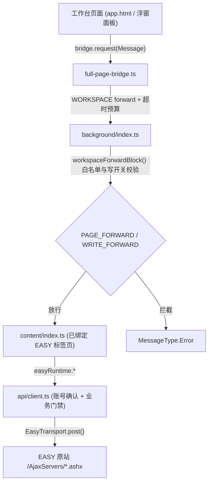

# 通用约定

## 1. 服务

| 项 | 值 |
|---|---|
| Base URL | `http://183.36.43.66:88` |
| 协议 | HTTP |
| 分发方式 | `.ashx` + 表单参数 `Call` |

## 2. 请求

```http
POST /AjaxServers/{Handler}.ashx
Content-Type: application/x-www-form-urlencoded; charset=UTF-8
X-Requested-With: XMLHttpRequest
```

Body 为 `application/x-www-form-urlencoded`，字段平铺，不使用 JSON Body。

公共字段：

| 参数 | 说明 |
|---|---|
| Call | 业务动作名 |
| log_pagename | 来源页面，如 `CaseManage.aspx`、`FileSearch.aspx` |
| _t | 毫秒时间戳，防缓存。部分接口由前端公共封装自动附加 |

## 3. 鉴权

依赖 ASP.NET Session / Cookie，常见键：

- `ASP.NET_SessionId`
- `.pomp`
- `IPEasyUser`

同源请求携带登录态：

```http
Cookie: <浏览器当前会话>
```

调用方应复用当前站点 Cookie，不得把 Cookie 值写入源码。

未登录时响应中 `ClientInfo.IsLogin = false`，部分场景 `ClientInfo.Url` 可能给出跳转地址。

## 4. 公共响应 ClientInfo

多数 `.ashx` JSON 响应包含：

| 字段 | 类型 | 说明 |
|---|---|---|
| ClientInfo.IsLogin | bool | 会话是否有效 |
| ClientInfo.Status | bool | 请求是否执行完成。为 `false` 时读取 `Message` |
| ClientInfo.Result | bool | 业务标志。为 `false` 时仍可能返回业务数据，不能单独视为失败 |
| ClientInfo.Message | string / null | 提示或错误信息 |
| ClientInfo.Url | string / null | 跳转地址 |
| ClientInfo.WebPath | string | 站点根地址 |
| ClientInfo.ErrorCode | bool | 错误标记 |
| ClientInfo.Asyn | bool | 异步标记 |
| ClientInfo.IsNewWindow | bool | 是否新窗口 |
| ClientInfo.OtherInfo | object | 附加信息 |

结果按下列顺序判断：

1. `IsLogin` 为 `false`：会话无效。
2. `Status` 为 `false`：本次请求未执行成功，读取 `Message`。
3. `Status` 为 `true`：再读取该接口文档写明的业务字段。已核对的大量列表、字典和初始化接口，在 `Result` 为 `false` 且 `Message` 为空时仍返回数组或对象，此时按已返回的数据读取。
4. 写操作的成功条件以专题文档为准。创建发文看 `Status` 与 `objid`，保存邮件看 `Status`，提交发文看 `Result` 为 `true`。上述条件不能从本条类推到其他 Call。

## 5. 列表响应约定

文件查询类接口：

| 字段 | 说明 |
|---|---|
| TableRows | 当前页记录数组，无数据时可能为 `null` |
| TableRowsCount | 总记录数，类型为 string |

## 6. 取值规则（前端提交约定）

| 控件类型 | 提交规则 |
|---|---|
| 普通文本 / select | 控件值；不筛选传空字符串 `""` |
| Tree / object 选择器 | 提交 `objid`（内部 ID），不提交页面显示名 |
| 日期为空复选框 `*_isnull` | 勾选 = `on`，未勾选 = `""` |
| 普通布尔复选框 | 勾选 = `true`，未勾选 = `""` |
| 申请号 `app_no` | 提交前去掉 `.` |

复杂选择器在历史 XML 中同时保存内部值与显示文本：

```text
{field}       内部 ID
{field}_text  显示名称
```

---

## 7. 生产运行期补充约定（追加）

以下为多环境生产接入与长期运行中核对确认的补充契约，原有抓包口径不变：

### 7.1 受信任站点环境

除初版抓包地址 `http://183.36.43.66:88` 外，EASY 实际存在多套部署站点，统一沿用同源 `.ashx` 协议：

- `http://d.hiseeip.com:88`、`http://z.hiseeip.com:88`
- `http://183.36.43.66:88`、`http://183.36.43.44:88`、`http://43.138.138.200:8588`

### 7.2 会话失效与异常响应识别

除 `ClientInfo.IsLogin === false` 与 302 重定向到 `login.aspx` 外，以下场景需区分处理：

- **短 HTML 掉线响应**：无会话时部分接口（如 `Login.ashx?Call=GetUserModel`）直接返回长度不超过 500 字节、无 `<html>` 壳的短文本 `出错了!`，应按 `SESSION_EXPIRED` 处理。
- **网关 502 / 503 与超时**：仅对**只读接口**允许有限次短退避重试；所有写接口、打包下载（`DownLoad`）、模板写回（`SearchQueryHisSave/Delete`、`UpdateQueryOutConfig*`）与服务端 Excel 导出（`ExcelFeeList*`）**严禁自动重试**。
- **超时不可误判掉线**：高并发下载或命名占满连接导致心跳超时时，保留原登录态，不主动置为失效。

### 7.3 ASP.NET 实体编码 XML 与 `TableRows` 双形态

- **实体编码 XML**：`AgencySearchCase` 的 `Element`、`UpdateQueryOutConfig*` 的 `element` 以及高级导出的 `e_coulums` 均以 `&lt;tag&gt;...&lt;/tag&gt;` 提交，规避 ASP.NET WebForms Request Validation 拦截；节点文本内含 `&`、`<`、`>` 需先转义。
- **`TableRows` 双形态**：多数列表返回 JSON 数组或 `null`，但部分接口（如 `Report.ashx?Call=FeeSearch`）在部分条件下返回 JSON 序列化字符串，调用方需统一兼容 `Array` 与 `JSON.parse(string)`。
- **统一文件取件**：打包 ZIP 与服务端导出 Excel 均经 `GET /AjaxServers/FileHandler.ashx?guid={GUID}&file_size={size}` 下载，详见 [06-文件操作.md](06-文件操作.md) 与 [45-清单导出与模板.md](45-清单导出与模板.md)。


---

## 8. 插件扩展内部通信与调度总览

PatMail 所有 EASY 原站接口请求均不从工作台页面直连原站，而是统一经 MV3 消息总线转发到**当前已绑定的 EASY 标签页内容脚本**，在同源上下文复用浏览器登录会话 Cookie：



- **转发白名单与写开关**（`patmail-extension/src/shared/message.ts`）：
  - `PAGE_FORWARD`：只读查询、字典、导出与会话心跳消息，直接允许转发；
  - `WRITE_FORWARD`：`CREATE_EASY_MAIL`、`SAVE_EASY_MAIL`、`SAVE_HISTORY_QUERY`、`DELETE_HISTORY_QUERY`、`SAVE_FILE_TEMP_NAME`、`DELETE_FILE_TEMP_NAME`、`SUBMIT_LIMIT_MAIL`、`SUBMIT_FILE_MANAGE`，必须在全局写开关开启（`isWriteSwitchOpen() === true`）时才允许转发。
- **分级超时调度**（`full-page-bridge.ts` + `transport.ts`）：
  - 常规只读：`30s`（传输层 `15s`）
  - 字典 / 表单扫描 / 审批读取（`slow`）：`70s`（传输层 `60s`）
  - 发文提交 / 联系人导出：`180s`
  - 流程反查（`LOOKUP_IC_FLOW`）/ 海牙读案（`READ_HAGUE_CASE`）/ 下载命名（`RESOLVE_DOWNLOAD_NAMES`）：`300s`（`GetFileName` 与 `DownLoad` 传输层不设总时长，仅响应显式取消）
  - 列表查询与费用导出（`SEARCH_FILES` / `SEARCH_LIMIT_MONITOR` / `SEARCH_FILING` / `SEARCH_FEE` / `EXPORT_FEE`）：跟随页面所选超时档位（1 / 2 / 5 / 10 分钟）+ 转发层 `15s` 余量。
