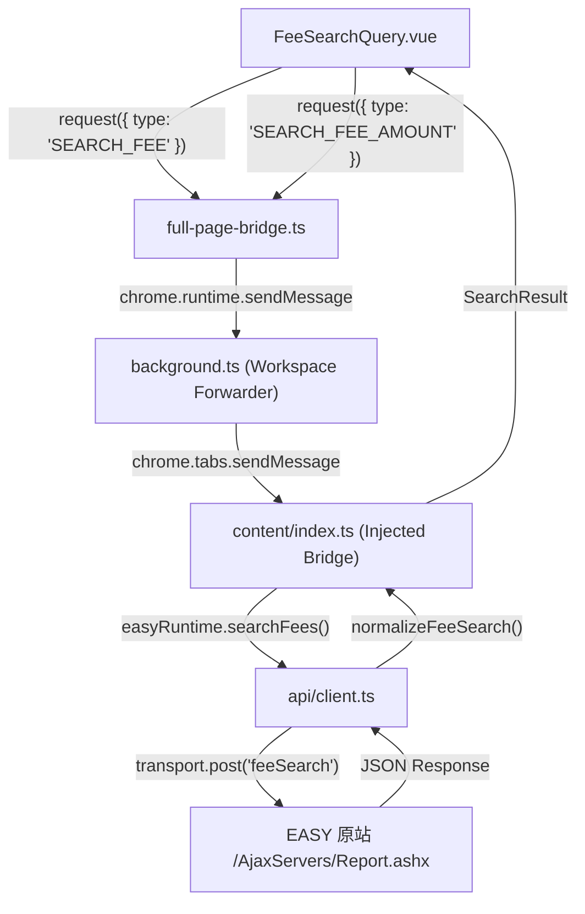

# 费用查询 FeeSearch

Handler：`POST /AjaxServers/Report.ashx`  
页面：`Forms/Bill/FeeSearch.aspx` / `FeeSearch.js`  
金额统计：`POST /AjaxServers/Report.ashx`（Call：`FeeSearchTotalAmount`）  
初始化字典：`POST /AjaxServers/Bill.ashx`（Call：`FeeSearchInit`，见 [33-账单请款.md](33-账单请款.md)）

已验证：通过原生 CDP 现场调取 `case_volume=PA2601250PCT`，`TableRowsCount=5`，成功返回官费记录（9220 CNY、2100 CNY、1000 CNY 等）。

---

## 1. 请求基础信息

| 项 | 值 |
|---|---|
| Method | POST |
| 地址 | `/AjaxServers/Report.ashx` |
| 主查询 Call | `FeeSearch` |
| 金额汇总 Call | `FeeSearchTotalAmount` |
| Content-Type | `application/x-www-form-urlencoded; charset=UTF-8` |
| 鉴权要求 | 依赖 EASY ASP.NET 会话 Cookie（`.pomp` / `IPEasyUser` / `ASP.NET_SessionId`） |

> [!IMPORTANT]
> `FeeSearch` 必须传递 `colsel` 参数（以分号开头和结尾的 84 列字段清单）。若未带 `colsel` 或字段缺失，原站接口直接返回服务端异常「系统繁忙，请求失败，请稍后重试！」。

---

## 2. 框架参数

| 参数 | 类型 | 示例 | 说明 |
|---|---|---|---|
| Call | string | `FeeSearch` / `FeeSearchTotalAmount` | 动作名 |
| log_pagename | string | `FeeSearch.aspx` | 来源页面固定值 |
| pageIndex | int | 1 | 页码，从 1 开始（`FeeSearchTotalAmount` 不传） |
| pageSize | int | 10 | 每页条数（可选 10, 15, 20, 30, 50, 100） |
| colsel | string | 见下文 | Layui/Grid 显示与查询列定义集合（必填） |
| order_by_search | string | `pay_deadline_date desc` | 排序规则：字段 + 空格 + `asc`/`desc` |
| _t | long | `1790046359929` | 毫秒防缓存时间戳 |

### colsel 完整 84 列集合

```text
;case_volume;case_volume_customer;case_name;case_status;country;business_type_name;currency_type;generation_status;notice_status;fee_name;amount;rate;amount_currency;pay_status;pay_date;is_fuzzy_query_case_volume;app_no;is_fuzzy_query_app_no;is_point_app_no;pct_app_no;is_fuzzy_query_pct_app_no;applicant_id;applicant_id_flag;customer_id;customer_id_flag;country_flag;case_type;fee_class;is_not_case_volume;pay_type;branch_dept_id;agency_id;request_status;receive_status;receive_date_start;receive_date_end;receive_date_null;actual_receive_date_start;actual_receive_date_end;actual_receive_date_null;create_date_start;create_date_end;create_date_null;sale_user_id;proc_pic_id;sale_help_id;confirm_date_start;confirm_date_end;confirm_date_null;app_date_start;app_date_end;app_date_null;pay_deadline_date_start;pay_deadline_date_end;pay_deadline_date_null;is_proxy_pay_deadline_date;is_proxy_pay_date;agent_name;case_pic_id;proc_pic_dept_id;charge_dept_id;commission_user;apply_tags;customer_status;demand_status;fee_create_user_id;fee_create_date_start;fee_create_date_end;fee_create_date_null;ctrl_proc;ctrl_proc_user_id;ctrl_proc_finish_date_start;ctrl_proc_finish_date_end;ctrl_proc_finish_date_null;actual_pay_date_start;actual_pay_date_end;actual_pay_date_null;is_vip;is_ahead_pub;is_ahead_audit;request_no;currency;invoice_no;exists_invoice_no;is_invoice;settle_status;rate_search;rebate;
```

---

## 3. 结果区单选控制与辅助字典/二级弹窗接口

### 3.1 结果区单选条（对齐 `FeeSearch.js` L637–671）

| 组 | 选项 | 行为 |
|---|---|---|
| `show_type` | `显示全部` / `仅显示选中项` | 前端过滤当前页展示全部行还是仅展示已勾选行 |
| `show_fee` | `只选官费` / `只选代理费` | 按当前页 `fee_class_name` 自动勾选所有「官费」或「代理费」行 |

### 3.2 初始化字典与二级弹窗接口（CDP 核对）

| 用途 | Handler | Call | 参数 / 返回说明 |
|---|---|---|---|
| 费用查询全量初始化 | `/AjaxServers/Bill.ashx` | `FeeSearchInit` | 返回 `CaseType`（排除科技服务）、`Case_direction`、`receive_status`、`PayType`、`FeeType`（434项）、`ApplyType`、`BussType`、`case_status`、`customerStatus`、`review_stage`、`FeeCurrency`、`sourcetype`、`bank_list` |
| 客户选择二级弹窗（`ShowIhgSelect`） | `/AjaxServers/Report.ashx` | `GetCustomerTreeData` | `searchKey` -> `CustList[{ id, name, tel, email }]`，支持多选，`customer_id` / `ruleOutcustomer_id` 用 `;` 拼接 |
| 申请人联动树 | `/AjaxServers/Report.ashx` | `GetTreeApplicant` | `customer_ids`（`;` 拼接）-> `TreeApplicant[]`，选中后解锁 `first_applicant`（`1`/`0`） |
| 代理机构下拉 | `/AjaxServers/CaseInfo.ashx` | `GetAencyList` | 返回 `AgencyList[{ agency_id, agency_name_cn }]`（331项） |
| 联系人类别 | `/AjaxServers/Customer.ashx` | `ContactInit` | 返回 `contacttype[]` |
| 产品类别树 | `/AjaxServers/BaseInfo.ashx` | `GetProducts` | 返回 `Products[]` |
| 技术领域树 | `/AjaxServers/Common.ashx` | `LoadTechnical` | `Key` -> `Technical[]` |
| 自定义栏位标题 | `/AjaxServers/PatentAction.ashx` | `GetFieldColumn` | 返回 `fieldColumn[]`（映射 `column_1..5` 动态标题） |
| 导出模板列表/详情 | `/AjaxServers/Common.ashx` | `GetQueryOutConfig` | `belong_key`（`FeeSearch_ExportByCond` / `FeeSearch_ExportCountByCond`）-> `out_model[]`；传 `type_id` -> `out_columns[]` |
| 导出模板保存/删除 | `/AjaxServers/Common.ashx` | `UpdateQueryOutConfig` | `ud_type=add`（附实体编码 `<item>` XML `element`）/ `ud_type=del`（`out_type_id`） |
| 导出模板更新 | `/AjaxServers/Common.ashx` | `UpdateQueryOutConfigNew` | `ud_type=up`，附 `out_type_id`、`model_name`、`element` |
| 导出清单 / 勾选 / 汇总 | `/AjaxServers/Report.ashx` | `ExcelFeeListByCond` / `ExcelFeeListByChecked` / `ExcelFeeListCountByCond` | 传查询条件或 `fee_ids` + `e_coulums`（实体编码 XML）；同步返回 `file_guid` / `file_size` 经 `/AjaxServers/FileHandler.ashx` 下载，大数据量 `ClientInfo.Asyn=true` 转异步下载清单 |

---

## 4. 关键字段与枚举校验（对照 `FeeSearch.aspx` 实时 DOM）

| 字段 | 控件形态 | 参数名 | 实测枚举 / 提交格式 |
|---|---|---|---|
| 我方文号 / 申请号 / PCT申请号 | 多行 `textarea` | `case_volume` / `app_no` / `pct_app_no` | 配套 `is_fuzzy_query_*` / `is_accurate_query_sort` / `is_point_app_no`（布尔，默认全不勾） |
| 案件类型 | 单选 `select` | `case_type` | `ALL`、专利、商标、版权/综合、其他、法律案件、调查案（**不含科技服务**） |
| 案件流向 | 多选树 `TreeUser` | `Case_direction` | `II`（内-内）、`IO`（内-外）、`OI`（外-内）、`OO`（外-外） |
| 客户名称 / 排除客户名称 | 只读框 + **二级弹窗** | `customer_id` / `ruleOutcustomer_id` | 点击弹出 `ShowIhgSelect`，确定后 `;` 拼接 GUID |
| 申请人 | 联动多选树 `TreeUser` | `applicant_id` + `first_applicant` | 按已选客户加载，逗号转 `;` 提交；未选申请人时 `限第一申请人` 禁用 |
| 费用类型 | 多选树 `TreeUser` | `fee_class` | `O`（官费）、`A`（代理费）、`T`（第三方费用） |
| 费用名称 | 联动多选树 `TreeUser` | `fee_type` | 需先选案件类型；按案件类型/国家/申请类型/费用类型联动筛选并自动消歧同名项 |
| 请款状态 | 多选树 `TreeUser` | `request_status` | `0`（未请款）、`100`（草稿中）、`1000`（审核中）、`3000`（已完成） |
| 收款状态 | 多选树 `TreeUser` | `receive_status` | `MN`（不收款）、`MW`（未收款）、`MY`（已收款）、`MB`（部分收款）、`WPZ`（未配置费用） |
| 缴费状态 | 单选 `select` | `pay_status` | `0`（未缴费）、`1`（已缴费）、`2`（已确认）、`3`（已登回执）+ `pay_status_is_agent_fee` |
| 缴费类型（高级） | 多选树 `TreeUser` | `pay_type` | `0`（代缴）、`1`（客户自缴）、`2`（客户放弃）、`3`（其他） |
| 缴费单号（高级） | 单选 `select` | `bill_no` | `""`（ALL）、`0`（缴费单号为空）、`1`（缴费单号不为空） |
| 案源类型（高级） | 单选 `select` | `sourcetype` | `SGH`（市区工会）、`DXYTH`（大学研讨会） |
| 是否预审（高级） | 单选 `select` | `hearing_the_case` | `""`（ALL）、`0`（否）、`1`（是） |
| 申请日月份（高级） | 多选树 `TreeUser` | `app_date_month` | `1`–`12`（生产站 `TR[10]` 可见） |
| 新申请递交日（高级） | 日期区间 | `filing_date_start` / `filing_date_end` | `YYYY-MM-DD`，无 `_isnull`（生产站 `TR[24]` 可见） |
| 代理机构(案件/费用)（高级） | 可搜索单选 `select2` | `case_agency_precorditem` / `case_agency` | 来自 `GetAencyList`（331 项），支持关键词筛选 |
| 案件处理人 / 部门（高级） | 多选树 / 单选树 | `pic_id` / `pic_dept` | `pic_dept`、`proc_pic_dept_id`、`receive_date_update_user` 为单选树 |
| 日期组 `_isnull` | 勾选框 | `*_isnull` / `receivepayor` | 勾选传 `'on'` 并清空禁用起止 `WDatePicker` |

---

## 5. 响应契约

### 5.1 FeeSearch 列表响应结构

```json
{
  "TableRows": "[{\"case_id\":\"...\",\"case_volume\":\"PA2601250PCT\",\"case_volume_customer\":\"P202501721-WO\",\"case_status\":\"检索报告\",\"country\":\"中国\",\"business_type_name\":\"PCT国际阶段\",\"currency_type\":\"CNY\",\"fee_name\":\"检索费\",\"amount\":9220.00,\"rate\":1.0000,\"amount_currency\":9220.00,\"notice_status\":\"未通知\",\"pay_status\":\"已缴费\",\"receive_status\":\"未收款\",\"request_status\":\"未请款\"}]",
  "TableRowsCount": "5",
  "ClientInfo": {
    "IsLogin": true,
    "Status": true,
    "Result": true,
    "Message": null,
    "ErrorCode": false,
    "Url": null,
    "WebPath": "http://d.hiseeip.com:88",
    "Asyn": false,
    "IsNewWindow": false,
    "OtherInfo": {}
  }
}
```

> [!NOTE]
> `TableRows` 在原站部分情况下为 JSON 序列化字符串，部分情况下为已解析的数组。规范化器（`normalizeFeeSearch`）统一做兼容处理。

### 5.2 TableRows 常用业务字段清单

| 字段 | 类型 | 说明 |
|---|---|---|
| `fee_id` | string | 费用唯一 GUID |
| `case_id` | string | 案件 GUID |
| `case_volume` | string | 我方文号（如 `PA2601250PCT`） |
| `case_volume_customer` | string | 客户文号 |
| `case_name` | string | 案件名称 |
| `case_status` | string | 案件状态 |
| `country` | string | 国家/地区 |
| `business_type_name` | string | 业务类型名称 |
| `fee_name` | string | 费用名称 |
| `fee_class` | string | 费用类别（官费/代理费/第三方费） |
| `amount` | number | 原始金额 |
| `currency_type` | string | 原始币种 |
| `rate` | number | 结算汇率 |
| `amount_currency` | number | 折合人民币金额 |
| `pay_status` | string | 缴费状态（如 未缴费、已缴费） |
| `pay_date` | string | 实缴日期 |
| `pay_deadline_date` | string | 缴费期限 |
| `notice_status` | string | 通知状态 |
| `request_status` | string | 请款状态 |
| `request_no` | string | 请款单号 |
| `receive_status` | string | 收款状态 |
| `settle_status` | string | 销账状态 |
| `app_no` | string | 申请号 |
| `customer_name` | string | 客户名称 |
| `applicant_name` | string | 申请人名称 |
| `ctrl_proc_name` | string | 处理事项名称 |
| `ctrl_proc_user` | string | 事项处理人 |
| `branch_name` | string | 所属分部 |

---

## 6. FeeSearchTotalAmount 汇总金额接口

### 6.1 请求
与 `FeeSearch` 携带完全相同的查询条件和业务过滤开关，不带 `pageIndex`、`pageSize` 和 `order_by_search`。

### 6.2 响应
返回当前条件下的全局金额汇总统计：
```json
{
  "AgentTotalAmount": 1000.00,
  "OfficialTotalAmount": 11320.00,
  "OtherTotalAmount": 0.00,
  "Currency": "CNY",
  "ClientInfo": {
    "IsLogin": true,
    "Status": true
  }
}
```

---

## 7. 插件扩展内部通信与调度

在 PatMail 插件内部，费用查询已完全对齐现有工作流消息体系：



- **消息类型**：
  - `MessageType.SearchFee` / `SearchFeeResult`
  - `MessageType.SearchFeeAmount` / `SearchFeeAmountResult`
  - `MessageType.LoadFeeInit` / `LoadFeeInitResult`（拉取 `FeeSearchInit`、`GetAencyList`、`ContactInit`、`GetProducts`、`LoadTechnical`、`GetFieldColumn`）
  - `MessageType.SearchFeeCustomers` / `SearchFeeCustomersResult`（客户二级弹窗 `GetCustomerTreeData`）
  - `MessageType.LoadFeeApplicants` / `LoadFeeApplicantsResult`（申请人树联动 `GetTreeApplicant`）
- **超时与取消控制**：支持动态查询超时与 `cancelFeeSearch()` AbortController 链路。
- **页面路由**：`/fees` -> [FeesPage.vue](file:///d:/Users/Administrator/Desktop/插件/patmail-extension/src/app/pages/FeesPage.vue)。
