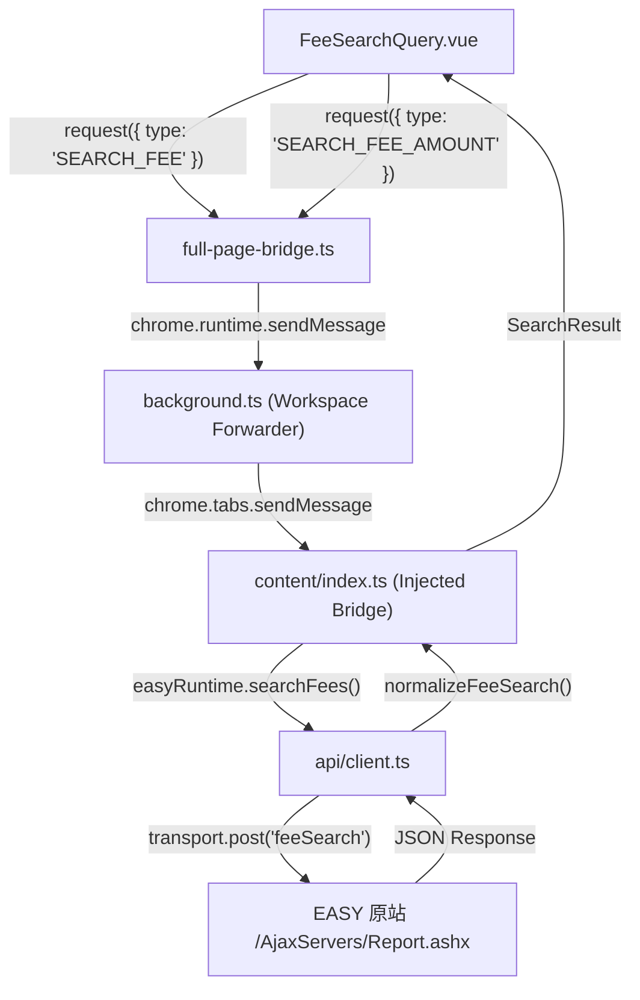

# 费用查询 FeeSearch

Handler：`POST /AjaxServers/Report.ashx`  
页面：`Forms/Bill/FeeSearch.aspx` / `FeeSearch.js`  
金额统计：`POST /AjaxServers/Report.ashx`（Call：`FeeSearchTotalAmount`）  
初始化字典：`POST /AjaxServers/Bill.ashx`（Call：`FeeSearchInit`，见 [33-账单请款.md](33-账单请款.md)）

已验证：通过原生 CDP 现场调取 `case_volume=PA2601250PCT`，`TableRowsCount=5`，成功返回官费记录（9220 CNY、2100 CNY、1000 CNY 等）。

---

## 1. 请求基础信息

| 项 | 值 |
|---|---|
| Method | POST |
| 地址 | `/AjaxServers/Report.ashx` |
| 主查询 Call | `FeeSearch` |
| 金额汇总 Call | `FeeSearchTotalAmount` |
| Content-Type | `application/x-www-form-urlencoded; charset=UTF-8` |
| 鉴权要求 | 依赖 EASY ASP.NET 会话 Cookie（`.pomp` / `IPEasyUser` / `ASP.NET_SessionId`） |

> [!IMPORTANT]
> `FeeSearch` 必须传递 `colsel` 参数（以分号开头和结尾的 84 列字段清单）。若未带 `colsel` 或字段缺失，原站接口直接返回服务端异常「系统繁忙，请求失败，请稍后重试！」。

---

## 2. 框架参数

| 参数 | 类型 | 示例 | 说明 |
|---|---|---|---|
| Call | string | `FeeSearch` / `FeeSearchTotalAmount` | 动作名 |
| log_pagename | string | `FeeSearch.aspx` | 来源页面固定值 |
| pageIndex | int | 1 | 页码，从 1 开始（`FeeSearchTotalAmount` 不传） |
| pageSize | int | 10 | 每页条数（可选 10, 15, 20, 30, 50, 100） |
| colsel | string | 见下文 | Layui/Grid 显示与查询列定义集合（必填） |
| order_by_search | string | `pay_deadline_date desc` | 排序规则：字段 + 空格 + `asc`/`desc` |
| _t | long | `1790046359929` | 毫秒防缓存时间戳 |

### colsel 完整 84 列集合

```text
;case_volume;case_volume_customer;case_name;case_status;country;business_type_name;currency_type;generation_status;notice_status;fee_name;amount;rate;amount_currency;pay_status;pay_date;is_fuzzy_query_case_volume;app_no;is_fuzzy_query_app_no;is_point_app_no;pct_app_no;is_fuzzy_query_pct_app_no;applicant_id;applicant_id_flag;customer_id;customer_id_flag;country_flag;case_type;fee_class;is_not_case_volume;pay_type;branch_dept_id;agency_id;request_status;receive_status;receive_date_start;receive_date_end;receive_date_null;actual_receive_date_start;actual_receive_date_end;actual_receive_date_null;create_date_start;create_date_end;create_date_null;sale_user_id;proc_pic_id;sale_help_id;confirm_date_start;confirm_date_end;confirm_date_null;app_date_start;app_date_end;app_date_null;pay_deadline_date_start;pay_deadline_date_end;pay_deadline_date_null;is_proxy_pay_deadline_date;is_proxy_pay_date;agent_name;case_pic_id;proc_pic_dept_id;charge_dept_id;commission_user;apply_tags;customer_status;demand_status;fee_create_user_id;fee_create_date_start;fee_create_date_end;fee_create_date_null;ctrl_proc;ctrl_proc_user_id;ctrl_proc_finish_date_start;ctrl_proc_finish_date_end;ctrl_proc_finish_date_null;actual_pay_date_start;actual_pay_date_end;actual_pay_date_null;is_vip;is_ahead_pub;is_ahead_audit;request_no;currency;invoice_no;exists_invoice_no;is_invoice;settle_status;rate_search;rebate;
```

---

## 3. 过滤模式（单选模式）

页面顶部单选条对应四个布尔开关参数，提交值为 `'true'` 或 `'false'`：

| 模式 | `is_search_all` | `is_search_customer` | `is_search_official` | `is_search_agent` | 含义 |
|---|---|---|---|---|---|
| 全部 | `true` | `false` | `false` | `false` | 显示全部费用 |
| 仅显示客户付 | `false` | `true` | `false` | `false` | 仅客户支付部分 |
| 仅显示官费 | `false` | `false` | `true` | `false` | 仅官方规费 |
| 仅收代理费 | `false` | `false` | `false` | `true` | 仅代理机构服务费 |

---

## 4. 查询条件参数列表

### 4.1 顶部快捷检索（支持换行/多条）

| 参数 | 类型 | 说明 |
|---|---|---|
| `case_volume` | string | 我方文号（支持分号、换行或空格拼接多个） |
| `is_fuzzy_query_case_volume` | string | 我方文号模糊查询（勾选 `'true'`，未勾选 `''`） |
| `is_accurate_query_sort` | string | 精确查询排序（勾选 `'true'`，未勾选 `''`） |
| `app_no` | string | 申请号 |
| `is_fuzzy_query_app_no` | string | 申请号模糊查询（勾选 `'true'`，未勾选 `''`） |
| `is_point_app_no` | string | 去点查询（勾选 `'true'`，未勾选 `''`） |
| `pct_app_no` | string | PCT 申请号 |
| `is_fuzzy_query_pct_app_no` | string | PCT 申请号模糊查询（勾选 `'true'`，未勾选 `''`） |

### 4.2 核心 7 排网格条件

| 参数 | 字段名称 | 控件形态 | 选项/说明 |
|---|---|---|---|
| `case_type` | 案件类型 | 下拉单选 | GUID，对应 `31D1A147-2931-43B5-94AE-B72B1525BA8A`（专利）、商标、版权等；默认空为 ALL |
| `case_status` | 案件状态 | 字典树多选 | GUID 逗号拼接，来自 `limitCaseStatus` 字典 |
| `country` | 申请国家/地区 | 字典树多选 | 国家二字码（如 CN, US, EP），来自 `limitCountry` |
| `country_flag` | 包含/排除国家 | 下拉单选 | `include`（包含）/ `exclude`（排除） |
| `customer_id` | 客户名称 | 文本输入 | 客户名称关键词 |
| `customer_id_flag` | 客户包含/排除 | 下拉单选 | `include`（包含）/ `exclude`（排除） |
| `applicant_id` | 申请人 | 文本输入 | 申请人名称关键词 |
| `applicant_id_flag` | 申请人包含/排除 | 下拉单选 | `include`（包含）/ `exclude`（排除） |
| `is_not_case_volume` | 我方第一申请人 | 勾选框 | 勾选 `'true'`，未勾选 `''` |
| `sale_user_id` | 业务员 | 人员字典树 | 用户 GUID，来自 `user` 字典树 |
| `fee_class` | 费用类型 | 下拉单选 | `O`（官费）、`A`（代理费）、`T`（第三方费） |
| `pay_status` | 缴费状态 | 下拉单选 | `0`（未缴费）、`1`（已缴费）、`2`（已确认）、`3`（已登回执） |
| `pay_deadline_date_start` | 缴费期限起 | 日期选择 | 格式 `YYYY-MM-DD` |
| `pay_deadline_date_end` | 缴费期限止 | 日期选择 | 格式 `YYYY-MM-DD` |
| `pay_deadline_date_null` | 缴费期限为空 | 勾选框 | 勾选 `'true'`，未勾选 `''` |
| `is_proxy_pay_deadline_date` | 包含代理 | 勾选框 | 勾选 `'true'`，未勾选 `''` |
| `notice_status` | 通知状态 | 下拉单选 | `0`（未通知）、`1`（已通知） |
| `receive_status` | 收款状态 | 下拉单选 | `0`（未收款）、`1000`（部分收款）、`3000`（已收款） |
| `actual_pay_date_start` | 实缴日期起 | 日期选择 | 格式 `YYYY-MM-DD` |
| `actual_pay_date_end` | 实缴日期止 | 日期选择 | 格式 `YYYY-MM-DD` |
| `actual_pay_date_null` | 实缴日期为空 | 勾选框 | 勾选 `'true'`，未勾选 `''` |
| `is_proxy_pay_date` | 实缴包含代理 | 勾选框 | 勾选 `'true'`，未勾选 `''` |
| `receive_date_start` | 应收日期起 | 日期选择 | 格式 `YYYY-MM-DD` |
| `receive_date_end` | 应收日期止 | 日期选择 | 格式 `YYYY-MM-DD` |
| `receive_date_null` | 应收日期为空 | 勾选框 | 勾选 `'true'`，未勾选 `''` |
| `actual_receive_date_start` | 实收日期起 | 日期选择 | 格式 `YYYY-MM-DD` |
| `actual_receive_date_end` | 实收日期止 | 日期选择 | 格式 `YYYY-MM-DD` |
| `actual_receive_date_null` | 实收日期为空 | 勾选框 | 勾选 `'true'`，未勾选 `''` |
| `confirm_date_start` | 确认日期起 | 日期选择 | 格式 `YYYY-MM-DD` |
| `confirm_date_end` | 确认日期止 | 日期选择 | 格式 `YYYY-MM-DD` |
| `confirm_date_null` | 确认日期为空 | 勾选框 | 勾选 `'true'`，未勾选 `''` |
| `create_date_start` | 开票日期起 | 日期选择 | 格式 `YYYY-MM-DD` |
| `create_date_end` | 开票日期止 | 日期选择 | 格式 `YYYY-MM-DD` |
| `create_date_null` | 开票日期为空 | 勾选框 | 勾选 `'true'`，未勾选 `''` |
| `app_date_start` | 申请日起 | 日期选择 | 格式 `YYYY-MM-DD` |
| `app_date_end` | 申请日止 | 日期选择 | 格式 `YYYY-MM-DD` |
| `app_date_null` | 申请日为空 | 勾选框 | 勾选 `'true'`，未勾选 `''` |
| `ctrl_proc` | 处理事项 | 事项字典树 | 事项 GUID，来自 `limitCtrlProc` |
| `ctrl_proc_user_id` | 处理事项处理人 | 人员字典树 | 用户 GUID，来自 `user` |
| `ctrl_proc_finish_date_start` | 事项完成日起 | 日期选择 | 格式 `YYYY-MM-DD` |
| `ctrl_proc_finish_date_end` | 事项完成日止 | 日期选择 | 格式 `YYYY-MM-DD` |
| `ctrl_proc_finish_date_null` | 事项完成日为空 | 勾选框 | 勾选 `'true'`，未勾选 `''` |

### 4.3 高级查询条件

#### 账单信息
| 参数 | 字段名称 | 控件形态 | 说明 |
|---|---|---|---|
| `request_no` | 请款单号 | 文本输入 | 账单/请款单编号 |
| `request_status` | 请款状态 | 下拉单选 | `0`（未请款）、`1000`（草稿中）、`2000`（审核中）、`3000`（已完成） |
| `currency` | 币种 | 下拉单选 | 币种代码（CNY, USD, EUR 等） |
| `rate_search` | 汇率 | 文本输入 | 数值 |
| `rebate` | 减缓比例 | 文本输入 | 减缓百分比（如 70%, 85%） |
| `exists_invoice_no` | 是否需要开票 | 下拉单选 | `1`（是）、`0`（否） |
| `is_invoice` | 是否开票 | 下拉单选 | `1`（是）、`0`（否） |
| `invoice_no` | 发票号 | 文本输入 | 发票编号 |
| `settle_status` | 销账状态 | 下拉单选 | 状态代码 |

#### 案件补充
| 参数 | 字段名称 | 控件形态 | 说明 |
|---|---|---|---|
| `case_volume_customer` | 客户文号 | 文本输入 | 客户侧文号 |
| `case_name` | 案件名称 | 文本输入 | 案件名称 |
| `agency_id` | 代理机构 | 机构字典树 | 代理机构 GUID，来自 `agent` |
| `agent_name` | 代理人 | 文本输入 | 代理人姓名 |
| `branch_dept_id` | 案件所属分部 | 分部字典树 | 分部 GUID，来自 `branch` |
| `fee_create_user_id` | 费用创建人 | 人员字典树 | 用户 GUID，来自 `user` |
| `fee_create_date_start` | 费用创建日起 | 日期选择 | 格式 `YYYY-MM-DD` |
| `fee_create_date_end` | 费用创建日止 | 日期选择 | 格式 `YYYY-MM-DD` |
| `fee_create_date_null` | 费用创建日为空 | 勾选框 | 勾选 `'true'`，未勾选 `''` |

#### 其它标记
| 参数 | 字段名称 | 控件形态 | 说明 |
|---|---|---|---|
| `is_ahead_pub` | 提请公开 | 下拉单选 | `1`（是）、`0`（否） |
| `is_ahead_audit` | 提请实审 | 下拉单选 | `1`（是）、`0`（否） |
| `is_vip` | 是否 VIP | 下拉单选 | `1`（是）、`0`（否） |
| `generation_status` | 生成状态 | 下拉单选 | 状态值 |
| `customer_code` | 客户代码 | 文本输入 | 客户唯一代码 |
| `apply_tags` | 申请标签 | 标签字典 | 标签 GUID，来自 `applyTags` |
| `customer_status` | 客户状态 | 下拉单选 | 状态 GUID，来自 `limitCustomerStatus` |
| `case_pic_id` | 案件处理人 | 人员字典树 | 用户 GUID，来自 `user` |
| `proc_pic_dept_id` | 处理人部门 | 部门树 | 部门 GUID，来自 `dept` |
| `charge_dept_id` | 承办部门 | 部门树 | 部门 GUID，来自 `dept` |
| `commission_user` | 提成人员 | 人员字典树 | 用户 GUID，来自 `user` |

---

## 5. 响应契约

### 5.1 FeeSearch 列表响应结构

```json
{
  "TableRows": "[{\"case_id\":\"...\",\"case_volume\":\"PA2601250PCT\",\"case_volume_customer\":\"P202501721-WO\",\"case_status\":\"检索报告\",\"country\":\"中国\",\"business_type_name\":\"PCT国际阶段\",\"currency_type\":\"CNY\",\"fee_name\":\"检索费\",\"amount\":9220.00,\"rate\":1.0000,\"amount_currency\":9220.00,\"notice_status\":\"未通知\",\"pay_status\":\"已缴费\",\"receive_status\":\"未收款\",\"request_status\":\"未请款\"}]",
  "TableRowsCount": "5",
  "ClientInfo": {
    "IsLogin": true,
    "Status": true,
    "Result": true,
    "Message": null,
    "ErrorCode": false,
    "Url": null,
    "WebPath": "http://d.hiseeip.com:88",
    "Asyn": false,
    "IsNewWindow": false,
    "OtherInfo": {}
  }
}
```

> [!NOTE]
> `TableRows` 在原站部分情况下为 JSON 序列化字符串，部分情况下为已解析的数组。规范化器（`normalizeFeeSearch`）统一做兼容处理。

### 5.2 TableRows 常用业务字段清单

| 字段 | 类型 | 说明 |
|---|---|---|
| `fee_id` | string | 费用唯一 GUID |
| `case_id` | string | 案件 GUID |
| `case_volume` | string | 我方文号（如 `PA2601250PCT`） |
| `case_volume_customer` | string | 客户文号 |
| `case_name` | string | 案件名称 |
| `case_status` | string | 案件状态 |
| `country` | string | 国家/地区 |
| `business_type_name` | string | 业务类型名称 |
| `fee_name` | string | 费用名称 |
| `fee_class` | string | 费用类别（官费/代理费/第三方费） |
| `amount` | number | 原始金额 |
| `currency_type` | string | 原始币种 |
| `rate` | number | 结算汇率 |
| `amount_currency` | number | 折合人民币金额 |
| `pay_status` | string | 缴费状态（如 未缴费、已缴费） |
| `pay_date` | string | 实缴日期 |
| `pay_deadline_date` | string | 缴费期限 |
| `notice_status` | string | 通知状态 |
| `request_status` | string | 请款状态 |
| `request_no` | string | 请款单号 |
| `receive_status` | string | 收款状态 |
| `settle_status` | string | 销账状态 |
| `app_no` | string | 申请号 |
| `customer_name` | string | 客户名称 |
| `applicant_name` | string | 申请人名称 |
| `ctrl_proc_name` | string | 处理事项名称 |
| `ctrl_proc_user` | string | 事项处理人 |
| `branch_name` | string | 所属分部 |

---

## 6. FeeSearchTotalAmount 汇总金额接口

### 6.1 请求
与 `FeeSearch` 携带完全相同的查询条件和业务过滤开关，不带 `pageIndex`、`pageSize` 和 `order_by_search`。

### 6.2 响应
返回当前条件下的全局金额汇总统计：
```json
{
  "AgentTotalAmount": 1000.00,
  "OfficialTotalAmount": 11320.00,
  "OtherTotalAmount": 0.00,
  "Currency": "CNY",
  "ClientInfo": {
    "IsLogin": true,
    "Status": true
  }
}
```

---

## 7. 插件扩展内部通信与调度

在 PatMail 插件内部，费用查询已完全对齐现有工作流消息体系：



- **消息类型**：
  - `MessageType.SearchFee` (`'SEARCH_FEE'`)
  - `MessageType.SearchFeeResult` (`'SEARCH_FEE_RESULT'`)
  - `MessageType.SearchFeeAmount` (`'SEARCH_FEE_AMOUNT'`)
  - `MessageType.SearchFeeAmountResult` (`'SEARCH_FEE_AMOUNT_RESULT'`)
- **超时与取消控制**：支持动态查询超时与 `cancelFeeSearch()` AbortController 链路。
- **页面路由**：`/fees` -> [FeesPage.vue](file:///d:/Users/Administrator/Desktop/插件/patmail-extension/src/app/pages/FeesPage.vue)。
