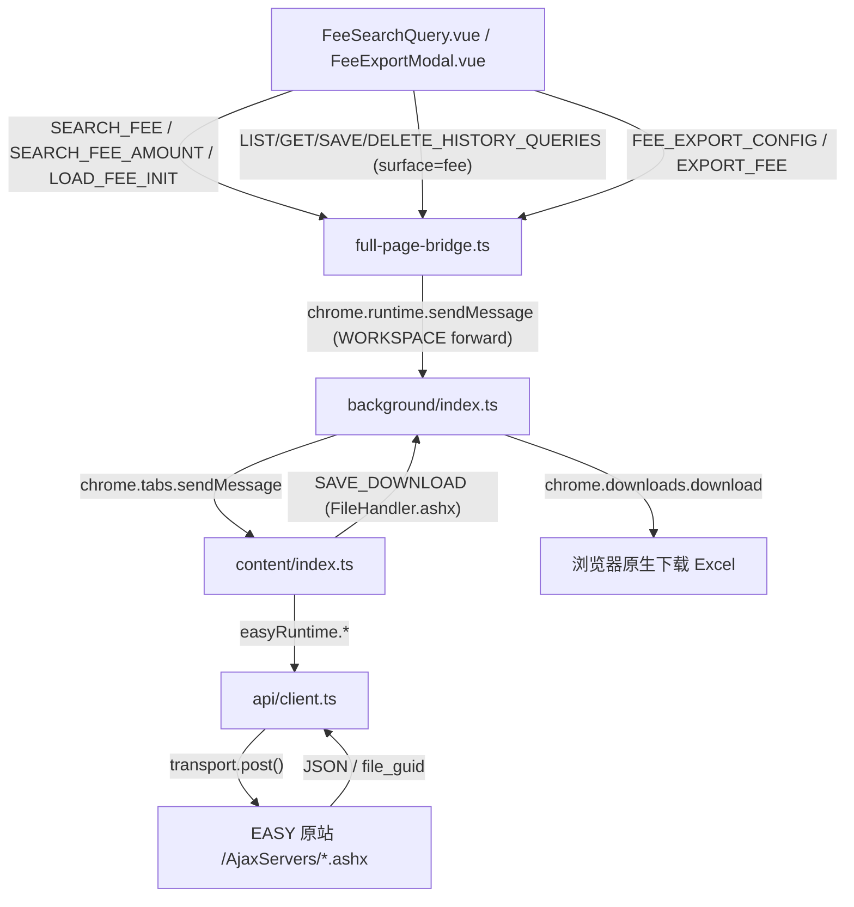

# 费用查询 FeeSearch

Handler：`POST /AjaxServers/Report.ashx`  
页面：`Forms/Bill/FeeSearch.aspx` / `FeeSearch.js`  
金额统计：`POST /AjaxServers/Report.ashx`（Call：`FeeSearchTotalAmount`）  
初始化字典：`POST /AjaxServers/Bill.ashx`（Call：`FeeSearchInit`，见 [33-账单请款.md](33-账单请款.md)）

已验证：通过原生 CDP 现场调取 `case_volume=PA2601250PCT`，`TableRowsCount=5`，成功返回官费记录（9220 CNY、2100 CNY、1000 CNY 等）。

---

<a id="1-请求基础信息"></a>

## Report.ashx FeeSearch

请求示例（业务标识为占位值）：

```http
POST /AjaxServers/Report.ashx
Content-Type: application/x-www-form-urlencoded; charset=UTF-8

Call=FeeSearch
case_volume=EXAMPLE-001
pageIndex=1
pageSize=10
colsel={下列完整栏位集合}
log_pagename=FeeSearch.aspx
```

| 项 | 值 |
|---|---|
| Method | POST |
| 地址 | `/AjaxServers/Report.ashx` |
| 主查询 Call | `FeeSearch` |
| 金额汇总 Call | `FeeSearchTotalAmount` |
| Content-Type | `application/x-www-form-urlencoded; charset=UTF-8` |
| 鉴权要求 | 依赖 EASY ASP.NET 会话 Cookie（`.pomp` / `IPEasyUser` / `ASP.NET_SessionId`） |

> [!IMPORTANT]
> `FeeSearch` 必须传递 `colsel` 参数（以分号开头和结尾的 84 列字段清单）。若未带 `colsel` 或字段缺失，原站接口直接返回服务端异常「系统繁忙，请求失败，请稍后重试！」。

---

### 2. 框架参数

| 参数 | 类型 | 示例 | 说明 |
|---|---|---|---|
| Call | string | `FeeSearch` / `FeeSearchTotalAmount` | 动作名 |
| log_pagename | string | `FeeSearch.aspx` | 来源页面固定值 |
| pageIndex | int | 1 | 页码，从 1 开始（`FeeSearchTotalAmount` 不传） |
| pageSize | int | 10 | 每页条数（可选 10, 15, 20, 30, 50, 100） |
| colsel | string | 见下文 | Layui/Grid 显示与查询列定义集合（必填） |
| order_by_search | string | `pay_deadline_date desc` | 排序规则：字段 + 空格 + `asc`/`desc` |
| _t | long | `1790046359929` | 毫秒防缓存时间戳 |

#### colsel 完整 84 列集合

```text
;case_volume;case_volume_customer;case_name;case_status;country;business_type_name;currency_type;generation_status;notice_status;fee_name;amount;rate;amount_currency;pay_status;pay_date;is_fuzzy_query_case_volume;app_no;is_fuzzy_query_app_no;is_point_app_no;pct_app_no;is_fuzzy_query_pct_app_no;applicant_id;applicant_id_flag;customer_id;customer_id_flag;country_flag;case_type;fee_class;is_not_case_volume;pay_type;branch_dept_id;agency_id;request_status;receive_status;receive_date_start;receive_date_end;receive_date_null;actual_receive_date_start;actual_receive_date_end;actual_receive_date_null;create_date_start;create_date_end;create_date_null;sale_user_id;proc_pic_id;sale_help_id;confirm_date_start;confirm_date_end;confirm_date_null;app_date_start;app_date_end;app_date_null;pay_deadline_date_start;pay_deadline_date_end;pay_deadline_date_null;is_proxy_pay_deadline_date;is_proxy_pay_date;agent_name;case_pic_id;proc_pic_dept_id;charge_dept_id;commission_user;apply_tags;customer_status;demand_status;fee_create_user_id;fee_create_date_start;fee_create_date_end;fee_create_date_null;ctrl_proc;ctrl_proc_user_id;ctrl_proc_finish_date_start;ctrl_proc_finish_date_end;ctrl_proc_finish_date_null;actual_pay_date_start;actual_pay_date_end;actual_pay_date_null;is_vip;is_ahead_pub;is_ahead_audit;request_no;currency;invoice_no;exists_invoice_no;is_invoice;settle_status;rate_search;rebate;
```

---

### 3. 结果区单选控制与辅助字典/二级弹窗接口

#### 3.1 结果区单选条（对齐 `FeeSearch.js` L637–671）

| 组 | 选项 | 行为 |
|---|---|---|
| `show_type` | `显示全部` / `仅显示选中项` | 前端过滤当前页展示全部行还是仅展示已勾选行 |
| `show_fee` | `只选官费` / `只选代理费` | 按当前页 `fee_class_name` 自动勾选所有「官费」或「代理费」行 |

#### 3.2 初始化字典与二级弹窗接口（CDP 核对）

| 用途 | Handler | Call | 参数 / 返回说明 |
|---|---|---|---|
| 费用查询全量初始化 | `/AjaxServers/Bill.ashx` | `FeeSearchInit` | 返回 `CaseType`（排除科技服务）、`Case_direction`、`receive_status`、`PayType`、`FeeType`（434项）、`ApplyType`、`BussType`、`case_status`、`customerStatus`、`review_stage`、`FeeCurrency`、`sourcetype`、`bank_list` |
| 客户选择二级弹窗（`ShowIhgSelect`） | `/AjaxServers/Report.ashx` | `GetCustomerTreeData` | `searchKey` -> `CustList[{ id, name, tel, email }]`，支持多选，`customer_id` / `ruleOutcustomer_id` 用 `;` 拼接 |
| 申请人联动树 | `/AjaxServers/Report.ashx` | `GetTreeApplicant` | `customer_ids`（`;` 拼接）-> `TreeApplicant[]`，选中后解锁 `first_applicant`（`1`/`0`） |
| 代理机构下拉 | `/AjaxServers/CaseInfo.ashx` | `GetAencyList` | 返回 `AgencyList[{ agency_id, agency_name_cn }]`（331项） |
| 联系人类别 | `/AjaxServers/Customer.ashx` | `ContactInit` | 返回 `contacttype[]` |
| 产品类别树 | `/AjaxServers/BaseInfo.ashx` | `GetProducts` | 返回 `Products[]` |
| 技术领域树 | `/AjaxServers/Common.ashx` | `LoadTechnical` | `Key` -> `Technical[]` |
| 自定义栏位标题 | `/AjaxServers/PatentAction.ashx` | `GetFieldColumn` | 返回 `fieldColumn[]`（映射 `column_1..5` 动态标题） |
| 导出模板列表/详情 | `/AjaxServers/Common.ashx` | `GetQueryOutConfig` | `belong_key`（`FeeSearch_ExportByCond` / `FeeSearch_ExportCountByCond`）-> `out_model[]`；传 `type_id` -> `out_columns[]` |
| 导出模板保存/删除 | `/AjaxServers/Common.ashx` | `UpdateQueryOutConfig` | `ud_type=add`（附实体编码 `<item>` XML `element`）/ `ud_type=del`（`out_type_id`） |
| 导出模板更新 | `/AjaxServers/Common.ashx` | `UpdateQueryOutConfigNew` | `ud_type=up`，附 `out_type_id`、`model_name`、`element` |
| 导出清单 / 勾选 / 汇总 | `/AjaxServers/Report.ashx` | `ExcelFeeListByCond` / `ExcelFeeListByChecked` / `ExcelFeeListCountByCond` | 传查询条件或 `fee_ids` + `e_coulums`（实体编码 XML）；同步返回 `file_guid` / `file_size` 经 `/AjaxServers/FileHandler.ashx` 下载，大数据量 `ClientInfo.Asyn=true` 转异步下载清单 |

---

### 4. 关键字段与枚举校验（对照 `FeeSearch.aspx` 实时 DOM）

| 字段 | 控件形态 | 参数名 | 实测枚举 / 提交格式 |
|---|---|---|---|
| 我方文号 / 申请号 / PCT申请号 | 多行 `textarea` | `case_volume` / `app_no` / `pct_app_no` | 配套 `is_fuzzy_query_*` / `is_accurate_query_sort` / `is_point_app_no`（布尔，默认全不勾） |
| 案件类型 | 单选 `select` | `case_type` | `ALL`、专利、商标、版权/综合、其他、法律案件、调查案（**不含科技服务**） |
| 案件流向 | 多选树 `TreeUser` | `Case_direction` | `II`（内-内）、`IO`（内-外）、`OI`（外-内）、`OO`（外-外） |
| 客户名称 / 排除客户名称 | 只读框 + **二级弹窗** | `customer_id` / `ruleOutcustomer_id` | 点击弹出 `ShowIhgSelect`，确定后 `;` 拼接 GUID |
| 申请人 | 联动多选树 `TreeUser` | `applicant_id` + `first_applicant` | 按已选客户加载，逗号转 `;` 提交；未选申请人时 `限第一申请人` 禁用 |
| 费用类型 | 多选树 `TreeUser` | `fee_class` | `O`（官费）、`A`（代理费）、`T`（第三方费用） |
| 费用名称 | 联动多选树 `TreeUser` | `fee_type` | 需先选案件类型；按案件类型/国家/申请类型/费用类型联动筛选并自动消歧同名项 |
| 请款状态 | 多选树 `TreeUser` | `request_status` | `0`（未请款）、`100`（草稿中）、`1000`（审核中）、`3000`（已完成） |
| 收款状态 | 多选树 `TreeUser` | `receive_status` | `MN`（不收款）、`MW`（未收款）、`MY`（已收款）、`MB`（部分收款）、`WPZ`（未配置费用） |
| 缴费状态 | 单选 `select` | `pay_status` | `0`（未缴费）、`1`（已缴费）、`2`（已确认）、`3`（已登回执）+ `pay_status_is_agent_fee` |
| 缴费类型（高级） | 多选树 `TreeUser` | `pay_type` | `0`（代缴）、`1`（客户自缴）、`2`（客户放弃）、`3`（其他） |
| 缴费单号（高级） | 单选 `select` | `bill_no` | `""`（ALL）、`0`（缴费单号为空）、`1`（缴费单号不为空） |
| 案源类型（高级） | 单选 `select` | `sourcetype` | `SGH`（市区工会）、`DXYTH`（大学研讨会） |
| 是否预审（高级） | 单选 `select` | `hearing_the_case` | `""`（ALL）、`0`（否）、`1`（是） |
| 申请日月份（高级） | 多选树 `TreeUser` | `app_date_month` | `1`–`12`（生产站 `TR[10]` 可见） |
| 新申请递交日（高级） | 日期区间 | `filing_date_start` / `filing_date_end` | `YYYY-MM-DD`，无 `_isnull`（生产站 `TR[24]` 可见） |
| 代理机构(案件/费用)（高级） | 可搜索单选 `select2` | `case_agency_precorditem` / `case_agency` | 来自 `GetAencyList`（331 项），支持关键词筛选 |
| 案件处理人 / 部门（高级） | 多选树 / 单选树 | `pic_id` / `pic_dept` | `pic_dept`、`proc_pic_dept_id`、`receive_date_update_user` 为单选树 |
| 日期组 `_isnull` | 勾选框 | `*_isnull` / `receivepayor` | 勾选传 `'on'` 并清空禁用起止 `WDatePicker` |

---

### 5. 响应契约

#### 5.1 FeeSearch 列表响应结构

```json
{
  "TableRows": "[{\"case_id\":\"...\",\"case_volume\":\"PA2601250PCT\",\"case_volume_customer\":\"P202501721-WO\",\"case_status\":\"检索报告\",\"country\":\"中国\",\"business_type_name\":\"PCT国际阶段\",\"currency_type\":\"CNY\",\"fee_name\":\"检索费\",\"amount\":9220.00,\"rate\":1.0000,\"amount_currency\":9220.00,\"notice_status\":\"未通知\",\"pay_status\":\"已缴费\",\"receive_status\":\"未收款\",\"request_status\":\"未请款\"}]",
  "TableRowsCount": "5",
  "ClientInfo": {
    "IsLogin": true,
    "Status": true,
    "Result": true,
    "Message": null,
    "ErrorCode": false,
    "Url": null,
    "WebPath": "http://d.hiseeip.com:88",
    "Asyn": false,
    "IsNewWindow": false,
    "OtherInfo": {}
  }
}
```

> [!NOTE]
> `TableRows` 在原站部分情况下为 JSON 序列化字符串，部分情况下为已解析的数组。规范化器（`normalizeFeeSearch`）统一做兼容处理。

#### 5.2 TableRows 常用业务字段清单

| 字段 | 类型 | 说明 |
|---|---|---|
| `fee_id` | string | 费用唯一 GUID |
| `case_id` | string | 案件 GUID |
| `case_volume` | string | 我方文号（如 `PA2601250PCT`） |
| `case_volume_customer` | string | 客户文号 |
| `case_name` | string | 案件名称 |
| `case_status` | string | 案件状态 |
| `country` | string | 国家/地区 |
| `business_type_name` | string | 业务类型名称 |
| `fee_name` | string | 费用名称 |
| `fee_class` | string | 费用类别（官费/代理费/第三方费） |
| `amount` | number | 原始金额 |
| `currency_type` | string | 原始币种 |
| `rate` | number | 结算汇率 |
| `amount_currency` | number | 折合人民币金额 |
| `pay_status` | string | 缴费状态（如 未缴费、已缴费） |
| `pay_date` | string | 实缴日期 |
| `pay_deadline_date` | string | 缴费期限 |
| `notice_status` | string | 通知状态 |
| `request_status` | string | 请款状态 |
| `request_no` | string | 请款单号 |
| `receive_status` | string | 收款状态 |
| `settle_status` | string | 销账状态 |
| `app_no` | string | 申请号 |
| `customer_name` | string | 客户名称 |
| `applicant_name` | string | 申请人名称 |
| `ctrl_proc_name` | string | 处理事项名称 |
| `ctrl_proc_user` | string | 事项处理人 |
| `branch_name` | string | 所属分部 |

---

<a id="6-feesearchtotalamount-汇总金额接口"></a>

## Report.ashx FeeSearchTotalAmount

请求示例（业务标识为占位值）：

```http
POST /AjaxServers/Report.ashx
Content-Type: application/x-www-form-urlencoded; charset=UTF-8

Call=FeeSearchTotalAmount
case_volume=EXAMPLE-001
log_pagename=FeeSearch.aspx
```

### 6.1 请求
与 `FeeSearch` 携带完全相同的查询条件和业务过滤开关，不带 `pageIndex`、`pageSize` 和 `order_by_search`。

### 6.2 响应
返回当前条件下的全局金额汇总统计：
```json
{
  "AgentTotalAmount": 1000.00,
  "OfficialTotalAmount": 11320.00,
  "OtherTotalAmount": 0.00,
  "Currency": "CNY",
  "ClientInfo": {
    "IsLogin": true,
    "Status": true
  }
}
```

---

## 7. 历史查询条件（QueryHistory）

Handler：`POST /AjaxServers/CaseInfo.ashx`（完整公共契约见 [03-历史查询条件.md](03-历史查询条件.md)）

| 动作 | Call | 关键参数 | 说明 |
|---|---|---|---|
| 读取列表 / 详情 | `SearchQueryHisList` | `query_type=FeeSearch`、`query_id`（空=列表，GUID=详情）、`log_pagename=FeeSearch.aspx` | 返回 `Options[{ query_id, title }]` 与 `QueryXml[{ query_xml, out_xml, is_proc }]` |
| 保存 / 另存模板 | `SearchQueryHisSave` | `query_type=FeeSearch`、`is_query_save=true`、`is_out_save=false`、`is_proc=false`、`query_save_title`、`query_id`、`query_xml`、`out_xml=` | 写回当前账号原站历史查询条件 |
| 删除模板 | `SearchQueryHisDelete` | `query_id`、`log_pagename=FeeSearch.aspx` | 从原站删除指定模板 |

### 7.1 `FeeSearch` 专属 `query_xml` 序列化规则（核对原站 `QueryHistory.SaveQueryCondition` / `Refresh`）

- **根节点**：`<xmlRoot>...</xmlRoot>`（原站服务端保存时可能再包一层形成双层 `<xmlRoot><xmlRoot>...</xmlRoot></xmlRoot>`，解析时需穿透内层）。
- **客户选择特例（`FeeSearch` 独有分支）**：
  - `<customer_id>` 存 ID 的 JSON 数组，如 `["guid-1","guid-2"]`；
  - `<customer_id_text>` 存对象数组，如 `[{"value":"guid-1","text":"客户甲"}]`；
  - 读取时同时兼容分号拼接字符串。
- **控件 DOM ID 与查询参数名差异**：
  - 申请人：`applicant_id` <-> `<applicant>` / `<applicant_text>`
  - 案件承办部门：`charge_dept_id` <-> `<charge_dept>` / `<charge_dept_text>`
- **多选/单选树与勾选框**：树控件成对写入 `<id>` 与 `<id>_text`；勾选框仅在勾选时写入 `<id>on</id>`。
- **插件本地 JSON 互导**：支持 `format: "patmail.query-template"`、`version: 1`、`queryType: "FeeSearch"`，文件名 `查询模板-费用查询-{模板名}-{时间戳}.json`，导入前按费用查询字段表逐项校验，防止跨查询面混用。

---

## 8. 高级 Excel 导出与导出模板（`IhgAdvExport.aspx`）

原站 `FeeSearch.aspx` 生产环境对外开放 3 个导出入口，全部经通用高级导出弹窗 `/IhgForms/IhgAdvExport.aspx`（`IhgAdvExport.js`）完成模板管理与服务端 Excel 生成。

### 8.1 导出模板管理（`POST /AjaxServers/Common.ashx`）

模板按 `belong_key` 区分并与当前登录账号实时热同步（无本地缓存）：

| 导出入口 | `belong_key` | 导出接口 Call（`Report.ashx`） | 说明 |
|---|---|---|---|
| 导出清单 | `FeeSearch_ExportByCond` | `ExcelFeeListByCond` | 按当前查询条件导出全部费用（无需先点查询） |
| 导出勾选费用 | `FeeSearch_ExportByCond` | `ExcelFeeListByChecked` | 仅导出勾选行 `fee_ids`（`;` 拼接） |
| 导出汇总数据 | `FeeSearch_ExportCountByCond` | `ExcelFeeListCountByCond` | 按案件汇总官费/代理费/第三方费并导出 |

| 动作 | Call | 必填参数 | 响应 |
|---|---|---|---|
| 读取账号模板列表 | `GetQueryOutConfig` | `belong_key`、`log_pagename=IhgAdvExport.aspx` | `{ out_model: [{ type_id, type_text }] }` |
| 读取模板栏位明细 | `GetQueryOutConfig` | `type_id`、`log_pagename=IhgAdvExport.aspx` | `{ out_columns: [{ seq, item_value, item_text, item_id }], ClientInfo }` |
| 新建模板 | `UpdateQueryOutConfig` | `ud_type=add`、`belong_key`、`model_name`、`element` | `{ out_model: [...], ClientInfo }` |
| 更新模板 | `UpdateQueryOutConfigNew` | `ud_type=up`、`belong_key`、`out_type_id`、`model_name`、`element` | `{ out_model: [...], ClientInfo }` |
| 删除模板 | `UpdateQueryOutConfig` | `ud_type=del`、`belong_key`、`out_type_id` | `{ out_model: [...], ClientInfo }` |

`element` 采用实体编码 XML（避免触发 ASP.NET Request Validation）：

```text
&lt;item&gt;&lt;value&gt;case_volume&lt;/value&gt;&lt;text&gt;我方文号&lt;/text&gt;&lt;sort&gt;1&lt;/sort&gt;&lt;/item&gt;
```

### 8.2 执行 Excel 导出（`POST /AjaxServers/Report.ashx`）

- **请求参数**：
  - `Call`：`ExcelFeeListByCond` / `ExcelFeeListByChecked` / `ExcelFeeListCountByCond`
  - 条件参数：`*ByCond` 携带当前全部查询条件（不带 `colsel`，附 `fee_page_type=`）；`ExcelFeeListByChecked` 携带 `fee_ids=id1;id2`
  - `e_coulums`（注意原站字段拼写即 `e_coulums`）：按右侧「已选栏位」顺序拼接的实体编码 XML：
    ```text
    &lt;case_volume&gt;我方文号&lt;/case_volume&gt;&lt;amount&gt;金额&lt;/amount&gt;
    ```
  - `log_pagename=IhgAdvExport.aspx`
- **响应与下载**：
  - **同步模式**（`ClientInfo.Result === true` 且 `ClientInfo.Asyn !== true`）：返回 `file_guid` 与 `file_size`，由 `GET /AjaxServers/FileHandler.ashx?guid={file_guid}&file_size={file_size}` 下载真实 Excel 文件（沿用服务端 `Content-Disposition` 文件名与 `.xls/.xlsx` 扩展名）。
  - **异步模式**（`ClientInfo.Asyn === true`）：大数据量时原站转入后台队列，需在原站 `/IhgForms/DownloadList.aspx` 查看并下载。

---

## 9. 插件扩展内部通信与调度

在 PatMail 插件内部，费用查询、历史模板与原站 Excel 导出已全部纳入工作台消息转发体系：



- **消息类型**：
  - 查询与统计：`MessageType.SearchFee` / `SearchFeeResult`、`MessageType.SearchFeeAmount` / `SearchFeeAmountResult`
  - 字典与二级选择：`MessageType.LoadFeeInit` / `LoadFeeInitResult`、`MessageType.SearchFeeCustomers` / `SearchFeeCustomersResult`、`MessageType.LoadFeeApplicants` / `LoadFeeApplicantsResult`
  - 历史查询条件（`surface: 'fee'`）：`MessageType.ListHistoryQueries`、`GetHistoryQuery`、`SaveHistoryQuery`、`DeleteHistoryQuery`
  - 高级 Excel 导出：`MessageType.FeeExportConfig` / `FeeExportConfigResult`、`MessageType.ExportFee` / `ExportFeeResult`、`MessageType.SaveDownload`（空 `fileName` 时沿用服务端 `Content-Disposition` 文件名，失败兜底隐藏 `iframe`）
- **超时与写开关**：查询与导出共用页面超时时间设置（1 / 2 / 5 / 10 分钟）；模板写操作（历史模板保存/删除、导出模板保存/更新/删除）均受 PatMail 写开关保护。
- **页面路由**：
  - 费用查询页：`/fees` -> [FeesPage.vue](file:///d:/Users/Administrator/Desktop/插件/patmail-extension/src/app/pages/FeesPage.vue)
  - 模板管理页：`/templates`（「费用查询」页签）-> [TemplatesPage.vue](file:///d:/Users/Administrator/Desktop/插件/patmail-extension/src/app/pages/TemplatesPage.vue)

---

## 10. 生产站（`d.hiseeip.com`）字段显隐与发布开关核对基线

以下为通过只读 CDP 对照生产站 `http://d.hiseeip.com:88/Forms/Bill/FeeSearch.aspx` 核对确认的运行时基线（详见高级导出协议 [45-高级导出与模板协议.md](45-高级导出与模板协议.md) 与补充契约 [46-运行期补充接口契约.md](46-运行期补充接口契约.md)）：

| 维度 | 生产站实测状态 | 影响说明 |
|---|---|---|
| 客户化定制开关（`isSJYG / isZBSD / isZT / isKLFD / LJDZ / isZiTeng / HKDZ2601 / JIAQUAN / isZY / Expand / isKLFD202605`） | 全部 `false` | 对应定制行（如客户编号、外代状态、提成人、是否大客户、紫藤定制列）保持隐藏 |
| `FeeExport.fee_export` | `true` | 导出清单/勾选费用栏位默认包含 `cancellation_date`（销账日期） |
| 高级查询 `TR[10]`（申请日月份）与 `TR[24]`（新申请递交日） | **可见** | `TR[10]` 未挂 `.HKDZ2601` 隐藏类；`TR[24]` 的 `.hide` 无 `!important`，点击「显示高级查询」后被 `$('#tbCommon').find('tr:gt(9)').show()` 行内样式覆盖显示 |
| 动态自定义栏位（`GetFieldColumn`） | `自定义栏位1 / 特批编号 / 回款日期 / 业务立案编号 / 所属部门` | 查询表单与导出弹窗「自定义栏位」分组均按实时接口动态替换标题 |
| 生产站空字典字段 | `GetApplyTags` 与 `bank_list` 返回 `null` | 「专利标签」与「收款公司账户」在生产站当前账号配置为空，属原站真实数据态 |
| `PageAuth` 导出权限 | 含 `btnExport01`、`btnExport02` | 对外开放「导出清单」「导出勾选费用」「导出汇总数据」三个按钮 |


## CaseInfo.ashx GetFeeListByCase

用途为按案件和费用类别回查费用详情。费用查询只对缺失字数的翻译费行发起回查，每组按 `fee_id` 对齐返回项。旧版响应结构见 [15-案件信息-费用流程与文件.md](15-案件信息-费用流程与文件.md#getfeelistbycase)。

请求示例（业务标识为占位值）：

```http
POST /AjaxServers/CaseInfo.ashx
Content-Type: application/x-www-form-urlencoded; charset=UTF-8

Call=GetFeeListByCase
case_id={案件GUID}
fee_class=T
pageIndex=1
pageSize=100
_PK=fee_id
colsel=
searchKey=
log_pagename=CaseManage.aspx
```

参数中 `fee_class` 使用 `O`、`A` 或 `T`，`_PK` 固定为 `fee_id`。响应 `TableRows` 支持数组或 JSON 数组字符串。读取二者均在同一行的 `fee_id` 和 `word_count`，字数支持字符串和数字。无法取得字数时保留查询结果。

## 本文件接口

| Handler | Call |
|---|---|
| `Report.ashx` | `FeeSearch`、`FeeSearchTotalAmount` |
| `CaseInfo.ashx` | `GetFeeListByCase` |
