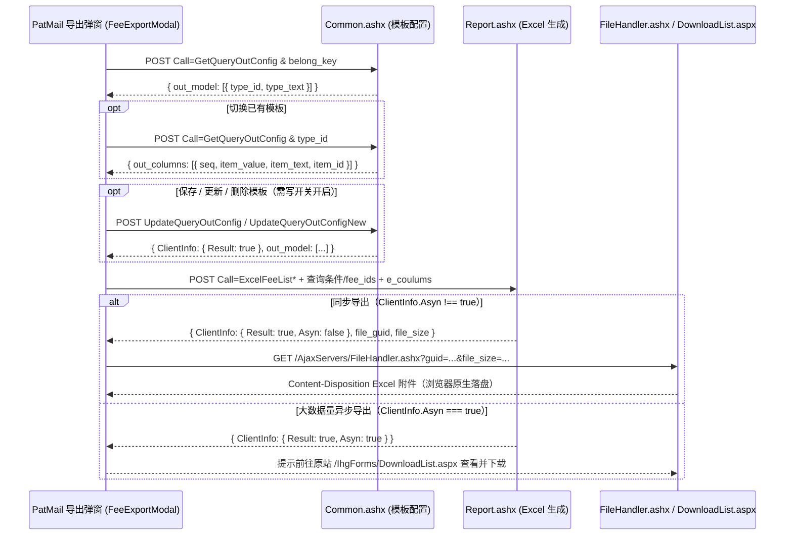
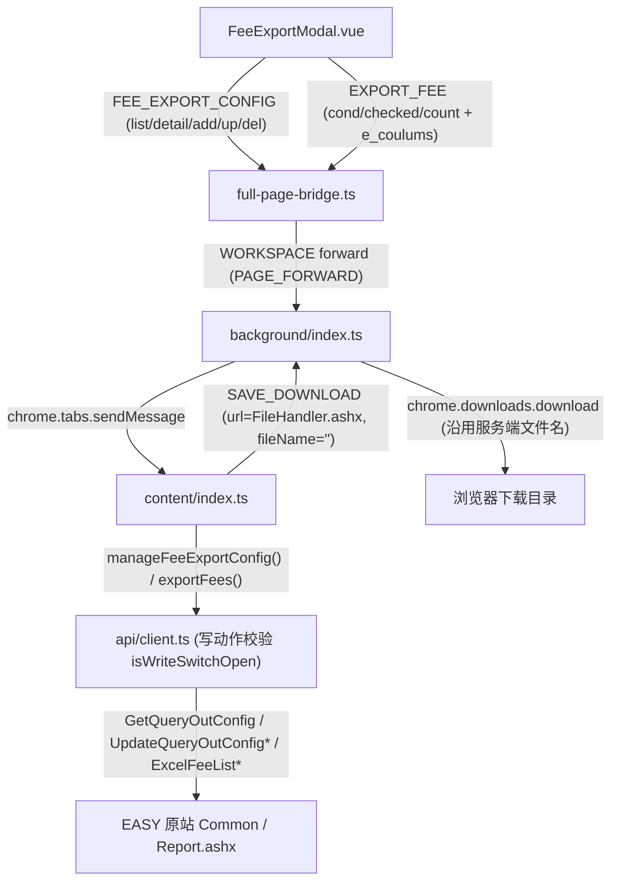

# 清单导出与模板

适用页面：`/IhgForms/IhgAdvExport.aspx`（脚本 `Scripts/Page/IhgAdvExport.js`）、`/IhgForms/DownloadList.aspx`（异步下载中心）  
涉及入口：
- 模板配置：`POST /AjaxServers/Common.ashx`（`GetQueryOutConfig` / `UpdateQueryOutConfig` / `UpdateQueryOutConfigNew`）
- 费用导出：`POST /AjaxServers/Report.ashx`（`ExcelFeeListByCond` / `ExcelFeeListByChecked` / `ExcelFeeListCountByCond`）
- 文件取件：`GET /AjaxServers/FileHandler.ashx?guid={guid}&file_size={size}`

本文档记录经生产站 `FeeSearch.aspx` + `IhgAdvExport.aspx` 源码与实时接口核对确认的完整导出与模板契约。费用查询主检索契约见 [44-费用查询.md](44-费用查询.md)。

---

## 1. 端到端协议时序



---

## 2. 导出模板配置接口（`POST /AjaxServers/Common.ashx`）

导出模板严格按当前登录账号（ASP.NET Session Cookie）与页面作用域 `belong_key` 隔离。前端不缓存模板清单，每次打开导出弹窗或切换导出模式均向原站实时热拉取。

### 2.1 `belong_key` 作用域对照

| 业务入口 | `belong_key` | 对应导出 Call | 导出范围 |
|---|---|---|---|
| 费用查询 · 导出清单 | `FeeSearch_ExportByCond` | `ExcelFeeListByCond` | 按当前查询条件导出全部命中费用（无需先点查询） |
| 费用查询 · 导出勾选费用 | `FeeSearch_ExportByCond` | `ExcelFeeListByChecked` | 仅导出勾选的 `fee_ids`（与「导出清单」共用模板集合） |
| 费用查询 · 导出汇总数据 | `FeeSearch_ExportCountByCond` | `ExcelFeeListCountByCond` | 按案件聚合官费/代理费/第三方费汇总导出 |
| 专利查询 · 导出清单 | `ICSearch` | `ICCaseSearchToExcel` | [专利查询全量导出](50-专利查询与导出.md#caseinfoashx-iccasesearchtoexcel) |
| 来文管理 · 导出清单 | `NoticeInfo` | 见来文导出表 | [来文管理导出](47-来文管理.md#5-四大服务端-excel-导出接口ihgadvexport-协议) |

<a id="22-getqueryoutconfig读取模板列表--栏位明细"></a>

## Common.ashx GetQueryOutConfig

请求示例（业务标识为占位值）：

```http
POST /AjaxServers/Common.ashx
Content-Type: application/x-www-form-urlencoded; charset=UTF-8

Call=GetQueryOutConfig
belong_key=ICSearch
log_pagename=IhgAdvExport.aspx
```

同一 `Call` 依据传参区分列表态与详情态：

| 模式 | 必填参数 | 说明 |
|---|---|---|
| 模板列表 | `Call=GetQueryOutConfig`、`belong_key`、`log_pagename=IhgAdvExport.aspx` | 返回当前账号该 `belong_key` 下的全部模板摘要 |
| 模板明细 | `Call=GetQueryOutConfig`、`type_id`、`log_pagename=IhgAdvExport.aspx` | 返回指定模板的已选栏位及导出顺序 `seq` |

列表响应示例：

```json
{
  "out_model": [
    {
      "type_id": "9058E23D-BB84-49C6-AAF6-B3C47B462096",
      "type_text": "对账"
    },
    {
      "type_id": "67F82865-C284-45F0-ACFD-4D21150F4E4C",
      "type_text": "收据信息"
    }
  ],
  "ClientInfo": { "IsLogin": true, "Status": true, "Result": true }
}
```

明细响应示例：

```json
{
  "out_columns": [
    {
      "type_id": "9058E23D-BB84-49C6-AAF6-B3C47B462096",
      "seq": 1,
      "item_value": "case_volume",
      "item_text": "我方文号",
      "item_id": "990BE177-0105-4E0A-B742-35041BC61A9F"
    },
    {
      "type_id": "9058E23D-BB84-49C6-AAF6-B3C47B462096",
      "seq": 2,
      "item_value": "case_status",
      "item_text": "案件状态",
      "item_id": "A5B9BF31-EA52-4F7A-A2B9-2435F06FE794"
    }
  ],
  "ClientInfo": { "IsLogin": true, "Status": true, "Result": true }
}
```

<a id="23-updatequeryoutconfig新建--删除模板"></a>

## Common.ashx UpdateQueryOutConfig

请求示例（业务标识为占位值）：

```http
POST /AjaxServers/Common.ashx
Content-Type: application/x-www-form-urlencoded; charset=UTF-8

Call=UpdateQueryOutConfig
belong_key=ICSearch
ud_type=add
model_name=示例清单
element={实体编码栏位列表}
log_pagename=IhgAdvExport.aspx
```

| 参数 | 新建（`add`） | 删除（`del`） | 说明 |
|---|---|---|---|
| `Call` | `UpdateQueryOutConfig` | `UpdateQueryOutConfig` | 固定动作名 |
| `ud_type` | `add` | `del` | 操作类型 |
| `belong_key` | 必填 | 必填 | 作用域标识 |
| `model_name` | 必填 | — | 模板显示名称（非空） |
| `element` | 必填 | — | 实体编码栏位 XML（见 §2.5） |
| `out_type_id` | — | 必填 | 要删除的模板 GUID |
| `log_pagename` | `IhgAdvExport.aspx` | `IhgAdvExport.aspx` | 来源页 |

成功响应返回 `ClientInfo.Result = true` 以及刷新后的 `out_model[]`（新保存的模板排在首位 `out_model[0]`）。

<a id="24-updatequeryoutconfignew更新已有模板"></a>

## Common.ashx UpdateQueryOutConfigNew

请求示例（业务标识为占位值）：

```http
POST /AjaxServers/Common.ashx
Content-Type: application/x-www-form-urlencoded; charset=UTF-8

Call=UpdateQueryOutConfigNew
belong_key=ICSearch
ud_type=up
out_type_id={模板ID}
model_name=示例清单
element={实体编码栏位列表}
log_pagename=IhgAdvExport.aspx
```

| 参数 | 必填 | 说明 |
|---|---|---|
| `Call` | 是 | 固定 `UpdateQueryOutConfigNew` |
| `ud_type` | 是 | 固定 `up` |
| `belong_key` | 是 | 作用域标识 |
| `out_type_id` | 是 | 待更新模板 GUID |
| `model_name` | 是 | 更新后的模板名称 |
| `element` | 是 | 更新后的实体编码栏位 XML（见 §2.5） |
| `log_pagename` | 否 | `IhgAdvExport.aspx` |

## 2.5 `element` 实体编码 XML 规范

ASP.NET WebForms 默认开启 Request Validation，表单中提交裸 `<tag>` 会触发服务端 500 拦截，因此原站 `IhgAdvExport.js` 统一以 HTML 实体 `&lt;` / `&gt;` 编码节点标签，并按右侧「已选栏位」顺序写入 `sort`（从 `1` 递增）：

```text
&lt;item&gt;&lt;value&gt;case_volume&lt;/value&gt;&lt;text&gt;我方文号&lt;/text&gt;&lt;sort&gt;1&lt;/sort&gt;&lt;/item&gt;&lt;item&gt;&lt;value&gt;amount&lt;/value&gt;&lt;text&gt;金额&lt;/text&gt;&lt;sort&gt;2&lt;/sort&gt;&lt;/item&gt;
```

> [!NOTE]
> 栏位显示文案内部若包含 `&`、`<`、`>`，需先做实体转义（`&amp;` / `&lt;` / `&gt;`）再嵌入 `<text>`，确保服务端 XML 反序列化不报错。

---

## 3. 费用服务端 Excel 导出接口（`POST /AjaxServers/Report.ashx`）

<a id="31-excelfeelistbycond导出清单"></a>

## Report.ashx ExcelFeeListByCond

请求示例（业务标识为占位值）：

```http
POST /AjaxServers/Report.ashx
Content-Type: application/x-www-form-urlencoded; charset=UTF-8

Call=ExcelFeeListByCond
case_volume=EXAMPLE-001
fee_page_type=
PageIndex=1
PageSize=20
e_coulums={实体编码栏位}
log_pagename=IhgAdvExport.aspx
```

按当前查询表单条件导出全部符合条件的费用明细 Excel。

| 参数 | 必填 | 说明 |
|---|---|---|
| `Call` | 是 | 固定 `ExcelFeeListByCond` |
| 查询条件字段 | 否 | 与 `FeeSearch` 一致的过滤参数（不传 `colsel`），附带 `fee_page_type=`、`PageIndex`、`PageSize` |
| `e_coulums` | 是 | 导出列定义实体编码 XML（**注意原站参数名拼写即为 `e_coulums`**） |
| `log_pagename` | 否 | `IhgAdvExport.aspx` |

<a id="32-excelfeelistbychecked导出勾选费用"></a>

## Report.ashx ExcelFeeListByChecked

请求示例（业务标识为占位值）：

```http
POST /AjaxServers/Report.ashx
Content-Type: application/x-www-form-urlencoded; charset=UTF-8

Call=ExcelFeeListByChecked
fee_ids={费用ID};{费用ID}
e_coulums={实体编码栏位}
log_pagename=IhgAdvExport.aspx
```

仅按勾选行主键集合导出费用明细 Excel。

| 参数 | 必填 | 说明 |
|---|---|---|
| `Call` | 是 | 固定 `ExcelFeeListByChecked` |
| `fee_ids` | 是 | 已勾选费用主键 GUID，以英文分号 `;` 拼接 |
| `e_coulums` | 是 | 导出列定义实体编码 XML |
| `log_pagename` | 否 | `IhgAdvExport.aspx` |

<a id="33-excelfeelistcountbycond导出汇总数据"></a>

## Report.ashx ExcelFeeListCountByCond

请求示例（业务标识为占位值）：

```http
POST /AjaxServers/Report.ashx
Content-Type: application/x-www-form-urlencoded; charset=UTF-8

Call=ExcelFeeListCountByCond
case_volume=EXAMPLE-001
fee_page_type=
PageIndex=1
PageSize=20
e_coulums={实体编码栏位}
log_pagename=IhgAdvExport.aspx
```

按当前查询条件以案件维度汇总官费、代理费、第三方费及实收金额导出 Excel。请求参数与 `ExcelFeeListByCond` 一致，仅 `Call` 改为 `ExcelFeeListCountByCond`，导出列分组为 3 组（`案件信息`、`著录项目`、`费用信息`）。

## 3.4 `e_coulums` 实体编码 XML 与分组列规则

`e_coulums` 按右侧「已选栏位」最终排序拼接，每个节点以列键 `value` 为标签名、列标题 `text` 为节点文本：

```text
&lt;case_volume&gt;我方文号&lt;/case_volume&gt;&lt;case_name&gt;案件名称&lt;/case_name&gt;&lt;amount&gt;金额&lt;/amount&gt;
```

生产站列集合核对结论（`FeeSearch.js`）：
- **导出清单（6 组）**：`案件信息`、`处理事项`、`著录项目`、`费用信息`、`扩展信息`、`自定义栏位`（`column_1`–`column_5` 标题由 `PatentAction.ashx?Call=GetFieldColumn` 动态替换，默认不勾选）。
- **商标条件列**：仅当 `case_type` 为空或等于商标 GUID（`0E8A4B7F-E407-4EFF-9562-3809BF484207`）时追加 `register_type_code`（商标类别）。
- **销账日期列**：生产站 `FeeExport.fee_export = true`，默认暴露 `cancellation_date`（销账日期）。
- **导出汇总数据（3 组）**：`案件信息`、`著录项目`、`费用信息`（含 `o_amount`、`a_amount`、`t_amount`、`total_oa_amount`、`total_oat_amount`、`total_oa_recieve_amount` 等汇总指标列）。

---

## 4. 响应契约与下载分流

### 4.1 同步导出响应（常规数据量）

```json
{
  "file_guid": "11111111-2222-3333-4444-555555555555",
  "file_size": 48128,
  "ClientInfo": {
    "IsLogin": true,
    "Status": true,
    "Result": true,
    "Asyn": false,
    "Message": null
  }
}
```

拿到 `file_guid` 与 `file_size` 后，客户端向 `GET /AjaxServers/FileHandler.ashx?guid={file_guid}&file_size={file_size}` 发起带会话 Cookie 的下载请求：
- 服务端通过响应头 `Content-Disposition` 下发真实 Excel 文件名与扩展名（`.xls` 或 `.xlsx`）。
- PatMail 经后台 `chrome.downloads.download({ url, saveAs: false })` 触发原生落盘，不覆盖 `filename` 以避免 `.xls`/`.xlsx` 格式与扩展名错配；若下载权限受限，则自动降级为内容脚本隐藏 `iframe` 指向同一取件 URL（对齐原站 `GetFile()`）。

### 4.2 异步导出响应（大批量数据）

```json
{
  "ClientInfo": {
    "IsLogin": true,
    "Status": true,
    "Result": true,
    "Asyn": true,
    "Message": null
  }
}
```

当 `ClientInfo.Asyn === true` 时，服务端不立即返回 `file_guid`，任务进入原站后台异步队列；原站通过 `/IhgForms/DownloadList.aspx`（`DownloadList.js`）展示生成进度并提供下载入口。

---

## 5. 超时、重试与写保护策略

- **禁止自动重试**：`UpdateQueryOutConfig`、`UpdateQueryOutConfigNew` 及三个 `ExcelFeeList*` 导出接口均属于写操作或重计算服务端落盘操作，网关 502/503 时不得自动重试，避免重复创建模板或双份临时文件。
- **超时预算**：Excel 生成沿用页面所选超时档位（1 / 2 / 5 / 10 分钟），工作台转发层额外预留 15 秒缓冲。
- **写开关门禁**：模板读取按只读请求处理。模板新建、更新与删除受全局写开关保护。专利导出生成请求也受写开关保护，并按站点和登录人进入 WAL。


---

## 6. 插件扩展内部通信与调度

在 PatMail 插件内，高级导出弹窗 [FeeExportModal.vue](file:///d:/Users/Administrator/Desktop/插件/patmail-extension/src/app/components/FeeExportModal.vue) 通过 `FEE_EXPORT_CONFIG` 与 `EXPORT_FEE` 两个消息通道完成原站模板热同步与 Excel 真实落盘：



- **消息类型**：
  - `MessageType.FeeExportConfig` / `FeeExportConfigResult`：统一承接模板列表、详情、保存、更新与删除；`list`/`detail` 只读直放，`add`/`up`/`del` 在 `client.ts` 内受 `isWriteSwitchOpen()` 门禁保护。
  - `MessageType.ExportFee` / `ExportFeeResult`：同步返回 `file_guid` 时，由 `content/index.ts` 向后台发送 `MessageType.SaveDownload`（`fileName: ''` 保留原站 `Content-Disposition` 真实 Excel 文件名与扩展名），若后台下载异常则自动降级为内容脚本隐藏 `iframe`（`startArchiveDownload`）兜底；返回 `ClientInfo.Asyn === true` 时前端弹出卡哇伊提示引导至原站「下载清单」。
- **超时预算**：`EXPORT_FEE` 纳入 `full-page-bridge.ts` 的 `searchWait`（页面所选超时 1–10 分钟 + `15s` 余量），避免大导出被默认 30s 掐断。


## 本文件接口

| Handler | Call |
|---|---|
| `Common.ashx` | `GetQueryOutConfig`、`UpdateQueryOutConfig`、`UpdateQueryOutConfigNew` |
| `Report.ashx` | `ExcelFeeListByCond`、`ExcelFeeListByChecked`、`ExcelFeeListCountByCond` |
| `CaseInfo.ashx` | [ICCaseSearchToExcel](50-专利查询与导出.md#caseinfoashx-iccasesearchtoexcel) |
