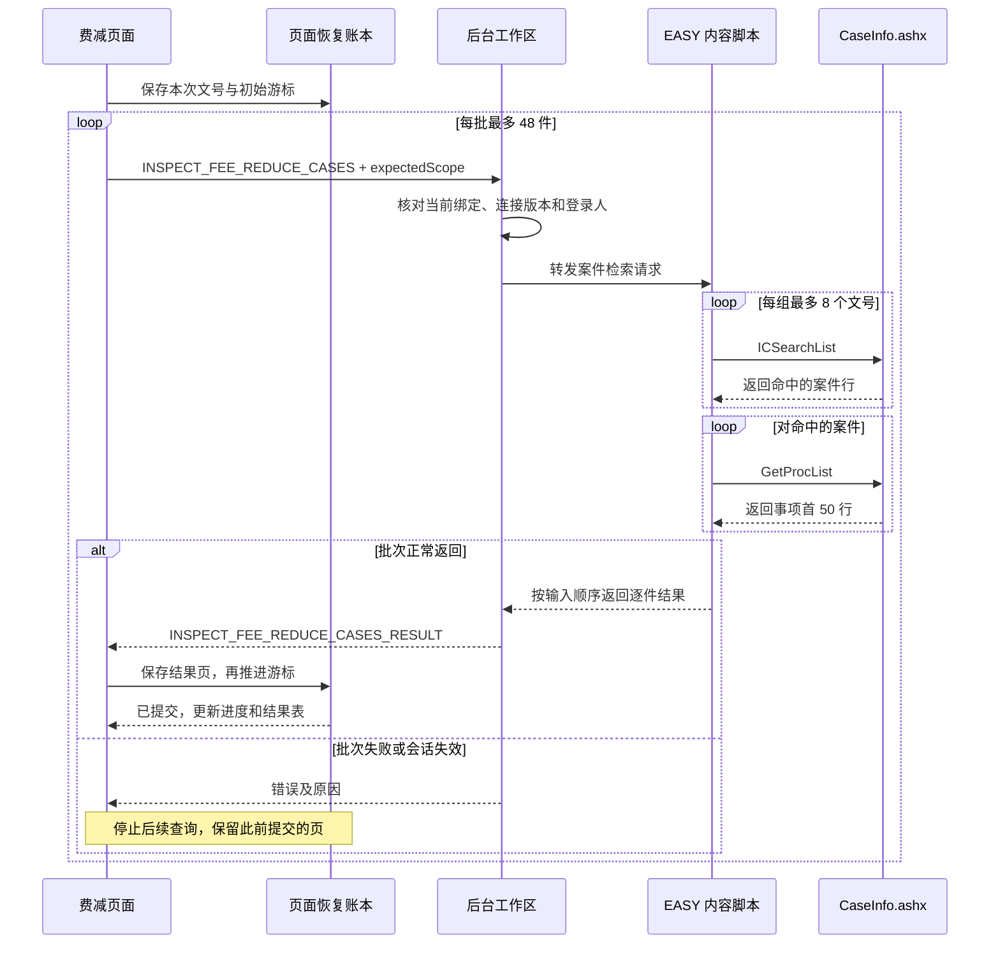
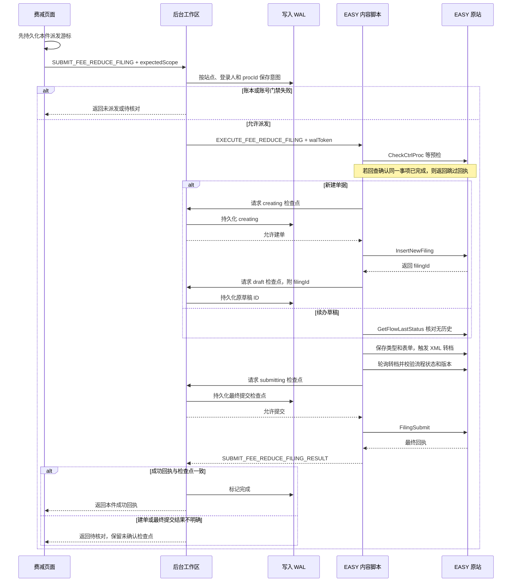

# 费减工作流接口

本章按 PatMail 当前实现记录「请求费用减缓」的案件检索、初核人读取、XML 转档和流程提交。接口字段和分支以代码为依据。示例中的文号和 ID 均为虚构值。[费减客户端](../patmail-extension/src/api/fee-reduce-client.ts) · [消息类型](../patmail-extension/src/api/fee-reduce-types.ts) · [原站路由](../patmail-extension/src/api/transport.ts)

Handler 为 `CaseInfo.ashx`、`FilingApiAction.ashx`、`FilingAction.ashx` 和 `Common.ashx`。页面标识为 `ICSearch.aspx`、`CaseManage.aspx`、`Filing.aspx` 和 `IhgFlow.aspx`。下方 HTTP 示例逐行展示表单字段，实际请求使用 `application/x-www-form-urlencoded; charset=UTF-8`。登录及公共响应见 [00-通用约定.md](00-通用约定.md)。

## 检索与未查到的归因



1. 页面按大小写不敏感去重，支持换行、空白及中英文逗号、分号分隔。48 件是页面向后台发出的批次；内容侧查询案件时每组最多 8 个文号，默认最多 6 路并发。
2. `POST /AjaxServers/CaseInfo.ashx` 的 `ICSearchList` 把分号拼接的文号放入 `Element` 的 `case_volume` 节点，使用 `is_fuzzy_query_case_volume=false`、`is_proc=false`、`pageIndex=1`、`pageSize=10`、`log_pagename=ICSearch.aspx`。从 `TableRows` 按文号匹配，忽略大小写和空白，只接受有效的 `case_id`。本工作流使用我方文号精确匹配。[案件查询的原站表单](13-案件查询.md)
3. 对每个命中案件调用同一 Handler 的 `GetProcList`，提交 `case_id`、`pageIndex=1`、`pageSize=50`、`_PK=proc_id`、`log_pagename=CaseManage.aspx`。从该页 `TableRows` 精确匹配 `ctrl_proc=请求费用减缓`，有多条时优先选「撰写中」，否则取列表中最后一条匹配项。

### CaseInfo.ashx ICSearchList

请求字段摘录如下。实际请求完整带上案件查询的 `Element` 空条件、`colsel` 和其余开关。参见 [13-案件查询.md](13-案件查询.md) 和 [表单构建代码](../patmail-extension/src/api/ic-search.ts)。

```http
POST /AjaxServers/CaseInfo.ashx

Call=ICSearchList
Element=…&lt;case_volume&gt;EXAMPLE-001;EXAMPLE-002&lt;/case_volume&gt;…
pageIndex=1
pageSize=10
is_proc=false
is_fuzzy_query_case_volume=false
log_pagename=ICSearch.aspx
```

响应读取 `TableRows[]` 中的 `case_id`、`case_volume`、`case_name` 和 `app_no`。同一文号未匹配到有效行时，本批结果对该文号返回 `not_found`。

### CaseInfo.ashx GetProcList

```http
POST /AjaxServers/CaseInfo.ashx
Content-Type: application/x-www-form-urlencoded; charset=UTF-8

Call=GetProcList
case_id=11111111-1111-4111-8111-111111111111
pageIndex=1
pageSize=50
_PK=proc_id
log_pagename=CaseManage.aspx
```

响应骨架中只列出费减读取的字段。

```json
{
  "ClientInfo": { "IsLogin": true, "Status": true, "Message": null },
  "TableRows": [
    {
      "proc_id": "22222222-2222-4222-8222-222222222222",
      "ctrl_proc": "请求费用减缓",
      "proc_status": "撰写中"
    }
  ]
}
```

### 扩展状态映射

每行字段为 `caseVolume`、`caseId`、`caseName`、`appNo`、`procId`、`procName`、`procStatus`、`state`、`reason`。原站未提供的标识、状态或文本以空串表示。

| `state` | 判断与页面处置 |
|---|---|
| `ready` | 费减事项为「撰写中」。新鲜检索结果可勾选，历史回执待核对的行继续锁定 |
| `completed` | 事项为「递交中」或「完成」。跳过递交 |
| `not_found` | 当前站点的有效返回中没有匹配的我方文号。结果表上方的「只看未查到」筛选显示这些文号 |
| `missing_proc` | 已查到案件，当前返回的事项页没有「请求费用减缓」 |
| `other_status` | 找到费减事项，状态不属于上述可递交或已推进状态 |
| `error` | 文号超过 80 字符，或事项读取出现非会话类错误。原因见 `reason` |

案件查询整组请求失败或会话失效会结束本次检索；前面已落盘的批次仍可恢复。排查「未查到」时先核对当前站点和我方文号原值，再查 `ICSearchList` 是否返回有效案件。拿到 `case_id` 后再排查 `GetProcList` 的事项及首 50 条范围。

## 原站递交调用顺序

以下 Handler 均为 `POST /AjaxServers/{Handler}`，表单字段名区分大小写。普通业务失败可在 `ClientInfo.Message` 取得原因。参见 [通用约定](00-通用约定.md)。



| 顺序 | Handler / Call | 表单参数及回执 |
|---|---|---|
| 1. 事项校验 | `CaseInfo.ashx / CheckCtrlProc` | `proc_id`，`log_pagename=CaseManage.aspx`。检查 `ClientInfo.Result` |
| 2. 新递交单预检 | `CaseInfo.ashx / VerificateFiling` | `case_id`、`proc_id`，同上页面标识。恢复旧草稿时改用 `GetFlowLastStatus` 核对该单无历史 |
| 3. CPC 类型 | `FilingApiAction.ashx / GetCPCBusineeType` | `log_pagename=Filing.aspx`。从 `cpcBusinessType[]` 取「手续办理」/ `5` 与「费用减缴请求」/ `100008` 的 `id`。缺失时使用代码中的对应回退 ID |
| 4. 建单 | `FilingApiAction.ashx / InsertNewFiling` | `case_id`、`proc_id`、`filing_type=E`、`filing_new=1`、`levelOne`、`levelTwo`、`levelThree=`，`log_pagename=Filing.aspx`。须有 `ClientInfo.Result` 成功及响应 `id`；已有 WAL 草稿则沿用原 `filing_id` |
| 5. 保存业务类型 | `FilingApiAction.ashx / SaveCPCType` | `levelOneCode`、`levelTwoCode`、`levelThreeCode=`、`filing_id`，`log_pagename=Filing.aspx` |
| 6. 保存文件类型 | `FilingAction.ashx / SaveFilingType` | `filing_id`、`file_desc_code=100008`、`number=`、`type=费用减缴请求`，同上页面标识 |
| 7. 保存费减表单 | `FilingAction.ashx / SaveFeeReduceRspInfo` | `oa_name`、`filing_id`，同上页面标识 |
| 8. 读取校验提示 | `FilingAction.ashx / CheckResult`、`CheckSplitPDF`、`CheckFirstInventor` | `filing_id`，同上页面标识。从成功返回的 `ClientInfo.Message` 收集 `warnings[]` |
| 9. 触发 XML 转档 | `FilingAction.ashx / ConvertSubmit` | `filing_id`、`flow_code=FIRST`、`convert_format=XML`、`adv_option_json=`，同上页面标识 |
| 10. 轮询转档 | `FilingAction.ashx / GetConvertStatus` | `filing_id`，同上页面标识。每 2 秒检查一次，预算 60 秒。首行 `err_code` 非空时报错；`convert_status` 和 `form_status` 均为 `1000` 才能继续 |
| 11. 读取转档文件 | `FilingAction.ashx / GetConvertedFile` | `filing_id`、`pageIndex=1`、`pageSize=10`，同上页面标识。返回首屏 `TableRows` 中的 `file_desc` 或 `file_name` |
| 12. 读取流程配置 | `Common.ashx / GetFlowInfo`、`GetFlowSubmit`、`GetPicProcessCount` | 获取启动节点、初核节点、候选人及待办数量。详见下节 |
| 13. 紧急度及版本复核 | `Common.ashx / GetUrgencyList`、`GetFlowLastStatus` | `log_pagename=IhgFlow.aspx`。从 `UrgencyList` 取 `urgency_code=CM` 的 `urgency_id`。最后状态另带 `obj_id=filing_id`、`flow_type=EF`，并与当前流程配置比对 |
| 14. 提交初核 | `FilingAction.ashx / FilingSubmit` | 带递交单、流程节点、版本验证后的状态及办理人。以成功回执和 WAL 一致性为准 |

校验返回「处理事项已完成」时，扩展再次按 `case_id` 查询事项，匹配 **同一 `proc_id` 和同名事项**，且确认状态为「完成」或「递交中」后才返回 `{ outcome: 'already_completed', caseVolume, caseId, procId, procStatus, message }`。这个分支会跳过递交。

### FilingApiAction.ashx InsertNewFiling

```http
POST /AjaxServers/FilingApiAction.ashx
Content-Type: application/x-www-form-urlencoded; charset=UTF-8

Call=InsertNewFiling
case_id=11111111-1111-4111-8111-111111111111
proc_id=22222222-2222-4222-8222-222222222222
filing_type=E
filing_new=1
levelOne={手续办理字典ID}
levelTwo={费用减缴请求字典ID}
levelThree=
log_pagename=Filing.aspx
```

```json
{
  "ClientInfo": { "IsLogin": true, "Status": true, "Result": true, "Message": null },
  "id": "33333333-3333-4333-8333-333333333333"
}
```

建单响应使用 `id`，后续表单统一以 `filing_id` 传递这个值。建单成功只表示创建了递交草稿。

### FilingAction.ashx GetConvertStatus

```http
POST /AjaxServers/FilingAction.ashx

Call=GetConvertStatus
filing_id=33333333-3333-4333-8333-333333333333
log_pagename=Filing.aspx
```

```json
{
  "TableRows": [
    { "convert_status": "1000", "form_status": "1000", "err_code": "", "convert_result": "" }
  ]
}
```

### 流程节点与提交表单

- `GetFlowInfo` 提交 `obj_id`、`flow_type=EF`、`flow_sub_type=OA`、`log_pagename=Filing.aspx`，读取 `Result.flow_id`、`status`、当前节点代码和 `update_time_ss`。初核人预览用全零 GUID；若请求成功但未找到初核节点，尝试用 `GetProcessByTypeEF`（`pageIndex=1`、`pageSize=5`、`log_pagename=Default.aspx`）提供的首个样本单据再次读取。正式提交使用本件 `filing_id`。
- `GetFlowSubmit` 将 `GetFlowInfo.Result` 中的标量字段回传，设 `Call=GetFlowSubmit`、`log_pagename=IhgFlow.aspx`。从返回的 `Result[]` 取 `FIRST` 启动节点和 `PROCE` /「流程人员初核」节点；候选人由后者的 `user_list_id`、`user_list_name` 分号对齐。
- `GetPicProcessCount` 传 `cur_node_id`、分号拼接的 `cur_user_id`、`flow_type=EF`、`flow_sub_type=OA`、`log_pagename=IhgFlow.aspx`，读取 `Result[]` 中的 `user_id` 与 `count`。
- `GetFlowLastStatus` 的 `last_status=null` 只有在会话有效、`Status=true` 且无错误消息时才能作为空历史；这时原站可以返回 `Result=false`。已有历史时读取版本标记，正式提交在初始状态或 `FIRST` 节点且版本比对通过后才发送。[流程版本判定代码](../patmail-extension/src/workflow/contracts.ts)

| `FilingSubmit` 字段组 | 实际值 |
|---|---|
| 路由与审批 | `handler=FilingAction.ashx`、`Call=FilingSubmit`、`log_pagename=IhgFlow.aspx`、`f_audit_type_id=submit` |
| 单据及流程 | `f_obj_id=filing_id`、`f_flow_id`、`f_flow_type=EF`、`f_flow_sub_type=OA` |
| 状态与节点 | `f_cur_status`、`f_status=1000`、`f_cur_node_id`、`f_cur_node_code=FIRST`、`f_next_node_id`、`f_next_node_code=PROCE`、`f_list_id`、`f_cur_node` |
| 人员与意见 | `f_next_user_id`、`f_next_user_name`（有待办数时附括号计数）、`f_remark`、`f_urgency_id` |
| 固定开关 | `f_allow_edit=1`、`f_is_parallel=0`、`finishdate=false` |
| 固定空串 | `f_ep_proc`、`pic_user`、`int_due_date`、`cus_due_date`、`leg_due_date`、`f_score`、`f_cur_proc_status_fd`、`f_cur_remark_fd`、`f_cur_proc_note_fd` |

提交响应读取 `ClientInfo.Result` 与 `ClientInfo.Message`。最终扩展响应里的 `filingId` 必须与已保存的提交检查点一致。

## 扩展消息契约

页面通过 `createWorkflowBridge('fee-reduce')` 发送 `WORKSPACE` 的 `forward` 动作，由后台转发给当前绑定的 EASY 标签页。结果消息的 `payload` 形如 `{ ok: true, data }` 或 `{ ok: false, error: { code, message } }`。后台门禁或通信失败还可能返回 `ERROR`，错误文本在 `payload.message`。

| 请求 → 结果 | 请求与校验 | 成功结果 |
|---|---|---|
| `INSPECT_FEE_REDUCE_CASES` → `INSPECT_FEE_REDUCE_CASES_RESULT` | `{ caseVolumes: string[], expectedScope }`。页面按 48 件分批发送 | `{ items: FeeReduceCaseInspectItem[] }`，按提交的有效文号顺序逐件返回 |
| `READ_FEE_REDUCE_REVIEWERS` → `READ_FEE_REDUCE_REVIEWERS_RESULT` | 无业务参数，使用当前绑定的已登录标签页 | `{ reviewers: [{ userId, name, count }], nodeName, message }`。待办数无法取得时 `count=null` |
| `SUBMIT_FEE_REDUCE_FILING` → `SUBMIT_FEE_REDUCE_FILING_RESULT` | `caseVolume`、`caseId`、`procId`、`expectedScope`。可选 `oaName`、`remark`、`reviewerStrategy`、`defaultReviewerId`、`overrideReviewerId` | 提交回执含 `caseVolume`、`caseId`、`procId`、`filingId`、`reviewerId`、`reviewerName`、`convertedFiles[]`、`warnings[]`、`message`。回查确认事项已推进时，另见下文的 `already_completed` |

`expectedScope` 为调用时看到的 `{ easyOrigin, operatorId, easyTabId, connectionVersion }`。检索和递交经过后台工作台时必须提供，后台以实际连接与会话复查作为门禁。初核人预览使用当前绑定账号，递交时按本件的流程配置重新读取候选人。

消息校验允许一个检索请求传 1–2000 个非空文号，每个最多 200 字符。超过 80 字符且通过消息校验的文号在检索结果中记为 `error`。递交的文号最多 80 字符，`oaName` 和 `remark` 各最多 200 字符；`caseId`、`procId` 及非空的审核人 ID 必须为 GUID。

| 递交可选字段 | 取值与优先级 |
|---|---|
| `oaName` | 申请人或专利权人名称，留空时以空串传给 EASY |
| `remark` | 办理意见，空值按「同意」发送 |
| `reviewerStrategy` | `first`（默认首位）、`least_busy`（待办最少，未知待办数排在有数值的候选人之后）、`specific`（指定） |
| `defaultReviewerId` / `overrideReviewerId` | 后者优先。指定人员必须仍在本件的候选列表内 |

`EXECUTE_FEE_REDUCE_FILING` 是后台发给内容脚本的内部消息。后台生成 `walToken`，只有可安全续办的草稿阶段才附带 `resumeFilingId`。页面提交入口会拒绝外部传入的续办单号。

## WAL 与刷新恢复

| 层级 | 持久化范围与恢复行为 |
|---|---|
| 后台写操作 `workflow-write` | 按 `[fee-reduce, EASY origin, lowercase(operatorId), lowercase(procId)]` 隔离，一件事项一次性保护。先持久化待确认意图，再发起业务。只有可认可的回执才将写记录标为完成 |
| 递交检查点 | `preflight` 可安全重跑预检；`creating` 已取得建单许可，建单回执缺失时停在待核对；`draft` 持有原 `filingId`，允许在核对无流程历史后续办；`submitting` 已取得最终提交许可，回执缺失时先核对原站，不能重发 |
| 页面批次 `workflow-desk` | 按站点和登录人保存目标文号、已派发范围和逐件处置。刷新后根据回执区分已提交、跳过、失败、待核对和未派发。只推进到派发游标的项目归入待核对 |
| 检索进度 `workflow-desk` | 按同站点和登录人保存输入、分页结果、提交游标及待核对文号。先写结果页，再提交页游标；刷新只展示连续已持久化的页面。历史结果可查看和筛选，重新检索后才能递交 |

`feeBatchPause=not_sent` 表示后台能确认本件未派发；`verify` 表示需要核对实际状态。会话失效、不可确认的最后流程状态（`FLOW_STATUS_UNVERIFIED`）、回执丢失与 WAL 写失败应结合这两个层级判断。查询和初核人读取的页面等待预算为 70 秒，单件递交为 120 秒。等待超时本身无法证明原站没有执行。

[后台检查点实现](../patmail-extension/src/background/fee-reduce-checkpoint.ts) · [工作流写边界](../patmail-extension/src/background/workflow-write.ts) · [检索恢复账本](../patmail-extension/src/workflow/fee-reduce-inspection-recovery.ts)
