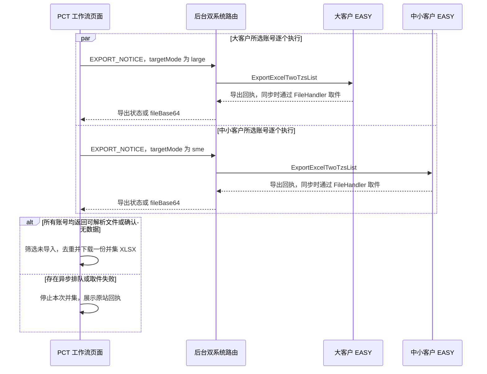
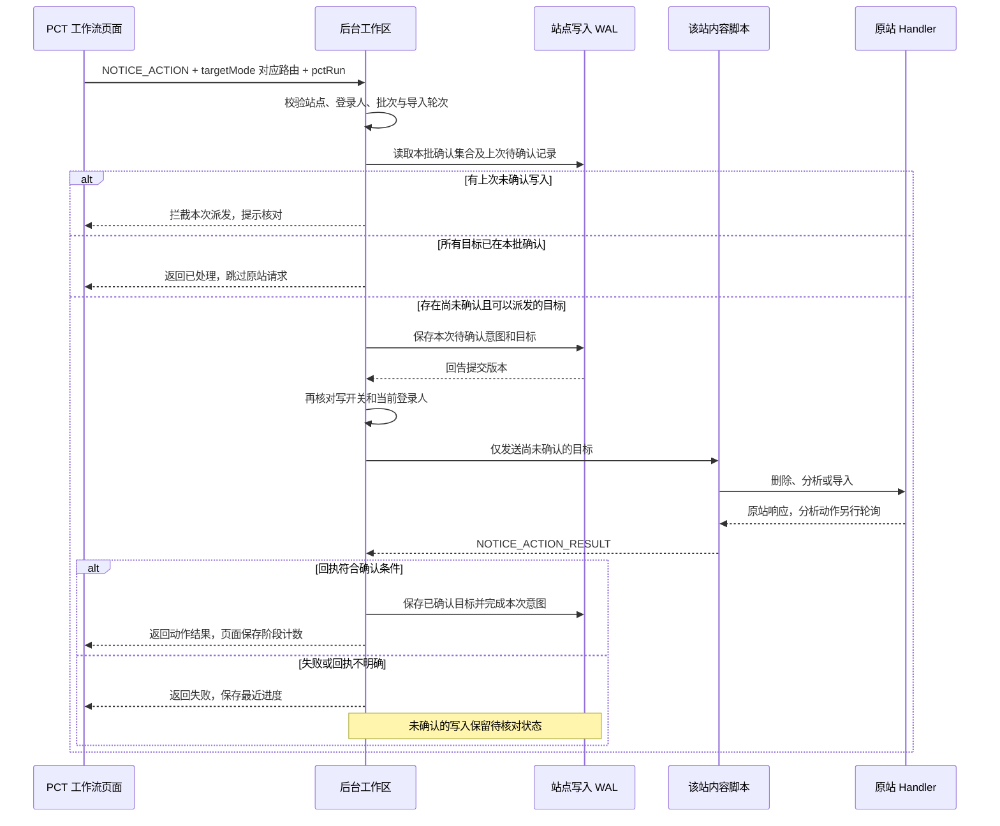

# PCT 官文下载上传工作流接口

本章记录 PatMail 的「PCT 官文下载上传」如何调用大客户与中小客户 EASY、如何识别成功回执，以及如何续办。接口行为以当前运行代码为依据。原站来文管理通用字段与动作另见 [来文管理接口](47-来文管理.md)。页面操作另见 [PCT 工作流使用说明](../patmail-extension/docs/workflows/pct官文下载上传.md)。

主要 Handler 为 `POST /AjaxServers/FilingApiAction.ashx` 和 `POST /AjaxServers/Notice.ashx`，页面为 `Forms/Patent/NoticeInfo.aspx`。HTTP 示例逐行展示表单字段，实际使用 `application/x-www-form-urlencoded; charset=UTF-8`；示例 ID 为虚构值。公共字段见 [00-通用约定.md](00-通用约定.md)。

## 第一步 导出并生成未导入核对清单



1. 每套系统依次处理该系统内已选的 CPC 账号，两站并行。每个账号发送一次 `EXPORT_NOTICE`。请求 `query` 传 `account`、`applyType`（页面默认 `2`）、`applyNo`、`caseName`、`noticeName`、`xlh`、`startTime`、`endTime`，并在扩展消息内提供 `pageIndex=1`、`pageSize=200`。
2. 原站调用 `POST /AjaxServers/FilingApiAction.ashx`，`Call=ExportExcelTwoTzsList`。传上述查询字段，附 `log_pagename=IhgAdvExport.aspx` 及 `e_coulums` 列定义。该导出请求不使用消息里的分页字段。默认列依次为 `tongzhismc`、`fawenxlh`、`dianzifwrq`、`cnApplicationnumber`、`famingczmc`、`account`、`status`。[高级导出协议](45-高级导出与模板协议.md)
3. 同步响应从 `file_guid`、`file_size` 生成 `GET /AjaxServers/FileHandler.ashx?guid={file_guid}&file_size={file_size}`。内容脚本同源取件，`delivery=inline` 将 `fileBase64`、`fileName`、`mimeType`、`fileGuid`、`fileSize` 等交回工作流，不逐个把原站清单保存到下载目录。
4. `async=true` 或缺少 `fileBase64` 时不能自动合并。原站提示异步生成时可缩小日期范围再执行。当前工作流把「无可导出数据」或「未返回有效的导出文件地址」类错误记为该账号 0 条；取件 HTTP 异常或格式错误会中止本次并集生成。
5. 从原站表格识别「是否导入系统」列并筛出未导入行。当前解析器遇到缺少状态列的表格时，会把非空行按未导入纳入。并集优先按发文序列号去重，序列号为空时按「申请号、来文名称、发文日」去重。页面生成一份并集 XLSX，并最多预览 200 行。

第一步可单独执行，写开关可保持关闭。全流程在触发浏览器下载前先保存 `exportDispatched`，续办时跳过该次自动下载。这个字段表示下载动作已进入派发阶段，用户仍可通过单独导出取得新文件。[导出解析与去重](../patmail-extension/src/workflow/pct-notice-excel.ts) · [内联文件响应](../patmail-extension/src/content/index.ts)

## FilingApiAction.ashx ExportExcelTwoTzsList

```http
POST /AjaxServers/FilingApiAction.ashx
Content-Type: application/x-www-form-urlencoded; charset=UTF-8

Call=ExportExcelTwoTzsList
account=11111111-1111-4111-8111-111111111111
applyType=2
applyNo=
caseName=
noticeName=
xlh=
startTime=2026-11-01
endTime=2026-11-27
e_coulums={按默认七列生成的实体编码XML}
log_pagename=IhgAdvExport.aspx
```

同步响应骨架如下。异步分支的 `ClientInfo.Asyn=true`。

```json
{
  "ClientInfo": { "IsLogin": true, "Status": true, "Result": true, "Asyn": false, "Message": null },
  "file_guid": "22222222-2222-4222-8222-222222222222",
  "file_size": 25600
}
```

## 步骤 4 至 6 查询与写入

两套系统并行，每套系统按 **4 → 5 → 6** 顺序推进。列表从第 1 页、每页 200 条开始，遇空页、短页（少于 200 条）或累计数量达到 `total` 即停止。每个写动作最多 50 个目标，单系统内逐批等待回执。

### 查询字段

| 阶段 | 扩展查询 / 原站 Call | 关键参数与目标选择 |
|---|---|---|
| 4. 来文下载 | `tab=download` → `FilingApiAction.ashx / GetUnProcessTzsList` | `account`、`casename`、`appno`、`startTime`、`endTime`、`status`（页面默认 `unprocess`）。按 `ShenQingH`、`cnApplicationnumber`、`app_no`、`appno` 的优先级读取申请号，去首尾空白并转大写后判断 `PCT/` 前缀；收集和去重非空 `fid` |
| 5. 来文二次下载 | `tab=replay` → `FilingApiAction.ashx / GetReplayTzsList` | `account`、`applyType`、`applyNo`、`caseName`、`noticeName`、`xlh`、`startTime`、`endTime`。仅在当前收文账号内按 `fid` 去重，提取同一行 `fawenxlh`，已导入与未导入行都参加分析 |
| 6. 导入来文 | `tab=import` → `Notice.ashx / SearchNotice` | 强制 `status='0'`（未处理）、`log_pagename=NoticeInfo.aspx`。每轮重新从第 1 页查询。读取 `oa_id`、`case_volume` 和 `is_finish` |

导入请求带上页面保存的查询条件。常用条件为 `case_volume`、`is_fuzzy_query_case_volume`、`post_date_s/e`、`filedesc`、`apply_type`、`app_no`、`orderby`；其余客户、人员、代理机构、流向、下载/分析日期等字段见 [来文管理](47-来文管理.md)。中小客户查询对 `apply_type`、`agency_id`、`flow_direction`、`branch_dept_id`、`apply_tags_id`、`customer_country` 做同名字典映射，对 `assayer`、`sales_help` 按人员树名称映射。缺少匹配项时沿用原值。

## Notice.ashx SearchNotice

用途为查询当前站点未处理来文。

请求示例（其余筛选项见 [47-来文管理.md](47-来文管理.md#22-导入来文searchnotice--getimportnoticelist请求参数与静态枚举)）：

```http
POST /AjaxServers/Notice.ashx
Content-Type: application/x-www-form-urlencoded; charset=UTF-8

Call=SearchNotice
pageIndex=1
pageSize=200
status=0
log_pagename=NoticeInfo.aspx
```

导入列表响应骨架如下。表格行保留原站字段名，扩展将总数转为数字 `total`。

```json
{
  "ClientInfo": { "IsLogin": true, "Status": true, "Message": null },
  "TableRowsCount": "1",
  "TableRows": [
    {
      "oa_id": "33333333-3333-4333-8333-333333333333",
      "case_volume": "EXAMPLE-PCT-001",
      "is_finish": 0
    }
  ]
}
```

### 动作字段及回执

以下原站 Call 使用 `POST /AjaxServers/{Handler}`，数组在表单内用英文分号拼接。

| 扩展 `NOTICE_ACTION.payload` | 原站 Handler / Call | 请求字段与检查 |
|---|---|---|
| `{ action: 'deleteDownloadOa', fids }` | `FilingApiAction.ashx / DeleteOaInfoByFids` | 以 `fids` 提交待下载记录主键，同步返回业务结果 |
| `{ action: 'downloadTzsList', account, accountLabel, fids, xlh, startTime, endTime, isReplay: true }` | `FilingApiAction.ashx / ProcessTzsList` | 提交 `account`、日期、`fids` 和对应的 `xlh`。之后每 2.5 秒调用一次 `ProcessTzsListStatus`，最多 25 次；状态成功后尝试 `GetReaplyTzsStatus(fids)` 同步逐行 `statusRows[]` |
| `{ action: 'importCheck', oaIds }` | `Notice.ashx / CheckImportNotice` | 传 `oa_ids`、`log_pagename=NoticeInfo.aspx`。读取 `CheckNotice[]`、`SGReduce[]` 并生成 `checkWarnings[]`；此调用只读 |
| `{ action: 'importNotice', oaIds, mailSales: 'N', checkName: false }` | `Notice.ashx / ImportNotice` | 传 `oa_ids`、`mail_sales=N`、`checkname=false`、`log_pagename=NoticeInfo.aspx`。「失败原因」「更新失败」的回执按业务失败处理；`ISErrorFee` 归一为 `isErrorFee` |
| `{ action: 'importCloseCase', oaIds }` | `Notice.ashx / ImportCloseCase` | 用 `ids` 传结案行的 `oa_id`，`log_pagename=NoticeInfo.aspx`。走结案只导文件分支 |

导入时先丢弃没有 `oa_id` 的行，有 `oa_id` 但没有我方文号的行按非本系统记录跳过。若 `closeCaseRule !== '1'`，或 `closeCaseRule === '1'` 且 `closeCaseImportNotice === '1'`，则 `Number(is_finish) === 1` 的行先走 `ImportCloseCase`，剩余行走预检加 `ImportNotice`；其它配置下，两类行都走预检加普通导入。第一轮回执落定后重新查询未处理记录，执行第二轮。预检的警告会记录在进度中，普通导入由实际导入回执判断。

二次分析的状态轮询到达上限时，来文客户端可能返回 `data.ok=true`，并在 `message` 提示原站仍在后台处理；当前 WAL 据这个规范化回执记录该批已受理。逐行状态回查为尽力同步，所以累计「已分析」不等于逐行均已完成。需要核对时，以对应系统的二次下载列表和 `GetReaplyTzsStatus` 行状态为准。[CPC 轮询与动作实现](../patmail-extension/src/api/notice-client.ts) · [工作流查询与批处理](../patmail-extension/src/workflow/pct-notice-runner.ts)

## FilingApiAction.ashx ProcessTzsList

```http
POST /AjaxServers/FilingApiAction.ashx

Call=ProcessTzsList
account=11111111-1111-4111-8111-111111111111
startTime=2026-11-01
endTime=2026-11-27
fids=44444444-4444-4444-8444-444444444444
xlh=EXAMPLE-0001
```

触发后使用同一 Handler 查询 `Call=ProcessTzsListStatus`，表单不额外带 `account` 或 `fid`。`ClientInfo.Result=true` 表示轮询完成；含「请稍等」「处理中」等文案时继续查询；遇其他非空错误消息就停止。读取状态连续失败 3 次也会停止。终态后按需用 `Call=GetReaplyTzsStatus` 带 `fids` 回查，响应取 `rows[]` 的逐行状态。

## Notice.ashx ImportNotice

```http
POST /AjaxServers/Notice.ashx

Call=ImportNotice
oa_ids=33333333-3333-4333-8333-333333333333
mail_sales=N
checkname=false
log_pagename=NoticeInfo.aspx
```

```json
{
  "ClientInfo": { "IsLogin": true, "Status": true, "Result": true, "Message": null },
  "ISErrorFee": false
}
```

结案专用接口改为 `Call=ImportCloseCase` 和 `ids=...`，不发送 `mail_sales` 与 `checkname`。

## FilingApiAction.ashx GetUnProcessTzsList

用途为查找待下载记录。下例省略为空的案件名称、申请号和日期。

请求示例：

```http
POST /AjaxServers/FilingApiAction.ashx
Content-Type: application/x-www-form-urlencoded; charset=UTF-8

Call=GetUnProcessTzsList
account={收文账号GUID}
pageIndex=1
pageSize=200
status=unprocess
```

参数：

| 参数 | 示例或取值 | 说明 |
|---|---|---|
| `Call` | `GetUnProcessTzsList` | 动作名 |
| `account` | `{收文账号GUID}` | 当前站点的 CPC 收文账号 |
| `pageIndex` | `1` | 起始页 |
| `pageSize` | `200` | 工作流分页大小 |
| `status` | `unprocess` | 待下载状态 |

响应：

读取 `TableRows[]` 与总条数，在本工作流按申请号筛选 PCT 来文并收集 `fid`。


## FilingApiAction.ashx GetReplayTzsList

用途为查询当前账号的来文二次下载记录。其余筛选条件见本章查询字段表。

请求示例：

```http
POST /AjaxServers/FilingApiAction.ashx
Content-Type: application/x-www-form-urlencoded; charset=UTF-8

Call=GetReplayTzsList
account={收文账号GUID}
pageIndex=1
pageSize=200
applyType=2
```

参数：

| 参数 | 示例或取值 | 说明 |
|---|---|---|
| `Call` | `GetReplayTzsList` | 动作名 |
| `account` | `{收文账号GUID}` | 当前站点的 CPC 收文账号 |
| `pageIndex` | `1` | 起始页 |
| `pageSize` | `200` | 工作流分页大小 |
| `applyType` | `2` | 页面默认申请类别 |

响应：

读取 `TableRows[]` 与总条数，同一账号按 `fid` 去重并保留对应的 `fawenxlh`。


## FilingApiAction.ashx DeleteOaInfoByFids

用途为按主键删除待下载记录。

请求示例：

```http
POST /AjaxServers/FilingApiAction.ashx
Content-Type: application/x-www-form-urlencoded; charset=UTF-8

Call=DeleteOaInfoByFids
fids={待下载记录GUID}
```

参数：

| 参数 | 示例或取值 | 说明 |
|---|---|---|
| `Call` | `DeleteOaInfoByFids` | 动作名 |
| `fids` | `{待下载记录GUID}` | 多条使用英文分号拼接 |

响应：

读取 `ClientInfo.Result`。失败原因来自 `ClientInfo.Message`。


## FilingApiAction.ashx ProcessTzsListStatus

用途为读取通知书分析进度。

请求示例：

```http
POST /AjaxServers/FilingApiAction.ashx
Content-Type: application/x-www-form-urlencoded; charset=UTF-8

Call=ProcessTzsListStatus
```

参数：

| 参数 | 示例或取值 | 说明 |
|---|---|---|
| `Call` | `ProcessTzsListStatus` | 动作名 |

响应：

检查 `ClientInfo.Result`、`IsLogin` 和 `Message`，仍在处理则续轮询。详见 [ProcessTzsList](#filingapiactionashx-processtzslist)。


## FilingApiAction.ashx GetReaplyTzsStatus

用途为二次分析后回查逐行状态。

请求示例：

```http
POST /AjaxServers/FilingApiAction.ashx
Content-Type: application/x-www-form-urlencoded; charset=UTF-8

Call=GetReaplyTzsStatus
fids={二次下载记录GUID}
```

参数：

| 参数 | 示例或取值 | 说明 |
|---|---|---|
| `Call` | `GetReaplyTzsStatus` | 动作名 |
| `fids` | `{二次下载记录GUID}` | 多条使用英文分号拼接 |

响应：

读取 `rows[]` 中的状态字段。回查失败不等同于下载分析失败。


## Notice.ashx CheckImportNotice

用途为导入前预检。

请求示例：

```http
POST /AjaxServers/Notice.ashx
Content-Type: application/x-www-form-urlencoded; charset=UTF-8

Call=CheckImportNotice
oa_ids={来文GUID}
log_pagename=NoticeInfo.aspx
```

参数：

| 参数 | 示例或取值 | 说明 |
|---|---|---|
| `Call` | `CheckImportNotice` | 动作名 |
| `oa_ids` | `{来文GUID}` | 多条使用英文分号拼接 |
| `log_pagename` | `NoticeInfo.aspx` | 来源页面 |

响应：

读取 `CheckNotice[]`、`SGReduce[]`，整理重复下发或费减警告。


## Notice.ashx ImportCloseCase

用途为只向结案案件导入来文文件。

请求示例：

```http
POST /AjaxServers/Notice.ashx
Content-Type: application/x-www-form-urlencoded; charset=UTF-8

Call=ImportCloseCase
ids={来文GUID}
log_pagename=NoticeInfo.aspx
```

参数：

| 参数 | 示例或取值 | 说明 |
|---|---|---|
| `Call` | `ImportCloseCase` | 动作名 |
| `ids` | `{来文GUID}` | 使用 `oa_id`，多条以英文分号拼接 |
| `log_pagename` | `NoticeInfo.aspx` | 来源页面 |

响应：

读取 `ClientInfo.Result`。失败原因来自 `ClientInfo.Message`。

## 通道、身份与初始化

| 扩展入口 | 路由与回执 |
|---|---|
| `WORKSPACE` 的 `checkDualSystems` | 后台分别探测 `large` 和 `sme`。从 `WORKSPACE_RESULT.payload.dualSystems` 取得 `checkedAt`、`allReady`、`writeSwitchOpen`，以及每套系统的 `mode`、`label`、`ready`、`tabId`、`origin`、`operatorId`、`displayName`、`loginUrl`、`reason`、`message` |
| `WORKSPACE` 的 `openDualLogin` | 传入 `mode: 'large' \| 'sme'`，打开或聚焦对应原站登录页 |
| `LOAD_NOTICE_INIT` → `LOAD_NOTICE_INIT_RESULT` | 无业务参数，分别发送到两套系统。使用 `data.cpcAccounts`、来文字典、`closeCaseRule` 和 `closeCaseImportNotice`。账号字典原站来源为 `FilingApiAction.ashx / GetCpcNoticeAccount`，结案配置来自 `BaseInfo.ashx / GetPublishConfig` |
| `SEARCH_NOTICE` → `SEARCH_NOTICE_RESULT` | `payload: { tab, query, timeoutMs? }`。成功响应含 `data: { tab, rows, total, pageIndex, pageSize, needCpcLogin?, loginMessage? }` |
| `EXPORT_NOTICE` → `EXPORT_NOTICE_RESULT` | 第一步使用 `{ tab: 'replay', delivery: 'inline', accountLabel, query }`。同步取件时返回文件字节；异步排队时返回状态和提示 |
| `NOTICE_ACTION` → `NOTICE_ACTION_RESULT` | `payload` 为单个来文动作。写操作在消息顶层附加 `pctRun`。外层是 `ApiResult`，动作还另有 `data.ok` 和 `data.message` |

两套桥接分别为 `createWorkflowBridge('pct-notice', 'large')` 和 `createWorkflowBridge('pct-notice', 'sme')`。后台按 `targetMode` 选对应标签页。两站都需通过预准备，步骤 4、5、6 还需打开写开关。页面按清理空白后的名称合并收文账号，保留各系统自己的 `largeId`、`smeId`；某账号在某系统没有对应 ID 时，该系统跳过该账号。CPC 收文账号 ID 只用于查询及分析，WAL 的登录人是 EASY 操作人。

只读查询及动作返回 `ERROR` 时看 `payload.message`，业务响应 `payload.ok=false` 时看 `payload.error.code/message`。列表的 `needCpcLogin=true`、动作的 `data.needCpcLogin=true` 均需要在对应系统的来文管理页完成 CPC 登录。原站的 `ClientInfo.IsLogin=false` 对应 EASY 会话失效。带 `_` 的分支收文账号在导出或执行 CPC 动作时会由原站 `CheckUserStatus(id)`、`GetCpcTzsUser` 等检验扫码状态。

[消息契约](../patmail-extension/src/shared/message.ts) · [来文数据类型](../patmail-extension/src/api/notice-types.ts) · [双系统派发](../patmail-extension/src/background/workspace.ts)

## WAL、重试与页面恢复

以下时序适用于双系统中任一站点的一批写入。



写操作的 `pctRun` 参数在消息顶层，后台据此验证目标系统的站点和登录人，然后再将有效目标派给内容脚本。下面用虚构的标识示意第二轮普通导入。

```json
{
  "type": "NOTICE_ACTION",
  "payload": {
    "action": "importNotice",
    "oaIds": ["22222222-2222-4222-8222-222222222222"],
    "mailSales": "N",
    "checkName": false
  },
  "pctRun": {
    "runId": "11111111-1111-4111-8111-111111111111",
    "origin": "https://easy.example.test",
    "operatorId": "33333333-3333-4333-8333-333333333333",
    "importRound": 2
  }
}
```

两轮导入必须提供 `importRound=1|2`，删除和二次分析不带该字段。同一次续办沿用同一个 `runId`。业务写账本 `workflow-write` 按单站和登录人隔离，批内使用下列身份保存待确认和已确认目标。

| 写动作 | 批内去重范围 | 目标 ID |
|---|---|---|
| 删除待下载 | `deleteDownloadOa` | `fid` |
| 二次分析 | `downloadTzsList` + CPC 收文账号 | `fid` |
| 普通与结案导入 | 各自动作 + 轮次，分别记账 | `oa_id` |

- 派发前写入待确认意图及目标，再复核写开关和登录人。账本提交失败、缺少批次参数或账号发生变化时停止派发。
- WAL 仅接受 `NOTICE_ACTION_RESULT` 的外层 `payload.ok=true`、内层 `data.ok=true`，同时 `needCpcLogin` 未置真且 `isErrorFee` 不为 `true`。续办会过滤同一 `runId` 中已确认的目标。存在上次未确认的写入时会停止新的派发，先到对应 EASY 核对。旧版在同一站点和账号留下的待确认写入也受保护。
- 页面恢复账本 `workflow-desk` 使用大客户和中小客户两套站点、两位登录人的组合范围，保存批次 ID、原查询条件、收文账号、结案规则、`exportDispatched`、双通道最近阶段与计数。刷新后将上次仍在执行的阶段标为「已暂停」，并保留已经完成的阶段。每批导入收到回执后更新本轮计数。原始导出文件字节和阶段日志不写入进度快照。
- 「续办上次全流程」由用户确认后，按保存条件重新查询。界面计数反映最近一次执行的阶段进度，确认目标是否已写入以业务 WAL 为准。两条系统管道都正常结束后保存完成快照，下次可以新建批次。

页面等待预算分别为：双系统检测 40 秒、来文字典 70 秒、查询及导出为查询超时档位外加 15 秒、来文动作 120 秒。页面超时或关闭时，已派发的 EASY 请求可能继续处理。恢复入口依据持久化回执决定可续办范围。

[PCT 写账本](../patmail-extension/src/background/pct-notice-write.ts) · [PCT 页面批次恢复](../patmail-extension/src/app/pages/PctNoticeWorkflowPage.vue) · [通用 WorkflowWal](../patmail-extension/src/workflow/wal.ts)

## 本文件接口

| Handler | Call |
|---|---|
| `FilingApiAction.ashx` | `ExportExcelTwoTzsList`、`ProcessTzsList`、`GetUnProcessTzsList`、`GetReplayTzsList`、`DeleteOaInfoByFids`、`ProcessTzsListStatus`、`GetReaplyTzsStatus` |
| `Notice.ashx` | `SearchNotice`、`ImportNotice`、`CheckImportNotice`、`ImportCloseCase` |
