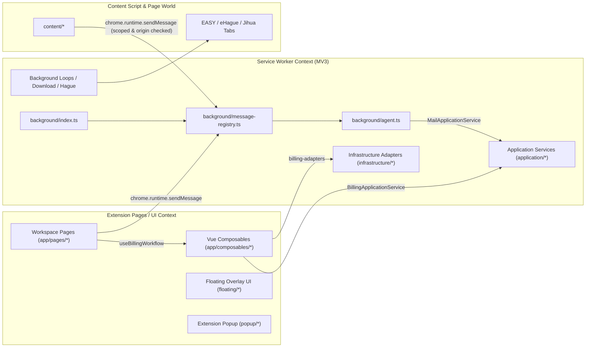

# PatMail 当前架构说明（Current Architecture）

> 基线提交：`ff3f2553d7bf677d787c1252c5d844536b2f4763`  
> 当前治理基线：`e350b99`（已完成 Phase A–F 渐进式重构与边界门禁）

## 一、Chrome Manifest V3 运行时拓扑

PatMail 是运行于浏览器侧的 Chrome Manifest V3 企业级专利协同与自动化扩展，遵循浏览器多上下文隔离模型，不引入独立常驻后端服务：

## 二、真实 AST 依赖统计对比（基线 vs 当前）

统计口径来源于扩展内真实 AST 静态扫描器 `patmail-extension/scripts/architecture/architecture-check.mjs`（区分运行时依赖与 `import type` 纯类型依赖，包含 Vue SFC `<script>`/`<script setup>` 与动态 `import()`）：

| 指标 | 基线（`17ff27d` 初扫） | 复审修复后 | 变化说明 |
| --- | --- | --- | --- |
| 扫描源码文件数（`src/`） | 493 | 516 | 新增 Application、Ports、Infrastructure、Agent 模块及网关 |
| 总导入边（`totalEdges`） | 2,159 | 2,268 | 新增端口与适配层清晰契约 |
| 内部运行时边（`runtimeInternalEdges`） | 1,538 | 1,586 | 拆分 `agent/tools/*` 与 `application/*` 带来的显式模块化边 |
| 纯类型边（`typeOnlyEdges`） | 492 | 551 | Ports / Contracts 全面优先使用 `import type` |
| 运行时循环依赖（`cycleCount`） | 0 | 0 | 保持全仓库 0 运行时循环 |
| 棘轮违规总数（`ratchetViolationIds`） | 10 | **0** | 全部清零（Billing 5 条 + Agent 5 条） |

### 按架构层分布（516 文件）

| 层级 | 文件数 | 代表目录 / 模块 |
| --- | --- | --- |
| `Presentation` | 131 | `app/`、`floating/`、`popup/`、`shell/` |
| `BusinessModule` | 208 | `customer/`、`mail/`、`workflow/`、`hague/`（编排与业务服务）、`query/`、`automation/` |
| `Infrastructure` | 94 | `background/`、`content/`、`storage/`、`browser-download/`、`infrastructure/`、`api/` |
| `Shared` | 34 | `shared/`、`utils/`、`schema/` |
| `Agent` | 27 | `agent/`（含拆分后的 `agent/tools/*`） |
| `Domain` | 12 | `domain/` 及纯计算/契约文件（如 `billing/fee-model.ts`、`hague/draft-plan.ts`、`hague/plan-identity.ts`、`hague/draft-contract.ts` 等） |
| `Application` | 10 | `application/billing/*`、`application/mail/*` |

## 三、已落地的核心架构改进

1. **Billing 应用服务化与 Ports/Adapters 隔离**：
   - 将请款流程从 `src/app/pages/BillingWorkflowPage.vue` 拆出至 `src/app/composables/useBillingWorkflow.ts` 与 `src/application/billing/billing-service.ts`；
   - 定义 `BillingTemplatePort`、`SpreadsheetPort`、`ExchangeRatePort`、`DownloadPort`、`BillingRecoveryPort` 与 6 态 `ExportOutcome`；
   - 将 `templates.ts` / `xlsx-engine.ts`（OOXML DOM 解析）、`pbc-rates.ts`、`chrome.downloads` / Blob 触发、以及 `recovery/client.ts` 封装于 `src/infrastructure/billing/billing-adapters.ts`。
2. **Agent 工具模块化与 `MailApplicationService` 收口**：
   - 拆分 `src/agent/tools.ts` 为 8 个职责明确的子模块（`src/agent/tools/contracts.ts`、`connection-tools.ts`、`case-tools.ts`、`deadline-tools.ts`、`mail-tools.ts`、`workflow-tools.ts`、`memory-tools.ts`、`documentation-tools.ts` 与 `registry.ts`），并保留 `src/agent/tools.ts` 兼容门面及已登记 ESLint 例外；
   - 由 `src/application/mail/mail-service.ts` 统一承载 `draftMail`、`checkReviewers` 与 `submitLimitMailForReview`，消除 `background/agent.ts` 对 `customer/*`、`mail/*`、`workflow/*` 的 5 条直接跨层耦合；
   - 修复并锁定 `submit_easy` schema 与 `SYSTEM_PROMPT` 对**默认审核人（`defaultReviewer`）**的契约一致性。
3. **Background 统一消息注册表与权限守卫**：
   - 新增 `src/background/message-registry.ts`，将 `AppMessage` 路由、Origin/Tab 校验、`authority` 会话变更加锁以及多通道（`DOCUMENT_EXPORT`、`HAGUE_*`、`JIHUA`、`EASY_PAGE_WORLD`）失败降级响应收敛至可单测的策略对象中；
   - `src/background/index.ts` 委托注册表执行分发，保留 MV3 Service Worker 保活与已登记安全例外。
4. **Hague 保护性执行网关**：
   - 从 `src/hague/draft-runner.ts` 导出 `DraftRunnerHost` 并新增 `src/hague/gateway.ts`（`HagueGateway`、`HagueCheckpointStorePort`、`HagueDiagnosticsPort`、`createDraftRunnerHost`），显式隔离只读 `inspect`、受保护写 `execute` 与受限恢复 `recover`，严守 `uncertain` 状态与单次重试上限；`HagueDiagnosticsPort` 仅通过 `import type` 引用 `AstAnalysis`，禁止 AST 诊断污染生产流程。
