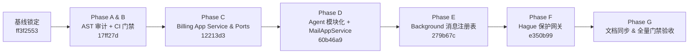

# PatMail 渐进式迁移路线图（Migration Plan）

遵循“**先审计、立门禁、加端口、切调用、留兼容、再验收**”原则，本轮架构治理分 6 个原子提交阶段推进，零大爆炸重构，全程保持已有功能、数据与测试兼容性。

## 一、分阶段实施记录（已执行）

1. **Commit 1（`17ff27d`）— Phase A & B：真实依赖图审计与自动化门禁**
   - 实现 `patmail-extension/scripts/architecture-check.mjs`，基于 TypeScript compiler AST 与 `@vue/compiler-sfc` 解析静态 import、动态 `import()`、`require`、Vue SFC 脚本块及 Chrome/DOM 全局信号；
   - 生成基线 `ci/architecture-baseline.json`（锁定初始 10 条棘轮违规与 0 循环依赖），落地 5 份架构边界 Vitest 测试并在 CI `static` 阶段强制门禁。
2. **Commit 2（`12213d3`）— Phase C：请款工作流分层重构**
   - 建立 `application/billing/ports/*`、`billing-contracts.ts`（显式 6 态 `ExportOutcome`）、`billing-validation.ts`、`billing-service.ts`、`infrastructure/billing/billing-adapters.ts` 与 `app/composables/useBillingWorkflow.ts`；
   - 重构 `BillingWorkflowPage.vue`，清空该页面全部 5 条直连基础设施/引擎的违规；保留原模板渲染与 3 类 Excel 工作簿语义。
3. **Commit 3（`60b46a9`）— Phase D：Agent 工具拆分与 `MailApplicationService`**
   - 将 `agent/tools.ts` 拆分为 `agent/tools/*` 8 个模块化文件与 `registry.ts`，保留 `tools.ts` 兼容门面及原 SHA-256 豁免注释；
   - 新建 `application/mail/mail-service.ts` 与 `mail-contracts.ts`，迁移 `background/agent.ts` 的邮件与审核调用（清零剩余 5 条 Agent 违规）；
   - 统一 `submit_easy` 工具描述与系统提示词，严格遵守默认审核人（`defaultReviewer`）契约。
4. **Commit 4（`279b67c`）— Phase E：Background 统一消息注册表**
   - 提取 `src/background/message-registry.ts`（按域拆分 `AppMessageHandler` 与 `ChannelMessageHandler`），集中负责来源域校验、账号绑定制止与通道降级回执；
   - `background/index.ts` 保持既有监听生命周期与 3 处已登记 ESLint 豁免，委托注册表执行路由。
5. **Commit 5（`e350b99`）— Phase F：Hague 保护性执行网关**
   - 导出 `DraftRunnerHost` 类型，落地 `src/hague/gateway.ts`（`HagueGateway`、`HagueCheckpointStorePort`、`HagueDiagnosticsPort`、`createDraftRunnerHost`）；
   - 通过单测验证只读/写入隔离、`uncertain` 保留、单次重试上限及 `planIdentity` SHA-256 防绕过。
6. **Commit 6 — Phase G：全套架构文档同步与全面验收**
   - 在 `docs/architecture/` 与 `patmail-extension/docs/architecture/` 同步维护 7 份 Markdown 文档与依赖清单 JSON，执行 `docs:check`、覆盖率门禁、`ci:check`、`verify:repro` 与 Playwright E2E 验证。

## 二、阶段二持续演进路径（建议）

1. **Hague → App 对话框/任务解耦**：引入 `HagueInteractionPort`，逐步替换 `hague/arbitration.ts` 与 `hague/draft-completion.ts` 对 `app/` 的直接引入。
2. **通道常量共享化**：将 `HAGUE_HTTP_CHANNEL`、`JIHUA_CHANNEL` 等从 `background/` 移至 `shared/` 契约文件，消除 UI/域文件向 `background/` 的只读常量 import。
3. **消息校验去中心化**：在 `shared/message.ts` 基础上允许各域自注册 Payload 守卫，消除中心扇出依赖。
4. **Hague 工作台 Composable 化**：参照 `useBillingWorkflow.ts` 模式为 `HaguePage.vue` 抽出 `useHagueWorkspace.ts` 与应用服务门面。
