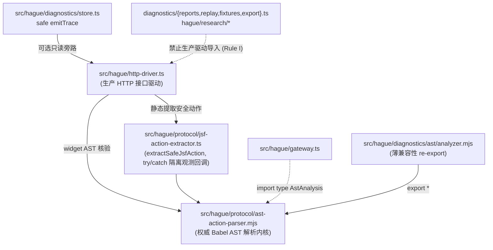

# PatMail Phase 2 海牙（WIPO eHague）协议内核与诊断边界说明（Hague Protocol Boundaries）

> 相关提交：`8b49675`、`c8a4075`

## 一、问题根源（ISSUE-B）

在 Phase 1 文档中曾声明“海牙生产驱动不得运行时导入 `diagnostics/ast/*`”，但实际扫描发现：

- `src/hague/http-driver.ts` 在运行 `jsfAction()`、`widget()` 与 `remote()` 时，直接导入了 `src/hague/diagnostics/ast/analyzer.mjs` 中的 `analyzeJavaScript`、`extractStaticActions`、`isStaticUiHandler` 与 `selectRemoteDefinition`；
- 这部分基于 Babel AST 的只读 JSF `PrimeFaces.ab(...)` / `PrimeFaces.cw(...)` / 远程句柄解析代码，实质上是生产接口链识别 JSF 静态动作、拒绝动态未知表达式（fail-closed）的**生产必需协议解析内核**，而非可移除的旁路日志功能。

## 二、准确拆分：协议解析内核 vs 旁路诊断分析

### 模块职责清单

| 文件 / 目录 | 归属边界 | 职责与隔离规则 |
| --- | --- | --- |
| `src/hague/protocol/ast-action-parser.mjs` (+ `.d.mts`) | **Protocol Kernel（Domain 纯度 + 零循环）** | 唯一的权威 Babel AST JSF 解析实现；不含重复副本；禁止 `vue` / UI / Chrome / `diagnostics/*` |
| `src/hague/protocol/jsf-action-extractor.ts` | **Protocol Kernel** | 封装 `extractSafeJsfAction`，以只读 fail-closed 模式拒绝多义控制流或动态未知表达式，并通过 `try/catch` 完全隔离诊断回调 `onAnalysis` 异常 |
| `src/hague/diagnostics/ast/analyzer.mjs` (+ `.d.mts`) | **Diagnostics Shim（只读 re-export）** | 严格仅为 `export * from '../../protocol/ast-action-parser.mjs'`，确保既有诊断脚本与研究单测继续共享同一内核 |
| `src/hague/http-driver.ts` | **Hague Production Driver** | 允许导入 `protocol/*`、`diagnostics/store.ts`（`emitTrace`）、`diagnostics/errors.ts`（`HagueDiagnosticError`）；**禁止**导入 `diagnostics/ast/*`、`diagnostics/{reports,replay,fixtures,export}.ts` 与 `research/*` |
| `src/hague/gateway.ts` | **Hague Protective Gateway** | 仅通过 `import type { AstAnalysis }` 引用 `protocol/ast-action-parser.mjs` |

## 三、Fail-Closed 与无副作用保证

由 `patmail-extension/tests/unit/hague/protocol-boundary.test.ts` 与全套 `tests/unit/hague/`（83 文件 / 537 用例）验证：

1. **单一权威内核验证**：`diagAnalyzer.analyzeJavaScript === astParser.analyzeJavaScript` 等全部 6 个导出符号引用严格同一，杜绝双实现漂移；
2. **故障隔离验证**：当 `onAnalysis` 诊断回调主动抛出异常时，`extractSafeJsfAction` 仍稳定返回准确的静态 `JsfAction`；
3. **动态未知/歧义控制流阻断**：遇 `PrimeFaces.ab({ s: window.dynamicTarget })` 或 `if (cond()) ...` 分支，立即抛出 `HagueDiagnosticError`（`diagnostic.errorCode === 'PROTOCOL_UNSUPPORTED'`），并经模拟 `HagueHttpDriver` 确认仅发起初始化 GET，零推测性 POST 写请求发出；
4. **既有 WIPO 安全不变量完整保留**：`uncertain` 状态保留、`planIdentity` SHA-256 指纹核对、Web Locks、Session Gate、Creation Pool 与单次恢复预算全部原样维持。
