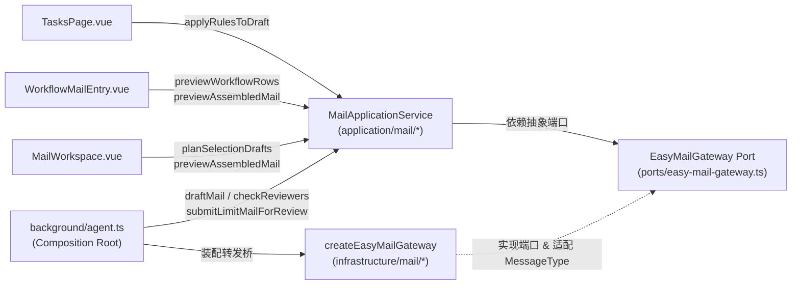

# PatMail Phase 2 发文业务入口收敛与 Port/Adapter 隔离（Mail Usecases）

> 相关提交：`b23e77f`、`a4fd686`、`c8a4075`

## 一、目标架构：UI 与 Agent 共用 `MailApplicationService`

在 Phase 1 让 Agent 与 `background/agent.ts` 收敛到 `MailApplicationService` 后，Phase 2 进一步消除了普通 UI 页面直接绕过 Application 层调用 `mail/assemble.ts`、`mail/planner.ts`、`mail/fingerprint.ts` 与 `customer/pct-recipients.ts` 的路径：

## 二、新增/收敛的应用层用例契约

位于 `patmail-extension/src/application/mail/mail-contracts.ts` 与 `mail-service.ts`：

| 用例 / 辅助入口 | 原分散调用方 | 收敛后的职责与边界 |
| --- | --- | --- |
| `applyRulesToDraft` | `TasksPage.vue` | 根据规则集与客户档案填报 `to`/`cc`/`subject`/`body` 并追加收件人 |
| `previewAssembledMail` | `WorkflowMailEntry.vue`、`MailWorkspace.vue` | 组装多封预览稿、生成 `who` 摘要并保留 `notes` 缺口说明 |
| `previewWorkflowRows` | `WorkflowMailEntry.vue` | 按 `batchPolicy: 'per_row'` 分组工作流勾选行并校验默认/显式发件箱 |
| `planSelectionDrafts` | `MailWorkspace.vue` | 为浮层选中文件生成草稿计划与去重指纹（`selectionFingerprint`） |
| `sheetDisplayName` / `usesInventorSheet` / `carriedMark` / `arbitratedMark` | `WorkflowMailEntry.vue` | 应用层纯展示包装函数（非直接透传 barrel），切断 UI 对 `customer/pct-recipients.ts` 的直连 |
| `draftMail` / `checkReviewers` / `submitLimitMailForReview` | `background/agent.ts` | Agent 与后台统一调用的草稿与限期提交审核用例 |

## 三、`EasyMailGateway` Port & Adapter 传输隔离

- **Port 契约**（`src/application/mail/ports/easy-mail-gateway.ts`）：
  - 定义纯业务领域无关传输接口 `EasyMailGateway`：`listReviewers()`、`readCaseFlow()`、`submitLimitMail()`；
  - 显式建模 `unknown` 状态（如远端响应异常/超时），严禁将未知结果降级为可重放成功/失败；
  - `src/application/mail/*` 不再导入 `shared/message.ts`、`shared/guards.ts` 或任何 `chrome.*` / MV3 消息枚举，由架构规则 Rule H 硬性保证。
- **Infrastructure Adapter**（`src/infrastructure/mail/easy-mail-gateway-adapter.ts`）：
  - `createEasyMailGateway(forward)` 封装 `MessageType.EASY_REVIEWERS`、`EASY_CASE_FLOW`、`EASY_LIMIT_SUBMIT` 与返回类型校验函数；
  - 由已登记 Composition Root `src/background/agent.ts` 装配并注入 `MailApplicationService`。

## 四、核心业务与安全语义保持验证

1. **默认审核人来源不变**：`submitLimitMailForReview` 始终从 `account.rules?.defaultReviewer?.userId` 读取审核人 GUID，绝不使用当前登录操作人 `operatorId` 替代。
2. **写开关保护不变**：`writeSwitchOpen` 关闭时直接返回 `{ ok: false, status: 'blocked' }`，不触及远端写请求。
3. **`unknown` 态不自动重试**：`EasyMailGateway` 返回 `status: 'unknown'` 时直接中止提交并原样返回状态说明，不自动重复创建或审批。
4. **测试覆盖**：`tests/unit/mail/mail-application-service.test.ts` 与 `tests/unit/mail/easy-mail-gateway-adapter.test.ts` 验证 UI/Agent 口径一致性、`defaultReviewer` 约束及传输 `unknown` 不重试语义。
