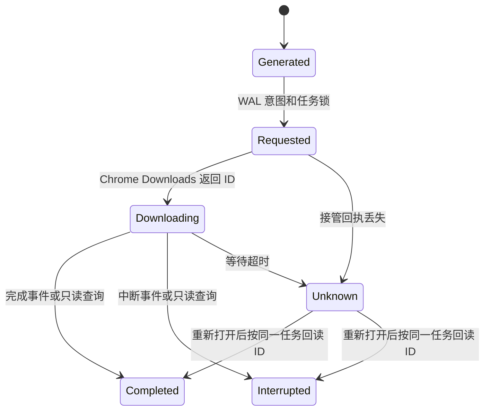

# Phase 3 请款下载生命周期

工作台扩展页创建 XLSX Blob。默认服务在 `chrome.downloads` 和 Web Locks 可用时走可核验适配器。下载意图先写入现有恢复账本。只持久化账号作用域、参数摘要、下载 ID、状态和时间。Chrome 接管后使用 `onChanged` 与 `search({ id })` 核对。

同作用域和相同导出参数再次操作时，待确认任务只回读。已完成回执在 24 小时内复用。明确中断后可重新发起。不同参数使用不同任务键。页面还存活时在终态等待结束后释放 Blob URL，页面销毁则由浏览器释放文档内的 URL。无完整 API 的环境仍走锚点下载，只标记已发起。

隔离 Chromium 测试验证了 PCT 和歌尔工作簿的实际文件名、Chrome 完成回执、文件内容以及相同任务不重复下载。测试 profile 使用独立下载目录和 Chromium 默认命名，日常 Chrome 配置未参与。

无 ID 的未知意图仍需人工核对，本轮未提供自动推断或重试入口。回读在用户再次打开相同导出任务时触发。
