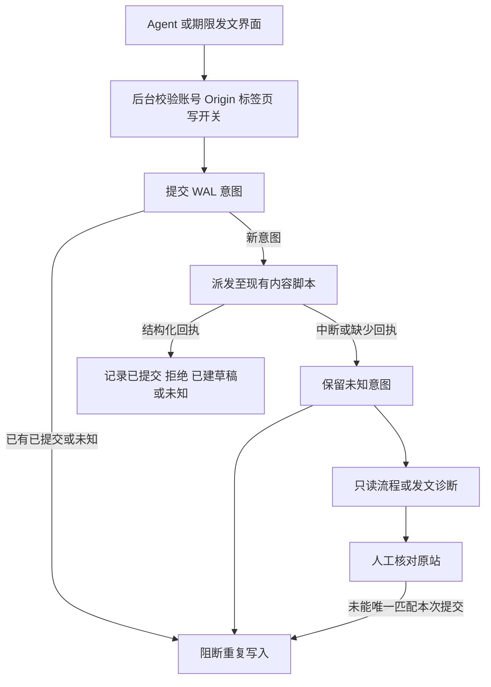

# Phase 3 EASY 写入回执

期限发文由后台在绑定账号、Origin、标签页和写开关有效时派发。派发前用已有 SQLite WAL 提交意图。新记录使用后台专用 `limit-mail-intent` 槽位与版本化账号作用域，保留事项 ID、状态、时间和可用的邮件 ID。历史页面账本仍使用原槽位作用域。新意图不存正文、联系人地址、Cookie 或模型凭据。

有已确认提交回执的事项，需要再次发文时，由后台重新读取并匹配事项的原站流程。只在流程允许时接受用户发起的一次新提交。未知事项持续阻断。回执明确给出可继续的草稿 ID 时，原流程使用同一 ID 继续。桥接中断、未识别回执和账号变化后的回执均保守处理。写请求不会触发内容脚本重注入后的自动转发。

单凭事项的当前流程门禁无法证明某次请求实际产生了哪封邮件。只读诊断可给人工核对提供证据，当前没有在缺乏唯一匹配的情况下自动解除未知意图。
