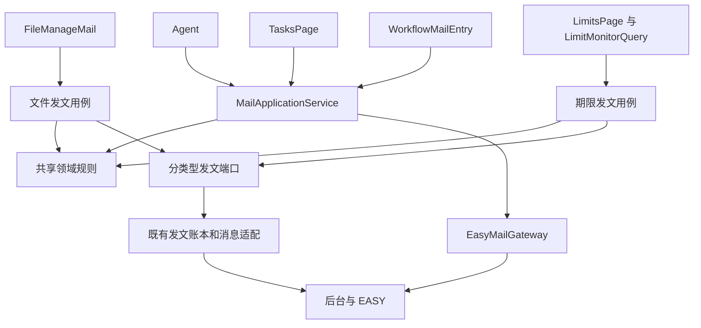

# Phase 3 发文入口

文件管理用例组装发件人、签名和文件清单，并保持每批 20 封上限。期限用例按事项分组，每封发送前使用界面传入的最新只读门禁。二者共用原来按封并发的执行池，以各自的中止条件收尾。

工作台组合根装配兼容适配器。适配器复用原 runFileManageSubmit 和 runLimitMailSubmit，保留既有回执、重用草稿与历史账本格式。Vue 保留确认、选择、进度和表格展示。期限界面只从结构化的已提交事项回执清除勾选。

首页通过只读账本查询入口读取统计。规则页直接引用规则管理模块。悬浮文件面板直接引用纯绑定逻辑。
