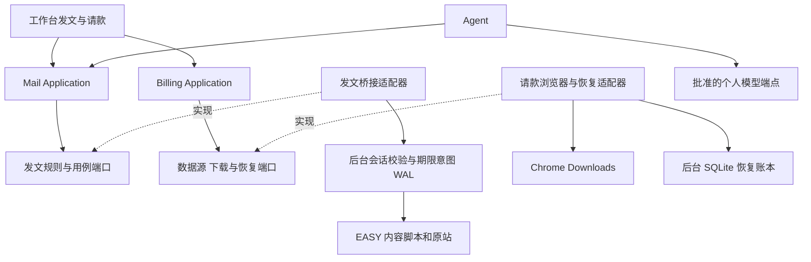

# PatMail Phase 3 迁移结果

发文迁移保留文件与期限各自的回执、模板和分组规则。请款由 Chrome 下载 ID 核对终态。Agent 将批准的模型端点作为单一数据出口。海牙继续使用原有恢复路径。

| 模块 | 迁移证据 |
| --- | --- |
| EASY | [派发、回执、WAL 与人工核对](phase3-easy-write-safety.md) |
| Billing | [下载接管、终态与回读](phase3-billing-download-lifecycle.md) |
| Mail | [多入口和领域端口](phase3-mail-usecases.md) |
| Agent | [凭据、模型端点与数据出口](../security/agent-model-security.md) |
| 质量门禁 | [架构规则](phase3-architecture-rules.md) |
