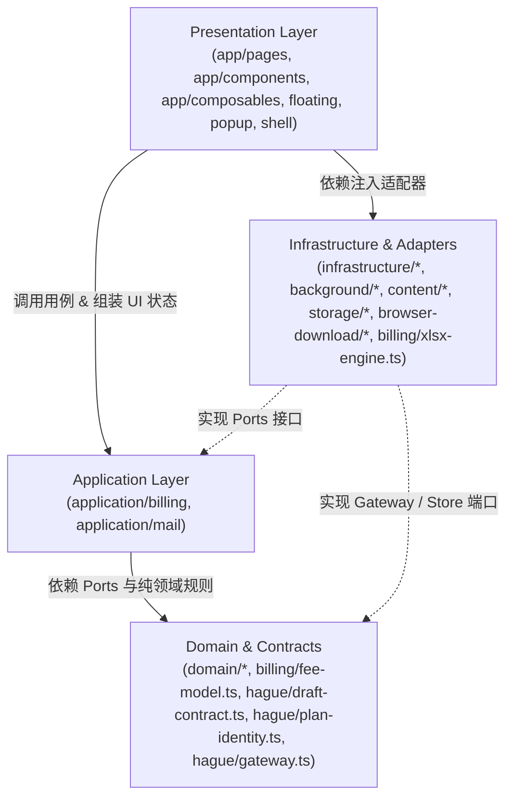

# PatMail 目标架构说明（Target Architecture）

本架构以 Clean Architecture / Ports & Adapters 为核心约束，结合 Chrome Manifest V3 多运行时隔离特性，定义依赖方向与关键业务边界：

## 一、分层依赖规则与目标结构

### 核心模块职责划分

| 模块 / 文件 | 目标分层 | 判定依据与职责边界 |
| --- | --- | --- |
| `src/billing/fee-model.ts` | **Domain（纯领域）** | 纯请款费用计算与金额校验，不触及 DOM/Chrome/网络 |
| `src/billing/xlsx-engine.ts` | **Infrastructure（OOXML 引擎）** | 真实使用 `DOMParser`、`XMLSerializer`、`document` 与 ZIP XML 解析生成三类工作簿 |
| `src/application/billing/billing-service.ts` | **Application（用例编排）** | `BillingApplicationService`，编排表单校验、模板填报、汇率、下载与历史恢复；严格仅依赖端口契约 |
| `src/infrastructure/billing/billing-adapters.ts` | **Infrastructure（适配器）** | 适配模板资产、`xlsx-engine`、中国人民银行汇率抓取、浏览器/Chrome 下载与恢复客户端 |
| `src/app/composables/useBillingWorkflow.ts` | **Presentation（组合逻辑）** | 持有页面响应式状态，向 `BillingApplicationService` 注入运行时适配器 |
| `src/application/mail/mail-service.ts` | **Application（用例编排）** | `MailApplicationService`，统一 `draftMail` / `checkReviewers` / `submitLimitMailForReview` 与卷号解析 |
| `src/agent/tools/*` | **Agent Tools Adapter** | 将 16 个工具拆分为按域聚合的模块，`tools.ts` 保持兼容外观（Facade） |
| `src/background/message-registry.ts` | **Background Application Boundary** | 按域拆分的 `AppMessageHandler` 与 `ChannelMessageHandler` 注册表 |
| `src/hague/gateway.ts` | **Protocol Gateway Boundary** | `HagueGateway`、`HagueCheckpointStorePort` 与 `createDraftRunnerHost`，强制隔离 `inspect` / `execute` / `recover` |

## 二、业务语义与导出状态契约

### 1. 请款导出结果 6 态显式模型（`ExportOutcome`）

位于 `patmail-extension/src/application/billing/billing-contracts.ts`：

- `generated`：工作簿已在内存生成，等待下一步下载或交接
- `download_started`：已触发浏览器 Blob/A 标签或下载接管，但真实落盘尚未被浏览器 API 终态确认
- `download_completed`：经后台 Chrome 下载状态轮询确认为 `complete` 终态（含 `downloadId`）
- `download_interrupted`：下载已明确中断（`interrupted`），向用户返回失败原因而不误报完成
- `unknown`：超时或状态未确认，保留现场且不重复触发无幂等副作用
- `failed`：校验失败、模板缺失或生成异常导致无法产生产物

### 2. 海牙（WIPO eHague）状态保护契约

- **`uncertain` 不自动重放写操作**：任何无法确认远端状态的提交保持 `uncertain`，交由只读 `recover` 核对；
- **`planIdentity` SHA-256 指纹不可绕过**：仅尚未执行的未来步骤允许变更并附警告恢复；当前或已执行步骤变更直接拒绝恢复；
- **单次重试预算上限**：经 `recoveryAttempts` / `recoveryRetries` 持久化计次，同一失败步骤最多重试一次；
- **AST 诊断纯旁路约束**：`HagueDiagnosticsPort` 仅使用 `import type { AstAnalysis }`，生产流程（`draft-runner.ts`、`http-driver.ts` 等）严禁运行时引入 `hague/diagnostics/ast/*`。

## 三、自动化架构门禁（CI Enforced）

由 `patmail-extension/scripts/architecture-check.mjs` 与 `patmail-extension/tests/architecture/` 自动强制执行（见 `ci.yml` 与 `ci:check`）：

- **Rule A (`A-domain-purity`)**：Domain 模块零 Vue / Presentation / Background / Content / DOM / Chrome API 运行时依赖；
- **Rule B (`B-application-no-ui`)**：`application/*` 严禁依赖 `.vue` 或 Presentation 模块；
- **Rule C (`C-agent-through-application`)**：`agent/*` 与 `background/agent.ts` 严禁绕过 `MailApplicationService` 直接导入发文/审核人/邮编提交模块；
- **Rule D (`D-presentation-no-direct-infra`)**：`BillingWorkflowPage.vue` 严禁直接导入 Excel 引擎、汇率客户端或恢复基础设施；
- **Rule E (`E-no-cycles`)**：核心目标模块间严格保持 0 运行时循环依赖；
- **Rule F (`F-runtime-isolation`)**：MV3 `background/` 与 `content/`/`*.vue` 双向隔离，且海牙生产编排与 AST 诊断分析器运行时隔离。
