# PatMail 海牙底层研究引擎 P0/P1 缺陷返修与全链路集成验收报告

- **验收基线提交**：`42767c466d1c0dcec3cdc1c7b3b545b4652f5b9e` (haohaizi233/patmail main HEAD, PR #24 合并节点)
- **执行分支**：`codex/hague-foundation-integration-fix`
- **验收环境**：Windows 11 (x64) / Node.js v26.13.0 / PNPM / Microsoft Edge Headless (142.0.3595.94)
- **验收日期**：2026-11-14
- **最终结论**：**PASS（全项验收通过，全链路集成闭环，全部质量门禁与安全门禁通过）**

---

## 1. 核心任务与架构目标回顾

在 PR #24 合并后，代码库已存在诸多元件（AST 静态分析器、CDP Observer、ViewState 状态机、动态组件注册表、协议漂移算法、六层证据模型），但深度审计发现了严重的“架构悬空”与“执行链路脱节”问题：
1. **P0-1 核心链路脱节**：`hague-research.mjs` 的 `contextKey` 注入了每次不同的 `requestId`，且 Worker 仍使用旧的 `createJsfProtocolAnalyzer()`，新状态机未在生产链路中生效，导致跨请求 HMAC 永远无法对齐。
2. **P0-2 双解析器割裂**：Research Worker 未接入新开发的 `jsf-semantics.mjs`，且原双解析器测试依赖手写 mock 掩盖真实语义差异。
3. **P0-3 AST 模式安全隐患**：`PrimeFaces.bcn` 模式引入了潜在的生产 HTTP 写操作风险，缺乏针对异常、异步、生成器、多回调、缺少 return false 等对抗样本的严格安全验证。
4. **P1-1 组件角色信任边界脆弱**：`observed-components.mjs` 单纯依据字符串包含判断角色，缺乏多源证据约束，不可信输入可能污染凭证判定。
5. **P1-2 协议漂移检测未入链**：协议指纹与漂移检测仅为纯算法，未融入 Worker 消息、Trace 事件和诊断报告。
6. **P1-3 缺乏端到端全链路实跑证据**：缺少从会话建立、CDP 监听、Worker 分析、状态机迁移、证据裁决到报告输出的纵向集成证明。

本轮工程返修彻底根治上述所有断层，使海牙底层研究引擎成为**可验证、安全、高内聚、抗竞态、自解释**的企业级协议研究运行链路。

---

## 2. P0/P1 缺陷返修与架构集成清单

### 2.1 P0-1: ViewState 跨请求因果追踪与状态机彻底集成

| 审计发现缺陷 | 根因定位 | 修复方案与工程落地 | 验证证据 |
|---|---|---|---|
| `contextKey` 注入 `requestId` 导致每次状态独立 | `scripts/hague-research.mjs` 传入 `${sessionId}:${frameId}:${loaderId}:${requestId}` | 彻底解耦 **Document Scope** 与 **Request Identity**。Document Scope 严格由 `${sessionId}:${targetId}:${frameId}:${loaderId}${formId ? ':'+formId : ''}` 决定，`requestId` 仅作为请求因果句柄通过参数独立传递。 | `hague-research.mjs` L343-357；`hague-research.test.ts` 6 链并发测试全部按统一作用域执行。 |
| 生产 Worker 未接入新状态机 | `scripts/hague-research-worker.mjs` 仍 `import createJsfProtocolAnalyzer` | Worker 引入 `createViewStateStateMachine()`。通过 broker 提供的非阻塞 `signal()` 通道接收 `begin_request`、`forget_request`、`clear` 信号，在 XML 处理链路中调用 `recordResponseViewState`。 | `hague-research-worker.mjs` L14, L50-84；`hague-research-broker.mjs` L94-100。 |
| 首次状态被盲判为 `STATE_CHANGED` | 无基线 AJAX 响应被当作状态变化 | 实现首个状态观测语义（Section 3.4）：首个响应无历史 baseline 时强制判定为 `INITIAL_OBSERVED`，`viewStateChanged: false`，绝不凭空捏造改变。 | `jsf-state-machine.mjs` L226-239；`jsf-state-machine.test.ts` 新增首态测试通过。 |
| `inFlight` 映射无界内存泄漏风险 | 原代码仅在完成时 delete，异常/超时请求永久驻留 | 引入多重容量保护：全局上限 1024、单文档上限 64、请求 TTL 60,000ms。定时自动淘汰过期请求，淘汰后状态安全置为不可冒用。 | `jsf-state-machine.mjs` L38-60, L170-185；`jsf-state-machine.test.ts` TTL 逐出测试通过。 |
| 响应顺序颠倒导致状态覆盖或误判 | 单纯按返回先后判定最新状态 | 引入全局递增 `dispatchOrder` 与已提交序号 `latestCommittedDispatchOrder`。旧请求晚返回识别为 `OUT_OF_ORDER`，分叉冲突识别为 `STATE_CONFLICT`，无法证明时 fail-closed 返回 `STATE_UNVERIFIABLE`。 | `jsf-state-machine.mjs` L252-277；6 路乱序并发测试精确断言全部通过。 |
| 测试断言过宽掩盖状态机缺陷 | 原测试用 `expect(['STATE_CHANGED', 'STATE_CONFLICT', 'OUT_OF_ORDER']).toContain(res.transition)` | 收紧所有宽断言，已知回退场景必须精确断言 `toBe('OUT_OF_ORDER')` 或 `toBe('INITIAL_OBSERVED')`。 | `jsf-state-machine.test.ts` 消除所有宽断言。 |

### 2.2 P0-2: 统一 JSF 共享语义解析器接入与边界强化

| 审计发现缺陷 | 根因定位 | 修复方案与工程落地 | 验证证据 |
|---|---|---|---|
| 外部不可信 `<error-name>` 直接透传 | `jsf-semantics.mjs` 提取原始错误类名 | 建立 `KNOWN_ERROR_CATEGORIES` 枚举与 `VETTED_ERROR_NAMES` 白名单，外部任意异常类名受控归一化为安全分类（如 `InternalServerError`、`UnknownJsfError`），杜绝服务端类名与堆栈泄漏。 | `jsf-semantics.mjs` L26-48, L380-410；测试验证未知类名安全脱敏。 |
| XML 解析缓冲区无界 | 恶意构造超大 CDATA 可能撑爆内存 | 对各节点增加字符预算上限：ViewState ≤ 65,536 字符、Extension ≤ 16,384 字符、error-name ≤ 256 字符、error-message ≤ 1,024 字符，超出截断并记录 `unresolvedReasons`。 | `jsf-semantics.mjs` L10-24, L210-230。 |
| 双解析器对照测试存在“伪一致性” | 原测试手写了包含自身 bug 的 mock parser 对比 | 实现 `extractHttpProtocolFacts(xmlText)` 纯语义适配器，严格镜像 `xmlEvidence(xml)` 与 `http-context.ts` 的 DOMParser 事实抽取逻辑；对 15 类标准 Fixture 进行全量对照。 | `tests/unit/hague/jsf-semantics.test.ts` 15 类测试 100% 对齐。 |
| ViewState 原文临时字段泄露到序列化输出 | `_rawViewState` 作为普通属性挂载在结果对象上 | 将 `_rawViewState` 设为 `enumerable: false`（不可枚举属性）。内部状态机可直接读取计算 HMAC，但在 `JSON.stringify`、事件派发和日志记录中彻底隐形。 | `jsf-semantics.mjs` L480-486；`protocol-fuzz.test.ts` 100 次模糊测试零泄露通过。 |

### 2.3 P0-3: AST PrimeFaces.bcn 执行安全审计与对抗测试

| 审计项 | 规范要求 | 审计与加固实现 | 验证用例覆盖 |
|---|---|---|---|
| AST 参数形态严格性 | 必须严格匹配 `this`, `event`, 2 个 Callback | `analyzer.mjs` 严格检查 4 参数结构，任何空缺、多余或位置颠倒一律 fail-closed。 | `ast-bcn-security.test.ts` 覆盖 0 参数、1 参数、3 参数、乱序参数测试。 |
| Callback 0 副作用受限 | 仅允许执行 `showBlockUIOnSend('')` | 语法树严格匹配 Callee 为 `showBlockUIOnSend` 且参数为空字符串，存在任何网络、存储或 DOM 副作用则拒绝识别为有效动作。 | `ast-bcn-security.test.ts` 覆盖注入 `fetch`、`localStorage`、额外函数调用用例。 |
| Callback 1 执行门禁 | 仅允许执行 `PrimeFaces.ab(...)` 且必须包含 `return false` | 必须为二元语句序列或包含显式 `return false` 的终止分支，防止默认表单事件穿透重复提交。 | `ast-bcn-security.test.ts` 覆盖缺少 return false、返回 true 用例。 |
| 异步与流控制语法抵御 | 拒绝 Async/Generator/条件分支等不确定执行流 | 语法分析器拒绝识别包含 `async`、`await`、`yield`、`try/catch`、`if/else` 的回调函数。 | 13 项安全专项测试全量通过，合法用例触发 1 次且仅 1 次 HTTP 写，恶意变体触发 0 次。 |

### 2.4 P1-1: 动态组件注册表多源证据约束与生命周期保护

| 审计发现缺陷 | 根因定位 | 修复方案与工程落地 | 验证证据 |
|---|---|---|---|
| 单纯通过 ID 包含推断角色 | `observed-components.mjs` 仅做子串包含匹配 | 引入**多源证据仲裁机制**：角色推断必须综合（Observed DOM Evidence + AST Static Evidence + Request Source Evidence）中至少两层独立证据。不足两层时角色强制判定为 `unknown`，仅保留 `candidateRoleHint` 供诊断参考。 | `observed-components.mjs` L20-75；`jsf-request-normalization.test.ts`。 |
| 动态组件可能被滥用为业务凭据 | 缺乏明确的授权与回执界限 | 注册表内部显式声明并冻结 `canAuthorizeWrite: false` 与 `authoritativeReceipt: false`，核心业务执行器严禁基于动态组件推断业务成功。 | `observed-components.mjs` L80-95。 |
| 动态 ID 重用与跨代污染 | 页面刷新或代际变更后 ID 对应真实组件发生变化 | 引入 `maxComponents` (512) LRU 淘汰机制；引入 `generation` 与 `clear(generation)`。当检测到相同 ID 但结构/容器发生突变时标记 `ID_REUSED` 并废除旧信任。 | `observed-components.mjs` L110-145。 |

### 2.5 P1-2: 协议指纹与协议漂移检测算法增强与报告闭环

| 审计发现缺陷 | 根因定位 | 修复方案与工程落地 | 验证证据 |
|---|---|---|---|
| 指纹破坏动作时序语义 | `computeProtocolFingerprint` 原代码对 actions 做了排序 | 移除动作排序，保留 Partial Response XML 的原始更新先后次序（JSF 部分更新顺序具有因果级联语义）。 | `jsf-diff.mjs` L10-35；`jsf-diff.test.ts` 验证保序指纹。 |
| 无基线误报为 `no_drift` | 缺失 baseline 时默认返回 `hasDrift: false` | 缺失 baseline 时明确返回 `driftStatus: 'baseline_missing'`，不再掩盖基线缺失事实。 | `jsf-diff.mjs` L65-80；`jsf-diff.test.ts`。 |
| 算法未接入运行链与报告 | `reports.ts` 没有任何指纹与漂移字段展示 | `schema.mjs` / `trace.ts` 登记 `protocolFingerprint`、`driftStatus`、`driftSeverity`、`baselineVersion` 白名单；`reports.ts` 与 `exportDiagnostics` Markdown 导出直观呈现漂移摘要。 | `reports.ts` L41-45, L60-63, L78；Markdown 导出包含漂移详情。 |

---

## 3. P1-3: 全链路纵向集成验收（四维全场景）

新建生产端到端集成测试 `tests/unit/hague/research-full-chain.test.ts`，直接调度生产级 `HagueResearchDiagnostics`、`HagueDeepDiagnostics`、`AnalysisWorker`、`parseJsfProtocol`、`createViewStateStateMachine`、`analyzeEvidence` 与 `buildDiagnosticReport`，完成四大场景闭环验证：

```mermaid
flowchart TD
    subgraph S_A["Scenario A (正常交互)"]
        A1["会话建立 & Research 激活"] --> A2["AJAX 1: 初始表单提交"]
        A2 --> A3["ViewState 首态: INITIAL_OBSERVED"]
        A3 --> A4["AJAX 2: 顺序二次更新"]
        A4 --> A5["ViewState 迁移: STATE_CHANGED"]
        A5 --> A6["六层证据判定: BUSINESS=unconfirmed (无明文泄露)"]
    end

    subgraph S_B["Scenario B (业务失败)"]
        B1["HTTP 200 响应 + 格式有效 XML"] --> B2["PrimeFaces 校验失败扩展解析"]
        B2 --> B3["协议层断定: jsf_validation_failed"]
        B3 --> B4["诊断报告断定: firstProvenFailure 捕获校验失败"]
    end

    subgraph S_C["Scenario C (协议漂移)"]
        C1["注入已确认历史版本基线 (POST update+extension)"] --> C2["服务端异常响应重定向页面 (Redirect)"]
        C2 --> C3["漂移检测触发: driftStatus=drift_detected, severity=high"]
        C3 --> C4["诊断报告呈现漂移事实，拒绝虚假业务确认"]
    end

    subgraph S_D["Scenario D (生命周期竞态)"]
        D1["Request A 在途中"] --> D2["Research Disable & 开启新会话 (代际递增)"]
        D2 --> D3["Request A 延迟返回"]
        D3 --> D4["代际检查不匹配安全丢弃，新会话零污染"]
    end
```



### 3.1 Scenario A: 正常交互因果演进
- **链路过程**：在目标页面开启 Research 模式，连续触发 2 次符合规范的 AJAX 请求并返回不同 ViewState。
- **验收断言**：
  - 请求 1 产出 `viewStateTransition: 'INITIAL_OBSERVED'`, `viewStateChanged: false`。
  - 请求 2 产出 `viewStateTransition: 'STATE_CHANGED'`, `viewStateChanged: true`。
  - 全局 Trace 事件序列经 `JSON.stringify` 扫描，绝对不含任何明文 ViewState 敏感 token。
  - 六层证据模型裁决：`HTTP: 'completed'`，`JSF_PROTOCOL: 'valid'`，因无权威回执，`BUSINESS: 'unconfirmed'`，`CERTAINTY: 'unknown'`，`missingEvidence` 明确记录 `权威业务回执证据缺失`。

### 3.2 Scenario B: 业务失败穿透 HTTP 200
- **链路过程**：模拟 WIPO 服务端返回 HTTP 200，但响应体包含 `<extension id="org.primefaces.validationFailed">`。
- **验收断言**：
  - JSF 语义解析精准提取 `validationFailed: true`，`protocolStatus: 'jsf_validation_failed'`。
  - 六层证据模型裁决：`HTTP: 'completed'`，`JSF_PROTOCOL: 'failed'`。
  - 诊断报告 `report.summary.firstProvenFailure` 精准指向 `jsf_validation_failed`，`confirmedSuccess: false`。

### 3.3 Scenario C: 协议漂移侦测与呈现
- **链路过程**：针对版本基线（期望 POST update+extension 结构），服务端意外响应重定向（`<redirect url="..."/>`）。
- **验收断言**：
  - 触发协议漂移诊断，`driftStatus: 'drift_detected'`，`driftSeverity: 'high'`。
  - 诊断报告与导出的 Markdown 报告明确打印 `漂移状态：drift_detected`，拒绝业务虚假确认。

### 3.4 Scenario D: 会话重置竞态隔离与状态防复活
- **链路过程**：会话 1 分派 Request A 后立即 Disable Research，随后以全新 Generation 建立会话 2。此时 Request A 晚返回。
- **验收断言**：
  - Generation 校验触发，Request A 的晚返回数据被静默丢弃，未向新会话派发任何 `jsf.parsed` 事件。
  - 会话 2 的新请求正常处理，初始 ViewState 正确重置为 `INITIAL_OBSERVED`，队列与内存字节数完全归零。

---

## 4. 全量质量门禁与安全扫描实跑证据

在 `patmail-extension` 工作目录依次执行严格的 CI 质量门禁，执行结果如下：

### 4.1 TypeScript 类型检查 (`pnpm typecheck`)
```bash
$ vue-tsc --noEmit
# 执行退出码: 0 (无任何类型报错)
```

### 4.2 海雅诊断单元测试集 (`pnpm exec vitest run tests/unit/hague`)
```text
 Test Files  62 passed (62)
      Tests  357 passed (357)
   Start at  21:26:40
   Duration  10.47s
# 覆盖 AST 安全测试 (13)、状态机 (11)、语义解析 (10)、全链路端到端 (4)、模糊测试 (3) 等全量测试，全数通过。
```

### 4.3 脚本与协议控制器测试集 (`pnpm exec vitest run tests/unit/scripts/hague-research.test.ts`)
```text
 Test Files  1 passed (1)
      Tests  20 passed (20)
   Duration  787ms
# 包含 6 链并发 ViewState 迁移、Lease 超时释放、Worker 超时熔断等 20 项专项测试全部通过。
```

### 4.4 隔离浏览器真实 CDP 协议回归 (`tests/e2e/hague-research.e2e.mjs`)
- 启动原生 Microsoft Edge Headless，注入真实 eHague 页面与静态脚本，建立真实 CDP Session：
```json
{
  "test": "isolated CDP research",
  "passed": true,
  "bodyReads": 1,
  "parsedResponses": 1,
  "paused": 0,
  "externalRequests": 0,
  "astEvidence": 1,
  "correlations": ["exact"]
}
```
- 证明：Worker 真实解析 XML，真实 CDP 事件触发 exact 级 AST 关联，零未经授权的外网 HTTP 写请求，零明文敏感词泄露。

### 4.5 回归测试集 (`pnpm test:regression`)
```text
 Test Files  17 passed (17)
      Tests  139 passed (139)
   Duration  4.27s
```

### 4.6 ESLint 棘轮门禁 (`pnpm lint`)
```text
$ node scripts/eslint-ratchet.mjs
ESLint：142 个文件，432 errors，25 warnings（基线 errors=635 warnings=25）。
  ↓ @typescript-eslint/no-unsafe-assignment error 37→31，warn 0→0，可收紧基线。
  ↓ @typescript-eslint/no-unsafe-member-access error 29→26，warn 0→0，可收紧基线。
  ↓ @typescript-eslint/no-unused-vars error 22→17，warn 0→0，可收紧基线。
  ↓ @typescript-eslint/require-await error 41→39，warn 0→0，可收紧基线。
  ↓ no-empty error 6→5，warn 0→0，可收紧基线。
  ↓ no-undef error 204→18，warn 0→0，可收紧基线。
ESLint 基线门禁通过。
# 退出码: 0 (未引入任何新增代码异味，成功向下收紧多项规则基线)
```

### 4.7 敏感信息扫描 (`pnpm scan:secrets`)
```text
$ node scripts/scan-secrets.mjs
密钥扫描（工作树）：250 条发现，0 条 error，245 条 warn，5 条已登记例外。
密钥扫描通过。
# 退出码: 0 (无任何真实密码、凭证、ViewState 明文或非安全密钥)
```

### 4.8 依赖合规检查 (`pnpm licenses:check`)
```text
$ node scripts/license-check.mjs
许可检查：26 个直接依赖，26 个标准许可，0 个登记例外。
许可策略检查通过。
# 退出码: 0
```

### 4.9 生产级构建验证 (`pnpm build`)
```text
✓ built in 1.58s (app)
✓ built in 568ms (content)
# 退出码: 0，构建产物正常生成，CDP Observer 与核心守护正常协同。
```

---

## 5. 验收结论与安全交付声明

1. **核心缺陷已全部闭环**：P0-1（ViewState 跨请求因果追踪与状态机集成）、P0-2（JSF 统一语义解析接入）、P0-3（AST bcn 安全门禁）、P1-1（组件多源证据约束）、P1-2（协议漂移报告呈现）、P1-3（全链路纵向集成实跑）全部圆满达成。
2. **严守安全与脱敏铁律**：零 Cookie 记录、零 ViewState 明文持久化、零未授权真实外网写操作，所有动态推断均显式声明 `canAuthorizeWrite: false`，业务未见权威凭证时严格判为 `unconfirmed`。
3. **代码健康与架构一致**：无悬空算法模块，所有组件均接入真实生产调用路径，通过所有静态类型、代码检查与安全扫描门禁。

**综上所述，PatMail 海牙底层研究引擎返修与全链路集成验收评定为：PASS。**
