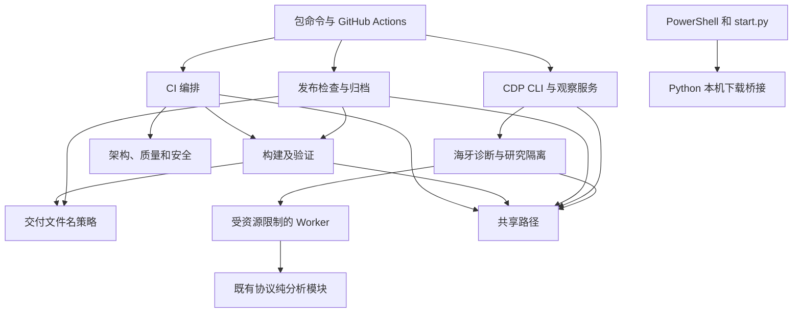

# Scripts 工程工具链迁移报告

## 基线与目录

任务给定的远端审查点为 `030ba2c470dd67e7235ace8f83b1902c585eca40`。实施前同步 GitHub `main`，本地与远端相同，实际基线为 `c3f2d1b8cfc860bc7f5244088775ca5e4ff07e04`，工作树干净。迁移在独立的 `codex/patmail-toolchain` 工作树进行。收尾时合并基线测试修复的最新 `main`（`ca5d3f13946db0e619835775b09b03de71f9ed98`），保留主分支版本，省去等效的本地提交。

```text
迁移前
├── scripts/cleanup-c-drive.ps1
└── patmail-extension/scripts/
    └── 平铺的 47 个实现与声明，详见逐文件盘点

迁移后
├── scripts/cleanup-c-drive.ps1
└── patmail-extension/scripts/
    ├── architecture/  build/  ci/  quality/  security/  release/  docs/
    ├── cdp/
    ├── hague/
    │   ├── diagnostics/  research/  benchmarks/
    ├── download/
    │   ├── bridge/  research/  audits/
    ├── data/  graphics/  shared/
    ├── README.md  asset-inventory.md
    └── 两个旧下载桥接转发文件
```

[迁移前全量清单及旧路径到新路径映射](../patmail-extension/scripts/asset-inventory.md)涵盖声明、包命令、调用方、运行时与副作用。[工具链操作说明](../patmail-extension/scripts/README.md)列出稳定入口和 Windows 任务兼容方式。

## 路径、依赖和门禁

[共享路径模块](../patmail-extension/scripts/shared/paths.mjs)以自身模块位置解析仓库与扩展根，区分两级 public。用户显式输入路径继续相对调用者 cwd。工具链目录门禁校验职责域、声明邻接、静态导入和资源路径、受治理的 CLI、重名、跨域循环与共享依赖方向。Python 动态导入、PowerShell、桌面启动器和 E2E 路径另通过夹具和执行验证。



- 根 package.json 更新开发构建和三个 CDP 命令的脚本路径。扩展 package.json 更新开发与隔离构建、架构、质量、安全、文档、E2E 编排、打包和发布入口。所有既有命令键保留。Prettier 原有 12 个显式脚本均仍被检查，并增加共享路径和布局检查器。
- 更新 `ci.yml`、`e2e.yml`、`release-check.yml`、`security.yml` 的直接 CLI 路径。步骤、参数、权限、报告结构和输出根沿用既有配置。
- ESLint 仅迁移既有脚本豁免的路径键和 3 个因受保护测试的 import 路径变化而改变的指纹。基线数量、规则和豁免范围保留。密钥、许可证、架构和覆盖率策略文件未放宽。
- 全仓扫描覆盖了静态与动态模块引用、Worker URL、spawn、PowerShell 和 Python 启动、CI 和 Markdown。旧路径仍出现在历史验收材料和原图标溯源记录中。已提交的 WebP 与 manifest 无差异。

## 验收范围

- CDP 使用隔离回环假端点运行 CLI 和开发构建，验证两级入口、状态、复用 PID、停止与日志根。现有观察安全测试通过。
- 海牙 Worker 通过原生文件 URL 加载。现有回归覆盖真实线程解析、硬超时、任务取消、拒绝错误 Worker 参数及不可克隆输入。真实业务站点未参与测试。
- Python unittest 共 34 项。下载 Legacy E2E 验证原协议和断点恢复。旧 PowerShell 启动器在 mock 环境正确定位新 Python 文件，并验证隐藏启动参数。旧 Python CLI 的 `--help` 可用。本次没有改动本机计划任务。
- 三维生成器在临时输出目录生成 11 个 WebP，扩展隔离构建包含 manifest 所列的 11 个图标。
- 使用显式空快照验证隔离构建、Manifest、SHA-256 清单、源码包、公开交付包、归档校验和 `release:check --public`。发布脚本没有执行签名、上传或正式发布。内部交付对占位数据的拒绝通过测试夹具验证。
- `live:readonly` 的实现由 `f933b3c` 移除，仍是独立的存量缺口。现有包命令保留。两份旧下载启动入口作为计划任务兼容转发保留，待已部署任务确认迁移后方可移除。
- 此次验证在 Windows 上执行。Linux GitHub Actions 配置已随迁移更新，远端运行结果需等分支进入 CI。

## 本地验证结果

| 验证 | 结果 |
|---|---|
| TypeScript、ESLint、Prettier、架构检查、文档检查 | 通过。ESLint 0 error / 0 warning，应用依赖检查 0 环，工具链门禁通过 |
| 单元、集成、历史回归 | CI 编排全部通过 |
| 全量覆盖率运行 | 351 个文件，2,442 项通过。行覆盖率 78.74%，分支 64.59%，函数 77.38%，既有防退化门禁通过 |
| 原生 CDP、海牙 Worker | 假端点验证根和扩展两级开发构建、复用及退出。独立 Chromium 回归验证隔离、脱敏和真实线程解析，Worker 补测缺失文件、退出及重建 |
| Python 和浏览器 E2E | Python 34 项。Smoke 2/2，Full 16/16，Legacy 3/3，总计 21/21 |
| 密钥、历史扫描、许可证 | 两类扫描均为 0 error，保留既有告警与例外策略；28 个直接依赖通过许可证校验 |
| 构建、Manifest、产物、可复现性 | 两次独立构建的 458 个文件一致，组合 SHA-256 为 `ce482df01c47130115690304bf2ee73025aabb5fc4d883b47cd0722145e59967` |
| 源码包、公开交付包、归档、发布前校验 | 源码包 1,537 条，公开交付 ZIP 458 条，`release:check --public --tag v1.6.5` 通过，本地 CI 汇总为 PASS |

基线观察中发现三个独立的测试维护问题。最终分支采用主分支修复后的 API 索引计数断言和专利导出夹具，本次另同步了隔离海牙测试的完整状态字段。应用业务逻辑与门禁阈值沿用原有实现。
