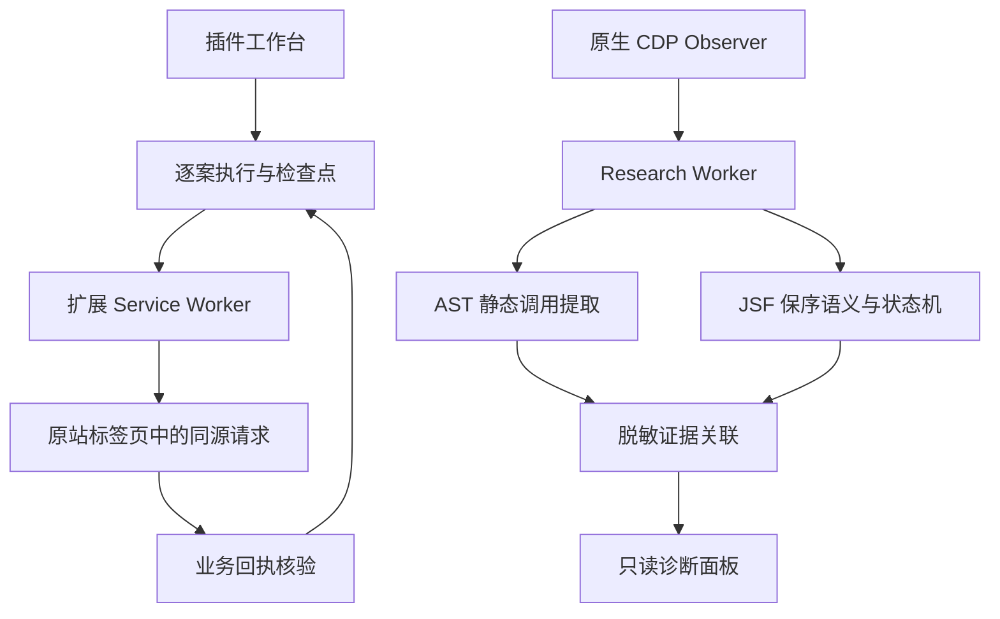

# 技术架构总览

核验：2026-11-16，代码基线 `de2ee0d`；证据等级 code_verified，关联离线测试入口如下。正式状态见治理清单。

## 交互边界

业务输入是已核对材料与原站会话，输出是草稿回执和 Summary；诊断输入是获授权的结构化观测，输出是有限证据，不产生业务命令。两条路径不能相互借用授权。

## 生产调用与不变量

[Research 控制器](../../../scripts/hague-research.mjs)记录 session、target、frame、loader 与 request 身份；[Worker](../../../scripts/hague-research-worker.mjs)收到 ast、xml、state、lookup 消息后调用各算法。组件注册表在 XML 结果中记录已观察组件，不能凭字符串名称认定其有业务权限。

[HTTP context](../../../src/hague/http-context.ts)维护应用模型和 JSF 状态；[driver](../../../src/hague/http-driver.ts)核验业务表单；[runner](../../../src/hague/draft-runner.ts)写前保存不确定检查点，再发送命令。研究状态机与业务检查点是不同的数据结构，研究结果不授予重放 POST 的许可。

## 资源与并发

CDP 请求表上限在 Research 控制器中为 2048；Worker、AST、ViewState 各自有更小预算，超限降级为证据不足。业务六路案件调度、网络许可与排他会话门禁见[并发容灾](concurrency-and-recovery.md)。不能由“运行六案”推断任何时刻都有六个在途 HTTP。

## 授权和证据

Observer 不设置下载行为、不触发业务操作；业务执行来自插件正常工作流。只记录允许列表结构，不保存凭据、原始 ViewState 或完整客户材料。本轮仅核验代码与离线测试入口，不为写文档操作真实原站。用户确认的最新验收状态见[总览](README.md)。

源码：上述控制器、Worker、context、driver、runner。测试：[研究证据](../../../tests/unit/hague/research-evidence.test.ts)、[状态机](../../../tests/unit/hague/jsf-state-machine.test.ts)。
