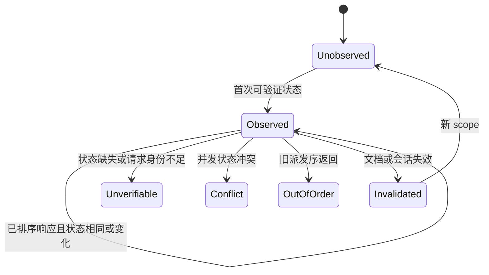

# ViewState 状态机

核验：2026-11-16，代码基线 `de2ee0d`；证据等级 code_verified，关联离线测试入口如下。正式状态见治理清单。

## 状态键与不变量

[状态机](../../../src/hague/diagnostics/protocol/jsf-state-machine.mjs)按 sessionId + 可选 targetId + frameId + loaderId（缺省 default）+ 可选 formId 构造文档键。请求表再追加 requestId。session/frame 缺失时不能建立有效 scope。requestId 不进入文档身份，否则每次请求都成为孤立上下文。

输入是 beginRequest、recordResponseViewState、invalidateDocument、invalidateSession 与 clear；输出为 transition/status 与有限证据。当前可核验调用在[Worker](../../../scripts/hague/research/hague-research-worker.mjs) signal/xml 分支，而不是只有单元测试导入。

图中是概念状态，不将所有 transition 字符串冒充同一枚举。首次没有前状态时用 INITIAL_OBSERVED/不可核验语义，不能宣称已经证明变化。

## 请求因果顺序

beginRequest 保存派发序、前状态摘要、世代与请求时刻。响应只在对应文档/请求/世代内比较；晚返回的旧派发序不能覆盖已提交的新状态。并发冲突、乱序与状态缺失分别降级，不通过 HTTP 200 推导状态有效。导航 Loader 变化和显式失效使原关联不可沿用。

## 隐私与资源

每次机实例生成 32 字节随机密钥，用 HMAC-SHA-256 对原始 ViewState 做内存标签。标签不用于重建原值，也不是跨运行持久身份。clear 会改变世代、清理状态与来源资源，不能用前次运行摘要匹配后续状态。

默认最多 128 文档、1024 在途请求、每文档 64 在途，TTL 60000ms；逐出与超时在记录/维护路径中清理，不是承诺后台定时器精确到点。Map 清理和旧文档逐出会扫描有限在途表，空间为 O(C+R)，HMAC 成本与输入长度相关；不宜宣称所有操作严格 O(1)。

不可核验不授权业务重发；业务层见[检查点恢复](concurrency-and-recovery.md)。测试：[状态机](../../../tests/unit/hague/jsf-state-machine.test.ts)、[研究证据](../../../tests/unit/hague/research-evidence.test.ts)。
