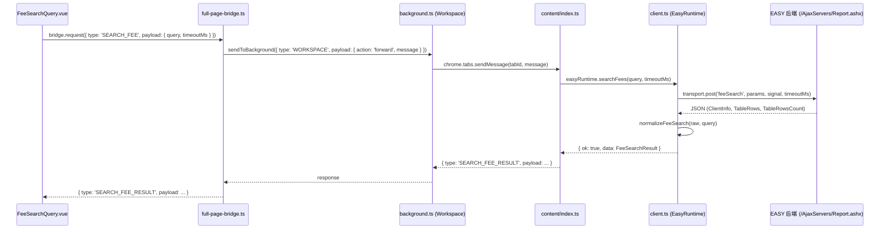

# PatMail 费用查询模块接口与架构文档

> 规范约定见根目录 [API/44-费用查询.md](../../API/44-费用查询.md)。整体架构见 [../../README.md](../../README.md)。

## 1. 模块定位

费用查询（官费管理 -> 费用查询）是 PatMail 扩展继**文件管理**、**期限监控**、**递交管理**之后的第四个核心查询表面。  
模块完整复刻了原站 `Forms/Bill/FeeSearch.aspx` 的查询功能、84 列字段明细、金额统计看板以及 Excel 导出能力。

---

## 2. 核心架构与文件结构

```
patmail-extension/
├── src/api/
│   ├── fee-form.ts              # 核心 7 排网格、高级区块、下拉字典映射与 cell 工具
│   ├── fee-search-params.ts     # 查询参数编码器（84 列 colsel 生成、布尔与日期格式化）
│   ├── fee-search-types.ts      # 84 列行数据 FeeSearchRow、金额汇总 FeeSearchAmountSummary
│   ├── fee-search-normalizer.ts # 后端响应反序列化与安全数据归一化
│   ├── transport.ts             # 路由注册：feeSearch / feeSearchAmount -> /AjaxServers/Report.ashx
│   └── client.ts                # EasyRuntime 业务方法：searchFees / searchFeesAmount / cancelFeeSearch
├── src/shared/
│   ├── message.ts               # 注册 SearchFee、SearchFeeAmount 消息类型与类型守卫
│   └── connection.ts            # 会话与账号范围识别
├── src/content/
│   └── index.ts                 # Content Script 分发 SearchFee 与 SearchFeeAmount
├── src/app/
│   ├── services/
│   │   └── full-page-bridge.ts  # 全页桥接层消息转发与动态超时配置
│   ├── components/
│   │   └── FeeSearchQuery.vue   # 完整查询组件：快捷区、网格、高级折叠、看板与数据表
│   ├── pages/
│   │   └── FeesPage.vue         # 费用查询页面容器
│   └── App.vue                  # 路由注册（/fees）与侧边导航入口
```

---

## 3. 通信与消息协议

### 3.1 消息定义（`src/shared/message.ts`）

| 消息类型 | 作用 | Payload 结构 |
|---|---|---|
| `SEARCH_FEE` (`MessageType.SearchFee`) | 发起费用列表查询 | `{ query: FeeSearchQuery, timeoutMs?: number, batch?: boolean }` |
| `SEARCH_FEE_RESULT` (`MessageType.SearchFeeResult`) | 返回费用列表查询结果 | `ApiResult<FeeSearchResult>` |
| `SEARCH_FEE_AMOUNT` (`MessageType.SearchFeeAmount`) | 发起金额统计汇总查询 | `{ query: FeeSearchQuery, timeoutMs?: number }` |
| `SEARCH_FEE_AMOUNT_RESULT` (`MessageType.SearchFeeAmountResult`) | 返回金额统计汇总结果 | `ApiResult<Record<string, unknown>>` |

### 3.2 链路流程



---

## 4. 核心类型契约（`src/api/fee-search-types.ts`）

### 4.1 单行数据记录 `FeeSearchRow`

包含 84 列核心属性，主要包含：

```typescript
export interface FeeSearchRow {
  fee_id: string
  case_id: string
  case_volume: string
  case_volume_customer: string
  case_name: string
  case_status: string
  country: string
  business_type_name: string
  currency_type: string
  generation_status: string
  notice_status: string
  fee_name: string
  amount: number
  rate: number
  amount_currency: number
  pay_status: string
  pay_date: string
  pay_deadline_date: string
  app_no: string
  pct_app_no: string
  customer_name: string
  applicant_name: string
  ctrl_proc_name: string
  ctrl_proc_user: string
  branch_name: string
  request_status: string
  request_no: string
  receive_status: string
  settle_status: string
  raw: Record<string, unknown>
}
```

### 4.2 查询返回结果 `FeeSearchResult`

```typescript
export interface FeeSearchResult {
  rows: FeeSearchRow[]
  total: number
  pageIndex: number
  pageSize: number
  amountSummary?: FeeSearchAmountSummary
}
```

### 4.3 金额汇总 `FeeSearchAmountSummary`

```typescript
export interface FeeSearchAmountSummary {
  agentAmount: number       // 折合代理费
  officialAmount: number    // 折合官费
  otherAmount: number       // 第三方费
  totalAmount: number       // 合计折合金额
}
```

---

## 5. 组件与交互细节（`FeeSearchQuery.vue`）

1. **原站一致的 7 排查询网格**：
   - 布局严格对齐原站 `Forms/Bill/FeeSearch.aspx`。
   - 复用通用组件：[ThemeSelect.vue](../src/shell/components/ThemeSelect.vue)、[TreeOptionSelect.vue](../src/shell/components/TreeOptionSelect.vue)、[WDatePicker.vue](../src/shell/components/WDatePicker.vue)。
2. **字典加载与缓存策略**：
   - 统一调用 `MessageType.LoadDictionary`（`kind: 'picker'`），自动拉取 `limitCountry`、`limitCaseStatus`、`limitCtrlProc`、`branch`、`user`、`agent` 等通用字典树。
   - 使用 `choicesFromDictionary` 转换为组件标准选项，并通过 `hasOptionTree` 自动判定树形展示。
3. **单选模式过滤与快捷全量计算**：
   - 顶部单选条（全部 / 仅显示客户付 / 仅显示官费 / 仅收代理费）在变动时触发即时过滤或重查。
   - 同步发起 `searchFeesAmount` 请求，并实时计算当前页金额与全局总额展示在看板上。
4. **Excel 导出与模板管理可靠性**：
   - 完整复刻原站 `IhgAdvExport.aspx`，支持「导出清单」（`cond`）、「导出勾选费用」（`checked`）与「导出汇总数据」（`count`）。
   - 详见第 6 节「费用 Excel 导出与模板管理可靠性规范」。

---

## 6. 费用 Excel 导出与模板管理可靠性规范

### 6.1 导出状态生命周期与状态定义

为避免将浏览器受理工序（返回 `downloadId`）与实际文件保存完成混淆，系统严格定义以下导出状态：

| 状态标识 | 业务含义 | 处理与 UI 表现 |
|---|---|---|
| `requested` | 已向原站发送导出请求 | 按钮进入加载态，显示「正在向原站请求生成 Excel 清单…」 |
| `server_queued` | 原站由于数据量过大转入后台异步队列生成（`ClientInfo.Asyn === true`） | 弹窗明确提示「已转入原站异步导出」，引导用户前往原站「下载清单」页面取件 |
| `file_ready` | 原站生成完毕并返回可取件 `file_guid` 与下载地址 | 准备交由浏览器后台下载 |
| `download_started` | 浏览器底层已受理下载请求并分配 `downloadId` | 提示「浏览器已受理下载，正在保存文件…」 |
| `downloading` | 浏览器正在传输大文件 | 提示「文件较大，正在下载中，请在浏览器下载列表查看进度」 |
| `download_completed` | 底层下载状态明确确认为 `complete` | 提示「费用 Excel 清单已成功下载保存」 |
| `download_interrupted` | 底层下载被中断或取消（`state === 'interrupted'`） | 报告明确业务错误（带原站/浏览器错误原因），不伪造完成 |
| `unknown` | 通信超时或后台回执状态未知 | 提示「原站 Excel 清单已生成，但下载回执未确认；未自动重复下载，请检查浏览器下载记录」 |
| `failed` | 原站明确拒绝（`Result === false`）或会话失效（`SESSION_EXPIRED`） | 弹出明确错误原因，终止流程 |

### 6.2 Chrome 下载受理与实际完成的区别

- **受理成功**：`chrome.downloads.download()` 返回数字 `downloadId`，仅代表浏览器后台线程接管了下载 URL，文件尚在网络传输或处于临时缓存中，并未真正落盘完毕。
- **实际完成**：必须通过 `MessageType.DownloadState`（底层 `chrome.downloads.search`）查询，当且仅当 `state === 'complete'` 时才算文件保存完毕。
- **防止重复触发兜底**：若后台调用 `sendToBackground` 发生网络超时或断开，**严禁**盲目通过隐藏 iframe 再次发起下载，避免用户下载记录中产生双份重复文件；只有在后台明确报告无扩展下载权限（权限缺失）且确认未创建任务时，才允许安全回退。

### 6.3 模板 CRUD 成功判定与只读回查机制

涉及原站 `GetQueryOutConfig` / `UpdateQueryOutConfig` / `UpdateQueryOutConfigNew`：

1. **会话校验**：若响应体 `ClientInfo.IsLogin === false`，坚决失效会话并返回 `SESSION_EXPIRED`。
2. **拒绝弱判定**：禁止将缺省视为成功。必须检查 `ClientInfo.Result !== false`。
3. **只读回查验证（Read-After-Write Verification）**：
   - **新增模板 (`add`)**：写请求返回后，检查返回的模板列表或主动调用 `list` 进行只读回查，必须在模板列表中核实到同名新模板；若回查未找到且原站未显式返回 `Result: true`，拒绝伪成功。
   - **更新模板 (`up`)**：回查确认模板存在且配置已刷新。
   - **删除模板 (`del`)**：删除后检查模板列表，若被删 `typeId` 依然存在，坚决报错；若原站未直接返回最新列表，主动执行只读回查确认模板已被移除。
4. **并发与竞态防护**：弹窗中使用 `templateGeneration` / `detailGeneration`，在快速切换模板或关闭弹窗后，过期回调一律丢弃，杜绝状态覆写。

