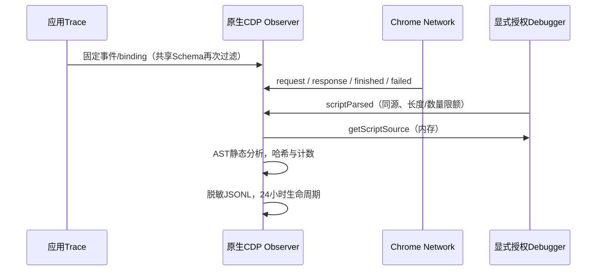

# 海牙 CDP 协议观察审计

> 状态：superseded。下文保留历史研究和实现演进，不作为当前生产结论。当前权威规范见[对应专题](engineering/hague/cdp-research.md)，核验基线与证据边界见[总览](engineering/README.md)。


2026-11-13：以下为源码审计和离线Fixture证据，不代表生产页面已实际观测。当前日志状态为 waiting、0 targets；未建立新CDP连接、未读取真实页面源码、未触发任何WIPO写入。



## C. 采集能力表

|能力/事件|原有保留|升级后/边界|
|---|---|---|
|Target.created/infoChanged/destroyed/attached/detached|目标选择、source、类型、脱离原因|导航、销毁、移出白名单撤销深度授权|
|Network.requestWillBeSent|requestId、origin/path、开始时间|海牙增加target/session/frame、方法、资源类型、发起者安全位置；重定向链最多8段；不读取postData|
|Network.responseReceived|真实status、MIME、连接/发送/等待耗时|额外httpStatus、redirect/client_error/server_error分类；无响应为null|
|Network.loadingFinished|字节、耗时|保留HTTP状态和重定向证据，不据此认定业务成功|
|Network.loadingFailed|耗时|cancelled/timeout/network/other类别；不持久原始errorText|
|Runtime.bindingCalled|固定应用监听、进度、下载状态|增加hague-trace，进入日志前共享Schema重过滤|
|Runtime.consoleAPICalled|警告/错误|海牙仅保留分类和level，不存控制台参数或正文|
|Runtime.exceptionThrown|位置、类别|海牙不存原始message或函数名，栈URL严格路径过滤|
|Runtime.executionContextCreated/contextsCleared|应用监听重装|context清理撤销深度状态，记录结构性生命周期事件|
|Debugger.scriptParsed/getScriptSource|无|独立显式开关；同源目标/脚本；非暂停；内存AST；哈希、计数及共享Schema过滤后的逐调用元数据|

原有 `isAllowedCdpMethod` 是宽泛的基础通道过滤，并非深度安全保证；新深度控制器独立验证方法和参数，拒绝Runtime.evaluate、断点、暂停、拦截、下载控制、Cookie、源码重写。基础通道只保留现有固定安装/快照表达式，不添加任意执行入口。

## D. 盲区、修复与验证

|盲区|根因与影响|实现与验证|剩余限制|
|---|---|---|---|
|失败时无法区分HTTP/网络|loadingFailed原来仅记录耗时|networkMetadata；缺响应null、超时Fixture|真实Chrome仍未授权验证|
|跳转丢失|同requestId覆盖旧状态|保存至多8段安全路径/状态|超过限额截断；未知路径统一redacted|
|同URL六路串案风险|URL时间不足证明案件归属|correlateRequest六候选ambiguous Fixture|应用缺target/frame时unmatched，绝不强制归属|
|来源脚本未知|基础Observer不启用Debugger|显式限定目标的内存AST|仅脚本摘要，不持久源码；动态调用不代表已运行|
|CDP信息到UI缺桥|扩展应用与本机服务隔离|固定安全事件桥、独立表达式/目标校验、状态available/unavailable|运行时断线仍需离线导出；生产浏览器未验证|
|隐私路径泄露|旧海牙任意pathname/WIPO子域|精确origin、静态页面路径白名单|未知路径失去具体路径证据但保留请求ID|
|运行时错误正文泄露|普通console脱敏不足以移除姓名等|海牙丢弃自由文本，只保留类别|错误细节需用户自行现场核对|
|业务Trace缺失|监听仅网络|固定安全事件入口、再次过滤、500事件候选窗口|离线日志不能补造业务步骤|

## 关联规则与日志语义

直接CDP requestId和sessionId证据唯一时才可exact；target/frame/method/安全路径一致且时间窗口内唯一候选为probable；多候选为ambiguous；缺证据为unmatched。时间接近本身不构成exact。固定绑定证据与已注册应用请求唯一匹配时为probable；未启用诊断、事件时序竞争或上下文缺失时为unmatched。

日志示例（人工Fixture）：

```json
{"kind":"network.failure","source":"hague","requestId":"41.2","origin":"https://hague.wipo.int","path":"/application.xhtml","httpStatus":null,"httpCategory":"no_response","failureCategory":"timeout","correlationConfidence":"unmatched"}
```

HTTP 200只证明网络响应；JSF校验和业务回执来自应用Trace。静态AST识别只证明源码结构，不能当作运行时调用或业务成功。原始表单、Cookie、Token、ViewState、申请材料、图纸、函数参数值与第三方源码不写日志。

排查顺序：读本机status和最近JSONL，按requestId及应用traceId关联，识别缺失证据，然后才决定是否需要用户授权现场观察。开关和重启方法见 [cdp-observer.md](cdp-observer.md)。没有CDP连接时应用执行不依赖该服务；不会因诊断失败重试业务请求。

离线Observer日志可以通过 `scripts/hague-diagnostics-export.mjs` 转换为面板Trace JSONL；共享浏览器适配器为 `src/hague/diagnostics/observer-adapter.mjs`。转换不推断案件归属。逐调用AST记录为版本1 `source=cdp,phase=protocol.analyzed`，携带安全组件、调用类型及位置，仍只代表静态证据。海牙UI快照自由文本现在只保留类别，draftTexts只保留类别及数量。

归因桥已补充固定Hague Runtime binding：仅诊断开启的注入请求发出脱敏元数据，Node以应用目标的先行Trace注册表核对traceId/requestId及方法/路径/案件运行ID，再用CDP executionContext观察到的frame/target/session丰富候选。真实请求可在唯一一致证据下成为probable，多路冲突保持ambiguous。页面声明的frame/target/CDP requestId不被采信，不产生exact。应用事件与页面事件存在时序竞争，先行证据或context缺失时保留unmatched，不重试业务。此能力已有离线实际处理链Fixture验证，生产浏览器仍未授权验证。

离线导出保留唯一候选的caseRunId、stepIndex、operation、transportMode及applicationRequestId，分别映射应用requestId与cdpRequestId。ambiguous/unmatched不会携带推测的案件归属，导入面板时保持未归因。

实时回流新增固定 `patmail-hague-cdp-trace` 事件。仅向现有选定、已知扩展ID的 `/app.html` 页面发送；绝不向WIPO目标运行表达式。命令独立校验为固定Runtime.evaluate事件分发器，数据先经共享Schema过滤，最多128条排队、每批16条/64KB、最多6个应用目标，每250ms发送；失败丢弃且不重发业务请求。深度策略仍拒绝任意Runtime.evaluate。连接断开或服务停止清空队列；UI诊断关闭时忽略事件；事件不回流应用Trace，避免回声循环。实时浏览器验证未进行。
