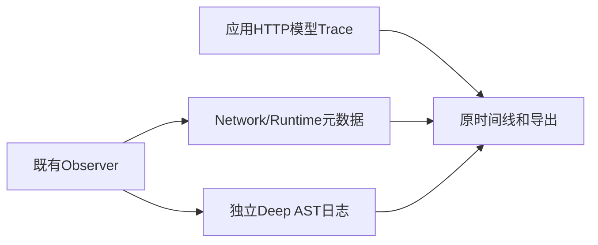
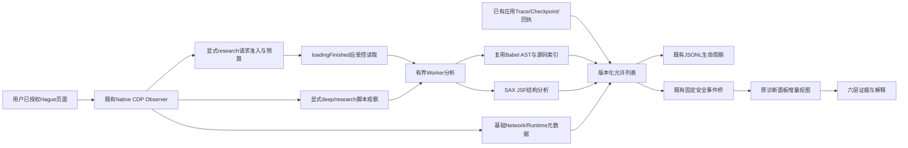
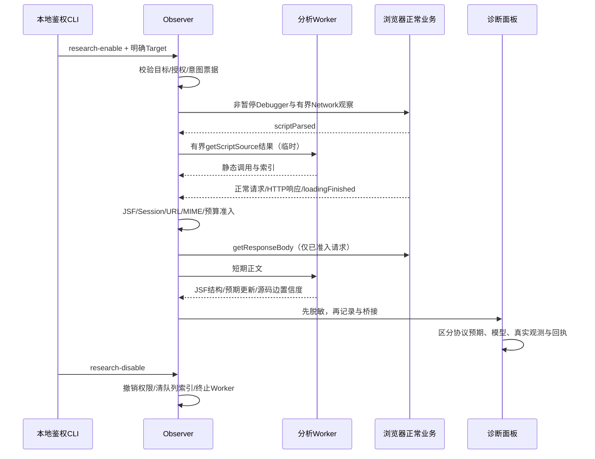

# Hague CDP + AST + JSF Research Mode：技术与验收报告

本报告对应2026-11-14的增量研究模式。旧诊断模块与业务执行引擎保留，本次没有新增申请、上传、提交或业务重试入口。所有正式控制仍由既有127.0.0.1鉴权服务承担。

## A. Git、审计与实施范围

|项|记录|
|---|---|
|Base commit|`7dbca12412485ac6fdea2cdffa6fd2358f49c0e7`|
|main同步|已fetch `haohaizi233/main`，开始时与HEAD相同，ahead/behind为0/0|
|工作分支|`codex/hague-research-mode`|
|Result commit|尚未创建；交付为可审查的工作区补丁，不包含自动推送或合并|
|既有修改|3个文件：旧验收文档、Observer重定向修复、对应测试；全部保留|
|备份|忽略目录`test-results/hague-research-baseline/{working.patch,index.patch,baseline.json}`|
|原测试基线|257文件、1705测试通过（上一阶段记录）|

开始时的能力矩阵见[实施计划](superpowers/plans/2026-11-14-hague-research-mode.md)。主要缺口为研究模式、受控正文、独立安全XML、源码索引、六层证据与状态筛选；已有AST和执行器没有重写。

|能力|本次实现证据|
|---|---|
|CDP生命周期/控制|`scripts/cdp-observer-core.mjs`：既有Session、Target、HTTP控制服务复用；调用research hooks|
|研究模式|`scripts/hague-research.mjs:HagueResearchDiagnostics`：enable/disable/stop、单调意图票据、generation、预算及指标|
|AST|既有`diagnostics/ast/analyzer.mjs`：新增诊断专用callee/property位置锚点；不改执行提取器|
|XML/请求识别|`diagnostics/protocol/jsf-partial-response.mjs`：SAX解析、请求标准字段投影、短期ViewState比较|
|正文授权|`HagueResearchDiagnostics.bodyCommandAllowed/readBody`：活跃租约、请求归属、生命周期、大小、MIME与并发|
|硬隔离|`scripts/hague-research-broker.mjs:AnalysisWorker`及worker：有界队列、硬超时、64+16MiB堆预算、终止与错误清理|
|跨层关联|`diagnostics/correlation/correlator.mjs:createSourceIndex/correlateRequest`：作用域隔离、唯一源码锚点、独立边置信度|
|证据|`diagnostics/evidence/evidence-model.mjs:analyzeEvidence`：六层状态、缺失证据、确定性解释|
|日志/展示|`schema.mjs`、`observer-adapter.mjs`、`store.ts`、`reports.ts`和`HagueDiagnostics.vue`|
|输出预算|`scripts/hague-research-output.mjs:ResearchOutputBudget`：只限制新增分析输出，不限制旧basic监听|

依赖仅把现有传递依赖`saxes@6.0.0`提升为运行时直接依赖，ISC许可、Node>=12.22.7，不引入第二套AST框架。已更新锁文件；官方npm生产依赖审计0项漏洞。镜像站audit端点不支持，已明确改用官方registry审计，没有把端点失败当成安全通过。

## B. 改造前后与整体架构

旧版：Network/Runtime元数据与独立AST日志，加上应用HTTP模型Trace；无法从受控CDP响应解释完整JSF，也没有可验证的独立证据边。



新版：仍是一个Observer、一个CDP连接管理层和一个本地控制服务；Worker只是分析隔离线程。





## C. 模式与生命周期

|模式|实际行为|
|---|---|
|basic|既有Network/Runtime监听；不获取正文，不主动获取脚本源码，不创建分析Worker|
|deep|明确Target后自动读取符合范围的脚本并使用Worker复用AST；不读取响应正文|
|research|deep加受控JSF请求元数据、正文、XML、源码关联及六层证据|

构建、普通start、扩展加载、重新连接都不会隐式开启research。多个Target时必须指定一个；不是随机挑选。授权只覆盖当前Session/Target。disable、导航、execution context销毁、detach、disconnect、stop撤销高强度权限；重连后回basic，需要重新显式启用。并行enable/deep/disable采用入口意图票据，旧请求不能覆盖新授权意图。底层deep还在首次await之前捕获activation generation，防止关闭后延迟开启Debugger；真实类竞态回归覆盖该边界。

```powershell
pnpm cdp:start
pnpm cdp:status
pnpm cdp:stop
node scripts/cdp-observer.mjs deep-enable --target TARGET_ID
node scripts/cdp-observer.mjs deep-status
node scripts/cdp-observer.mjs deep-disable
node scripts/cdp-observer.mjs research-enable --target TARGET_ID
node scripts/cdp-observer.mjs research-status
node scripts/cdp-observer.mjs research-disable
node scripts/cdp-observer.mjs basic
```

这些命令调用既有鉴权控制接口；没有任意CDP方法转发接口，前端也不取得本机控制Token。旧deep命令保持兼容。Target ID可从已连接会话的安全Network日志定位；`cdp:status`用于检查连接和模式，不应把waiting当成现场已采集。

## D. 请求、响应和XML

正文以`sessionId + requestId`命名空间维护，附带Target/frame/loader、HTTP及时间信息。只对当前授权Target、已观察且未过期的请求准入。限定官方Origin及既有protected JSF路径、POST、XHR/Fetch、非multipart、URL编码表单、标准JSF标志；大表单未附postData时，可以用精确`Faces-Request: partial/ajax`作为协议证据，字段不足就留空。不会再去请求完整上传或请求正文。

仅在loadingFinished后，依据实际HTTP状态、精确文本MIME白名单、非attachment和大小/队列预算尝试正文读取。核心sendCdp仅在内部有效准入租约下允许`Network.getResponseBody`，全局普通方法白名单仍不开放这个命令。没有新业务请求、拦截或响应替换。

|bodyStatus|含义|
|---|---|
|body_available|正文可供协议解析，不等于业务完成|
|body_unavailable|缓存/Session/取消/诊断超时等原因无法取得；不解释为服务器失败|
|body_too_large|元数据或读取后实际体积超预算|
|body_unsupported|二进制、下载、HTML等不支持的协议类型或编码|
|body_parse_failed|确实进入解析但XML结构无法解析|

读取前不能精确知道解码后体积，因此同时使用CDP缓冲预算、元数据筛选、读取后UTF-8字节检查和解析任务上限。不会声称CDP返回之前已经精确保证正文小于256KiB。

XML采用Saxes成熟SAX解析器：命名空间localName、根节点、CDATA、update/insert/delete/attributes/eval/extension/error/redirect、未知节点均有独立结构统计。DTD由解析器语法事件拒绝，实体与XXE测试拒绝；CDATA内字面DOCTYPE不误判为声明。禁止执行eval或持久化其中代码。错误正文不保存。HTML不能自动解释为登录过期，重定向也不能自动解释为鉴权失败。

ViewState支持javax/jakarta及有界JSF组件前缀。只输出存在性、总长度、可证明的变化。比较使用作用域内短期HMAC标签，不返回标签；clear轮换密钥并清标签。原先应用Trace的持久SHA-256摘要已停止输出。原生研究请求目前按独立CDP请求隔离：没有可靠共享视图身份时，不跨请求比较六路Token，也不伪造viewStateChanged。应用HTTP模型自身仍可报告同链变化，明确标为application_model。

## E. AST、关联与业务边界

scriptParsed自动进入既有源码获取与Babel分析。复用常量、别名、包装、静态解码与上限；不运行未知源码，不实现或宣称通用CFG/DFG/SSA/污点跟踪。

调用类型与Schema已对齐，包括PrimeFaces.ab/cw、Mojarra、jsf.ajax.request和旧Widget别名。AST索引按Session/Target/Script ID/脚本摘要隔离，复用结果；每条网络事件只查有界索引，不重跑全文件分析。inline脚本偏移已应用；精确位置包括实际callee/property token锚点。隔离Chrome/Edge证实V8常在成员属性token报告调用来源；不会按整行或时间强行匹配。最多检查20个initiator frame，多个候选保持ambiguous。

|边|规则|
|---|---|
|应用内Trace|生成的caseRunId/traceId/requestId直接关联|
|CDP请求内部|Session+CDP requestId；域内跳转保持归属，外域停止采集|
|AST→Network|已验证脚本身份与唯一语法位置锚点；动态/解码位置不冒充实际运行|
|CDP→应用|exact必须有唯一直接标识；probable只表示候选，不借用应用业务回执|
|DOM|XML更新仅expected_only；HTTP脱离DOM仅application_model；真实Page回执须有同文档前后数值证据|
|业务|只接受应用验证器明确的BUSINESS_RECEIPT_VERIFIED或精确Draft(s)回执DRAFT_LIST_MATCHED|

跨Session/Target/frame、标识冲突、缺少源码/应用Trace、乱序或多候选均保持ambiguous/unmatched。AST边和应用边分开建模。复核曾发现probable借用应用回执的问题，已在生产关联器、适配器和证据Reducer三处阻断；旧日志里猜测出的应用ID也不能重新升级为业务成功。

六层`REQUEST / HTTP / JSF_PROTOCOL / DOM / BUSINESS / CERTAINTY`相互独立。请求finished可以同时HTTP500；XML合法、更新节点或ViewState变化均不能证明保存成功。界面说明严格由证据生成，不调用AI补全事实。

## F. 字段、展示与安全预算

Schema仍为v1，采用增量字段：eventId、mode/researchState/observerState、bodyStatus、domStatus/domEvidenceSource、expectedUpdates及XML节点计数、源码位置和两种关联置信度。非法/缺失时间不补造；未知字符串不落盘。正文、Header、Cookie、CSRF、个人资料、文件与任意常量值均不进入Trace。所有日志和固定UI桥之前先允许列表处理。

```json
{"version":1,"source":"fixture","phase":"jsf.parsed","timestamp":"2026-11-14T00:00:00.000Z","httpStatus":200,"protocolStatus":"valid","updateCount":2,"domStatus":"expected_only","businessStatus":"unconfirmed","certainty":"unknown"}
```

此示例是人工结构示例，不是真实WIPO观测。

界面沿用折叠诊断面板，独立显示最近Observer状态、Target、模式、AST/XML/关联开关及实际计数；未取得指标显示“未采集”。AST关联计数不等于应用/业务成功数。支持7种筛选、每页200事件、惰性案件树、请求详情、事实解释和缺失证据。导出JSON/JSONL/Markdown及离线回放保持原入口，前端不控制真实业务。

|预算|实现|
|---|---|
|正文|256KiB UTF-8；同时读取2个；等待最多64条元数据|
|CDP缓存|总1MiB、单资源256KiB、请求postData最多4096字节；不足时不补取完整请求|
|源码|最多32个；每个128KiB UTF-8；累计2MiB|
|AST/XML|AST复用原30k节点/100深度/解码2层；XML30k元素/100深度|
|Worker|队列64，默认硬超时1500ms；V8 old64MiB+young16MiB；失效终止线程|
|索引|32脚本/512调用；ViewState比较128作用域，关闭销毁|
|分析输出|最多1000分析事件/分钟、128待写、每条32KiB；状态快照可绕过分析速率，但仍受待写和体积限制|
|UI|5000事件/4MB/24小时；超过容量只淘汰诊断数据并计数|

旧basic日志不受新增分析输出预算限流。磁盘失败、队列/源/正文/时间超限都只丢弃诊断数据，不重试业务或伪造业务失败。默认build/start没有正文/脚本采集授权。

## G. 验证、性能与验收结论

最终测试结果及A–G验收表见文末。测试命令如下，均使用Mock、人工Fixture或独立无用户资料浏览器：

```powershell
pnpm exec vitest run --maxWorkers=4
pnpm typecheck
pnpm lint
pnpm build
$env:HAGUE_TEST_CHROME='C:/Users/Administrator/AppData/Local/Google/Chrome/Application/chrome.exe'
node tests/e2e/hague-research.e2e.mjs
node tests/e2e/hague-diagnostics-ui.e2e.mjs
node tests/e2e/hague-draft-ui.e2e.mjs
node tests/e2e/hague.e2e.mjs --fixture
node scripts/measure-hague-research.mjs
```

初次默认全量测试与浏览器/Vite并行时出现系统提交内存压力，Node/Rust分配失败并导致分片用例超时；未修改断言或跳过用例。随后限制4个Vitest worker并串行浏览器检查。第一次有界完整运行262文件/1770测试通过；最终源码结果以末尾检查记录为准。

性能结果在忽略目录`test-results/hague-research-performance.json`，记录CPU/墙钟/RSS/worker heap/AST及XML时长/关联时长/队列/丢弃。输入64请求、8并发批次、每响应32936字节；这是Mock CDP传输+真实Worker的合成基准，不是真实站点、完整Observer WebSocket或整批业务耗时。CPU为0时可能来自OS计时粒度，不表示没有成本。不声明提升倍数。

### 尚未支持或未验证

1. 未在用户真实Hague页面开启research、读取私人响应/源码或执行真实写入。实站样本覆盖、真实业务成功率及生产性能未验证。
2. 复杂控制流、动态属性/闭包/异步来源仍可能unresolved/unmatched；没有通用反混淆或数据流证明。
3. 不通过XML预期更新验证真实DOM。HTTP模式的模型DOM不会冒充原站；Page的实际数值观测也只覆盖已观察字段，不证明整个DOM未变化。
4. 没有可靠共享视图作用域时，原生跨请求ViewState变化未知；不通过时间或同一frame猜测六路Token关系。
5. Body可能因缓存、导航、权限、预算或协议不可读取；这不是服务器业务失败。超限后记录可能不完整，丢弃数和缺失证据必须一起阅读。
6. 数据来自已有授权浏览器/正常业务，不会因缺证据自动点击、提交、重试或触发Hague函数。实站采样须显式指定Target并授权启用，关闭后不自动恢复。


## 排查与12项实现回答

|问题|最终实现|
|---|---|
|何时触发AST？|显式deep/research开启Debugger后，既有scriptParsed事件自动进入HagueDeepDiagnostics.script；不是按业务动作手工调用。|
|分析哪些脚本？|只接受当前授权Session/Target及官方Origin的脚本，32个/每个128KiB/总2MiB，动态未观测代码留空。|
|如何去重？|Deep按当前generation的scriptId去重；既有AST缓存以源码哈希区分，关闭清缓存；源索引保留脚本身份和全局位置。|
|哪些请求读正文？|本文D节全部准入条件满足、loadingFinished后且仍持有有效读取租约的请求。|
|原文如何不落盘？|源码/正文只经内存及Worker，输出前safeAnalysisOutput及sanitizeTraceEvent允许列表投影；未知字段丢弃，不打印错误正文。|
|如何识别JSF Error？|SAX识别partial-response/error及协议结构，输出安全类别和阶段，不记录任意error-message文本。|
|如何识别ViewState变化？|协议作用域内短期HMAC比较，关闭轮换密钥；无可靠共享scope时未知，原生请求间不猜测。|
|如何匹配AST与Network？|Network initiator中scriptId/Session/Target与V8实际语法锚点查索引；唯一静态匹配才是源码边exact。|
|何时unmatched？|源码缺失、位置未命中、动态未解、作用域不足或无直接应用标识。多候选ambiguous，可能候选probable；不靠时间升级。|
|如何确认业务完成？|只接受已有应用验证器明确通过的BUSINESS_RECEIPT_VERIFIED或DRAFT_LIST_MATCHED，且跨来源必须有唯一直接exact关联。|
|如何保证只读？|沿用鉴权控制和命令白名单；只观察/读取/分析；无任意CDP转发、未知代码执行、业务点击、提交、重试或下载行为设置。|
|超时/导航/断开/超限？|撤销generation和读取租约、清队列/index/token、终止Worker；迟到结果丢弃。超限记录analysis.skipped及实际丢弃计数。|

常见排查：

- `waiting`：Observer尚未连接浏览器，不等于已开始现场采集；检查浏览器远程调试与授权提示。
- `body_unavailable`：检查Session/导航、缓存和诊断预算，不据此重试创建草稿。
- `HTTP 200 + rejected/unconfirmed`：分别查看JSF层与业务回执，不能用响应码覆盖验证失败。
- `expected_only/application_model`：缺少真实浏览器DOM证据；不能写“页面已更新”。
- `unmatched/ambiguous`：查看缺失源码、脚本位置与作用域；不把同一时刻或同frame当作六路案件归属。
- 大批量UI只显示一页200条，导出仍依据保留事件；容量淘汰和输出限流需同时检查drop指标。


## 最终A–G验收记录（2026-11-14）

### A. Git状态

Base `7dbca12412485ac6fdea2cdffa6fd2358f49c0e7`；分支`codex/hague-research-mode`；Result commit未创建，交付工作区补丁；开始时已有3个修改全部保留。新增/修改文件按模块见本文A节和下方清单；未修改无关业务、Manifest或Origin权限。工作区其他任务的周报不属于本次交付。

### B. 完成能力和实际入口

|模块|实际路径和关键函数|
|---|---|
|CDP|scripts/cdp-observer-core.mjs + scripts/hague-research.mjs，HagueResearchDiagnostics.enable/disable/bodyCommandAllowed/readBody|
|AST|src/hague/diagnostics/ast/analyzer.mjs，analyzeJavaScript；scripts/hague-diagnostics.mjs，HagueDeepDiagnostics.script|
|JSF Parser|src/hague/diagnostics/protocol/jsf-partial-response.mjs，parseJsfPartialResponse/parseJsfRequest/createJsfProtocolAnalyzer|
|Correlation|src/hague/diagnostics/correlation/correlator.mjs，createSourceIndex/correlateRequest|
|Evidence Model|src/hague/diagnostics/evidence/evidence-model.mjs，analyzeEvidence|
|Diagnostics UI|src/app/components/HagueDiagnostics.vue；src/hague/diagnostics/reports.ts，buildDiagnosticReport/exportDiagnostics|
|Privacy Protection|src/hague/diagnostics/schema.mjs，sanitizeTraceEvent；scripts/hague-research-output.mjs，safeAnalysisOutput/ResearchOutputBudget|
|Regression Tests|tests/unit/hague/research-*.test.ts、tests/unit/scripts/hague-research*.test.ts、既有hague/observer回归和tests/e2e/hague-research.e2e.mjs|

### C. 架构变化

改造前后依赖图与完整时序见本文B节。新增的是现有Observer内的受控准入和Worker分析链，没有第二套CDP守护进程，没有业务请求生成器。

### D. 核心技术细节

12项问题逐项答案见上一节，预算、SAX安全、关联置信度和成功判定边界见C–F节。独立审查发现的probable借用业务回执、异步授权反转、关闭后底层Debugger复活均已修复，并有针对性测试。

### E. 测试与测量

|检查|结果|
|---|---|
|Total / Passed / Failed / Skipped|1776 / 1776 / 0 / 0，最终命令exit 0|
|完整测试|`pnpm exec vitest run --maxWorkers=2 --reporter=json --outputFile=test-results/hague-research-tests-final.json`|
|Typecheck|`pnpm typecheck` exit 0|
|Lint|`pnpm lint`基线门禁exit 0；全库432 errors/25 warnings，低于既有635/25基线，不能描述为全库零lint问题|
|Build|`pnpm build` exit 0；两次Vite产物构建完成；普通启动未打开research|
|研究E2E|Chrome及Edge各exit 0；实际CDP+Worker，1正文/1解析/1 AST exact，0暂停/0外网业务请求|
|诊断UI E2E|`node tests/e2e/hague-diagnostics-ui.e2e.mjs` exit 0；桌面/窄屏、详情、导出、回放、清空、脱敏|
|草稿UI E2E|`node tests/e2e/hague-draft-ui.e2e.mjs` exit 0；封装弹窗/取消/Esc/遮罩/六路重建/登录反馈，无外部写入|
|导入E2E|`node tests/e2e/hague.e2e.mjs --fixture` exit 0；文档解析、进度及独立滚动|
|依赖审计|官方npm生产依赖审计0漏洞；镜像不支持audit的失败已保留|
|补丁检查|`git -c core.safecrlf=false diff --check` exit 0|

首轮资源失败日志保留在`test-results/hague-research-tests.log`，最终有效结果在`test-results/hague-research-tests-final.{json,log}`。崩溃运行即使JSON出现success=true，也没有作为有效验收；最终检查要求进程exit 0且总数与通过数一致。

性能测量命令`node scripts/measure-hague-research.mjs` exit 0，64请求/8并发批次/每响应32936字节；Mock CDP+真实Worker，非实站业务基准：

|模式|墙钟ms|CPU user/system ms|峰值RSS MiB|Worker堆 MiB|正文读取|
|---|---:|---:|---:|---:|---:||basic|2.588|0.0/0.0|56.52|0.00|0|
|research|349.765|297.0/31.0|76.06|9.19|64|

此次合成研究批次64个响应均解析，解析失败0；关闭后Worker、正文队列和请求表均清空。数值是本机测量样本，不承诺真实站点延迟或业务成功率。


### F. 未解决/未验证

本文“尚未支持或未验证”的6项限制仍成立。真实WIPO业务样本及生产性能为not_verified；研究模式不自动开启，当前实机Observer为waiting（0 Targets），research-status为basic/off、0正文读取。若浏览器出现远程调试授权提示，需要用户在浏览器中允许连接。不能把等待连接、unmatched或unconfirmed解释成业务已成功。

### G. 验收结论

|关键模块|状态|边界|
|---|---|---|
|Native CDP / 研究启停 / 受控正文|PASS|Mock及隔离真实CDP验证，默认basic；实机当前waiting|
|AST识别/索引/Network源码边|PASS|静态唯一锚点精确匹配；动态/缺证据保留不确定|
|JSF Parser安全/结构|PASS|namespace/CDATA/DTD实体/边界测试，禁止执行eval|
|跨层关联及六层Evidence|PASS|probable不借回执，HTTP/XML/DOM不推导业务完成|
|UI / 导出 / 回放|PASS|隔离浏览器及单元回归通过|
|隐私/预算/生命周期P0条件|PASS|允许列表、硬超时、关闭清理及敏感值测试；无新增权限/真实业务请求|
|现有工作流回归|PASS|1776测试及相关隔离E2E通过|
|真实站点全样本覆盖/生产性能|PARTIAL|not_verified，没有读取用户私人正文或执行生产写入|

本阶段实现与离线/隔离验收PASS；生产全链路覆盖仍为PARTIAL，不能宣称当前所有真实异常已验证消除。未遗留已知P0/P1审查项；最终竞态修复有真实类回归且包含在最终1776项通过结果内。


### 本次交付文件清单

```text
patmail-extension/docs/hague-full-chain-diagnostics.md
```
