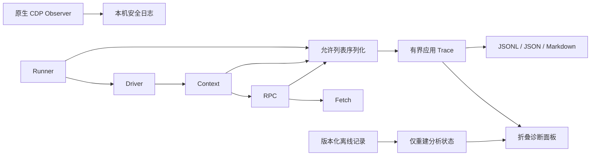
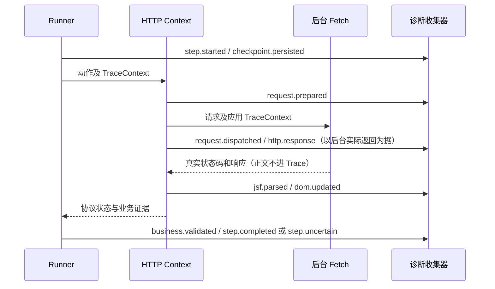

# 海牙 Trace、状态与诊断面板

> 状态：superseded。下文保留历史研究和实现演进，不作为当前生产结论。当前权威规范见[对应专题](engineering/hague/correlation-evidence.md)，核验基线与证据边界见[总览](engineering/README.md)。


应用诊断默认关闭。海牙页面下方展开“协议诊断”，勾选“应用内诊断采集”后收集后续安全事件。展开面板不会采集脚本，也不会连接 CDP。关闭应用诊断不会修改业务检查点或触发重试。

CDP 深度脚本分析是 Observer 的独立明确授权操作，参见 [CDP 使用说明](cdp-observer.md)。Observer使用严格固定的脱敏事件桥发送至已识别的PatMail应用页面，不依赖前端取得本机控制令牌；缺少CDP事件时明确显示“CDP数据缺失”。统一版本的 CDP Trace JSONL 可以通过离线回放查看，不能把本机旧式 Observer 原始日志直接当作本 Schema。





## 字段和证据

Schema 位于 `src/hague/diagnostics/schema.mjs`，类型位于 `trace.ts`。版本不兼容的回放拒绝导入。

| 字段 | 含义 |
| --- | --- |
| version / source / phase / timestamp | 当前版本 1；application、cdp 或 fixture（离线构造样本）；允许的阶段；ISO 时间 |
| traceId / caseRunId / stepIndex / operation | 不含业务输入的执行实例和步骤；不能使用 caseVolume 或 WIPO reference |
| requestId / cdpRequestId | 两套系统的请求标识，不以相同 URL 认定相同请求 |
| transportStatus / httpStatus | 传输结果 / 实际观测的 HTTP；没有响应为 null，不虚构 0 或 504 |
| protocolStatus / businessStatus / certainty | JSF/HTML 协议结果 / 业务回执结果 / 证据确定性 |
| sourceComponent / form / process / update | 白名单安全组件或不可逆结构代号，不含表单值 |
| sourceLocation / astCallType / astConfidence | 脚本摘要及位置、静态调用类型与置信度，不能证明该调用实际发生 |
| updatedComponents / before / after / diff | XML/DOM 的结构和计数，不保存文本或材料 |
| evidenceCodes / recoveryDecision | 明确证据代码及已记录的恢复决定；面板不批准重试 |
| correlationConfidence | exact / probable / ambiguous / unmatched；缺少证据不自动变成 exact |

HTTP 200 仅证明收到响应；JSF validationFailed 可以同时意味着业务 rejected。合法 XML 但没有业务回执时仍为 unconfirmed / unknown。超时后若可能产生远端副作用，沿用业务检查点人工核对，诊断不重新发送请求。

应用 TraceContext 沿调用链精确传递。CDP 自身用 requestId、target/session/frame 等归并。跨系统只有可验证直接关联才是 exact；唯一一致的间接证据为 probable，多候选为 ambiguous，其他为 unmatched。并发同 URL 请求不能按时间最近强行分配案件。没有应用案件标识的 CDP 事件在时间线显示“未归属”。

以下是人工构造示例，并非真实 WIPO 观测：

```json
{"version":1,"source":"application","phase":"http.response","timestamp":"2026-11-13T00:00:00.000Z","traceId":"trace-demo","caseRunId":"case-demo","stepIndex":1,"operation":"saveDraft","httpStatus":200,"transportStatus":"completed","protocolStatus":"valid","businessStatus":"unconfirmed","certainty":"unknown"}
```

## 排障和离线回放

1. 排查真实浏览器问题先查看根目录 `log/cdp/status.json` 及最近 JSONL，通过 requestId / progressId / taskId 关联，遵守项目 AGENTS.md。
2. 诊断面板先看首个可证明失败及首个不确定事件，再从案件树进入步骤、请求和协议/回执证据。
3. HTTP 未知与 HTTP 错误、协议错误、业务拒绝分别查看；不把最早错误等同于根因。没有采集到失败也不表示成功。
4. 导出 JSONL 用于事件复盘、JSON 用于摘要、Markdown 用于人工阅读。所有导出重新经过安全序列化。
5. “离线回放”支持 JSON 事件数组、导出的摘要 JSON 和 JSONL，最多 2 MB / 5000 事件；拒绝未知版本与无效事件。回放不启用采集、不写业务状态、不调用 executor/fetch，不执行 HTML 或 JavaScript。
6. 回放有醒目来源标签，返回当前观测后继续查看应用内事件。CDP 数据不足时保留缺失标记。

## 结构指纹与局限

`fingerprintProtocol()` 对安全表单、组件、调用类型和更新模式排序去重后摘要，`diffFingerprints()` 提供增删项。面板显示本次首尾 DOM 快照的表单/组件差异；这不是历史协议兼容保证。没有历史采样或 AST 元数据时显示证据不足，不制造历史对比或运行成功结论。

诊断仅保存结构。Cookie、Authorization、原始 ViewState、正文、材料、文件内容、姓名、地址、邮箱、reference 和 caseVolume 均不得进入事件。未知组件用摘要代号；案件在 UI 使用“案件 N”。AST 参数只显示允许的名称，不显示值。应用内存/持久化与本机 Observer 日志的生命周期分别由各自收集器控制，Observer 本机日志仅保留最近 24 小时。

当前 UI 不直接展示第三方脚本，也不运行输入代码。未连接 CDP、未读取页面脚本或没有现场浏览器验收均不能解释为实站验证通过。离线回放只证明分析行为，不能证明真实 WIPO 写入正确。

## 原始脱敏 Observer 与离线 Fixture

旧式 Observer JSONL 先通过 `node scripts/hague/diagnostics/hague-diagnostics-export.mjs <input.jsonl> <output.jsonl>` 转成统一事件，再在面板导入；转换器不会猜测案件归属。CLI 输入受大小上限约束，仅处理已知事件类别，输出前再次脱敏。

另支持单个 JSON Fixture：`{"version":1,"kind":"html|xml|javascript|receipt","content":"人工构造片段"}`（kind取其中一个值）。每片段最多262144字符，HTML/XML仅构造脱离页面的文档，JS仅AST静态分析，回执只提取安全类别。Fixture事件标记`source=fixture`，不会冒充CDP观测；`ok=true`也不能证明生产业务成功。禁止将含真实个人材料的原始片段交付或纳入仓库。

HTTP自动跟随重定向时仅能确认最终状态（例如登录HTML200），中间302须由CDP网络证据补充，不补造跳转状态。JSF insert/delete 当前采用明确unsupported并停链，未实现其DOM修改。当前模式直接使用已通过Fixture验证的AST提取，没有新旧解析器shadow双跑，也没有历史协议数据库；历史比较可对两份脱敏指纹显式调用`diffFingerprints`。


## Research Mode增量契约

详见 [全链路研究诊断](hague-full-chain-diagnostics.md)。新增独立AST源码边、六层证据、标准JSF请求投影和安全正文解析；probable不能借用业务回执。ViewState持久摘要已停止输出，只保留存在性/长度/可证明变化。缺失时间不补造；旧离线记录需具有实际timestamp。应用模型DOM明确标为application_model，真实观测须来源和同文档字段证据。
