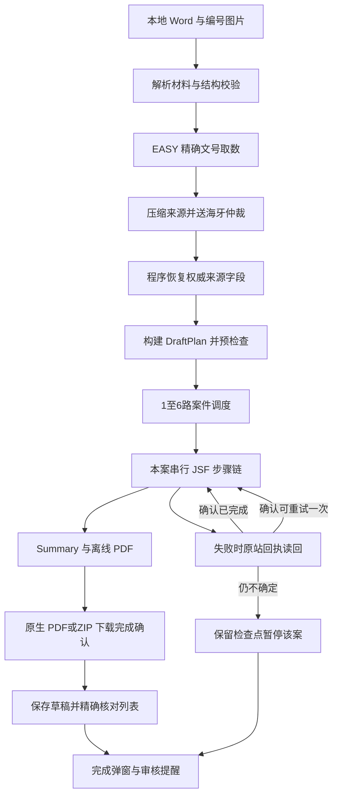
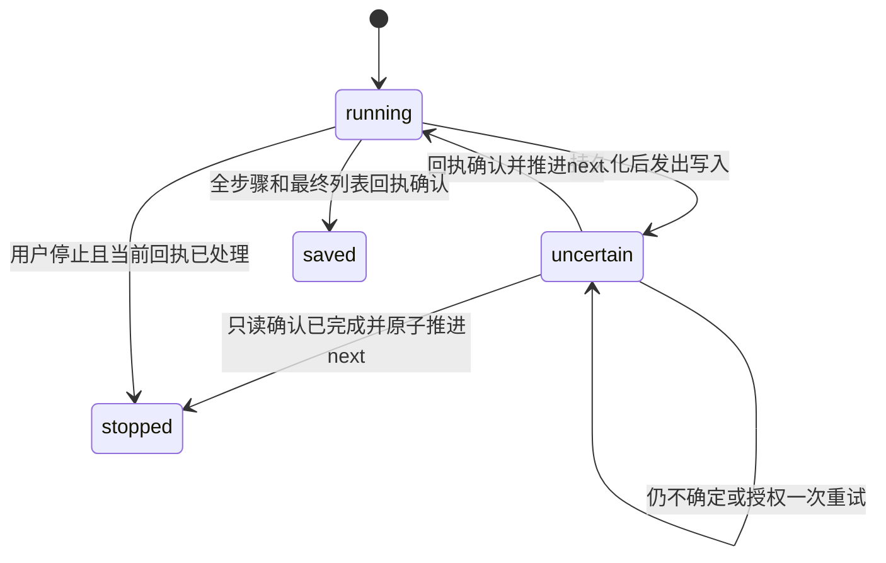

# 海牙接口链与容灾算法

更新：2026-11-13。本文解释当前实现怎样从材料生成草稿、隔离并发状态、判定回执和恢复故障。HTTP/RPC 字段契约见[接口文档](../../../API/external-platforms/hague.md)，日常操作见[海牙工作流](../workflows/海牙新申请.md)。文中算法是仓库实现，不是 WIPO 业务规则的权威说明。

## 1. 全链路与职责



三类状态不能混为一谈：材料/仲裁流水线状态、单案草稿检查点状态、全批调度统计。PDF 下载完成也不能替代草稿保存成功。

源码集中在 `src/hague/`、`src/background/hague-*.ts` 与 `src/app/pages/HaguePage.vue`。下文链接相对本机制文档。

## 2. 材料和来源算法

### 2.1 案件发现与 Word 解析

[materials.ts](../../src/hague/materials.ts) 按目录归组，识别 P 前缀、HAGUE 后缀文号。每案要求一份定稿 Word 和编号图纸；材料文件名文号与目录不一致要提示，不能静默混案。

- DOCX：读取 ZIP 中 word/document.xml；Word 不超过 20 MiB、目标 XML 不超过 10 MiB。
- DOC：由 [legacy-doc.ts](../../src/hague/legacy-doc.ts) 本地解析 MS-CFB 存储链与 MS-DOC 文本，不启动 Office、不远程转换；损坏、越界、循环链等报错。
- 提取 Locarno 大类、产品表、Description、图号/视图代码/Legend。
- 产品表第 1 列为设计编号，第 2 列为图纸数量，第 3 列为产品，第 4 列为小类；不能用图纸数量代替小类。
- 文档自身的视图代码对照表优先于内置表。跨 DM/1 版本时，例如 12 的语义必须依本案文档解析。
- 图号按数值自然排序；1.10 排在 1.2 后。图号重复、缺图、无对应 Legend、数量不符都会产生问题。

### 2.2 用户确认的重复编号修正

[repairRepeatedDesignNumbers](../../src/hague/draft-repairs.ts) 不修改 Word，仅产生修正后的 Filing：

```text
前提：产品行数至少2；每行设计编号均为1；各行产品名称与小类完全相同
图纸前缀数量 = 产品行数
第 i 行必须对应图纸组 i+1，且张数等于该行声明数
替换编号为1..N后，再执行完整 validateImages
任一条件不成立 => 不提供该修正结果
条件成立且用户点击修正 => 保存新产品行及 draftCorrections
```

本批原文确有六行都写成 1，不是已证明的解析器错误。用户授权按表格顺序和图纸分组修正后才执行；不能把所有编号冲突自动“修好”。修正说明独立放在 Filing 中，不依赖可能被重新仲裁替换的 Decision；存档时并入 checkpoint.warnings，完成弹窗继续披露。

### 2.3 来源取数与 AI 边界

[easy.ts](../../src/hague/easy.ts) 先按我方文号精确匹配唯一案件，再读取案件、全部申请人、设计人和优先权。各明细每页 50、最多 20 页；满页达上限则报未读完整。EASY 与 WIPO 的编号用途不同，不得交叉当成目标 reference。

[source.ts](../../src/hague/source.ts) / [arbitration.ts](../../src/hague/arbitration.ts) 的权威顺序：

1. 有效明确来源字段优先。
2. 允许从本案完整英文地址提取明确国名/邮编，再做地址截取。
3. 模型用于本案转写与整理，输出后仍由程序恢复、校验来源字段。
4. 缺失、矛盾或无法识别的条件进入 warnings；不能用另一案件的信息补齐。

具体规则：

| 字段 | 算法与限制 |
|---|---|
| 申请人名称 | 英文栏优先；中文栏原本就是英文可沿用，不编造英文公司名 |
| 地址层级 | 详细地址到区；城市、省份独立；合作区不当省份；SG 无来源省份可空 |
| 邮编 | 拒绝 /、-、N/A 等占位；字段或完整地址末尾的明确值；CN/SG 六位，保留 SG 前导零 |
| 邮编缺失 | 本批原站为选填，计划允许空值、写入后提醒；当前不按城市推定邮编 |
| 国家 | 归一来源国家；来源字段与地址冲突要提示，不从指定国/优先权国家猜申请人国家 |
| 设计人 | 保留原人数/顺序；英文名有来源则沿用；中文名按授权转拼音并保留 sourceName/nameOrigin |
| 设计人地址 | 复用第一申请人的全部地址字段 |
| 指定国 | 本案注明清单，EM 表示欧盟；多清单冲突不无条件合并；另案美国同日递交不自动追加 |
| 公开时间 | 本案“公开情况/方式/时间”优先；正常12、立即0；历史公开/展会不覆盖明确要求；未知为null |
| 优先权 | 来源申请号/日期/国家/DAS；priority_id、seq 不是申请号 |

不可用的中国优先权号在已有授权范围内生成草稿占位号，保留 originalNumber/generated/requiresReview；DAS 不编造。占位号采用日期年份、类型位、七位随机数及中国编号校验位形式，校验权重为 `[2,3,4,5,6,7,8,9,2,3,4,5]`，加权和 mod 11，10 写 X。它只是待替换的草稿候选，不能当作真实在先申请号。生成值随检查点保存，续跑不重新随机。

仲裁使用独立 hague-filing-arbitration 路由，共享助手串行通道；批次最多 3 案，压缩材料约 20,000 字符控制批量；单案过长有独立上限。JSON 格式失败最多修正一次，返回按 caseVolume 唯一匹配，某案缺失/重复不应串到其他案。

### 2.4 DraftPlan 预检查

[draft-plan.ts](../../src/hague/draft-plan.ts) 在创建前检查：材料问题、英文必需字段、申请人类型/国家、设计人与来源人数、指定国格式、公开月份、优先权完整性、产品/图纸归属与格式。

当前申请人自动配置为 CN/SG 法人。SG 资格国家与 ACP 按来源形成候选，并提醒审核国籍、住所、营业所和惯常居所；不代表已证明所有资格事实。自然人及其他国家配置继续拦截。

设计编号须从 1 连续；每组图纸数须等于本行声明；所有图片须被唯一设计组覆盖。小类转换为数值字符串；大类在执行选择时正规化，保持计划指纹兼容原始 03 等格式。

## 3. 并发隔离与请求队列

### 3.1 案件槽与网络槽

[draft-batch.ts](../../src/hague/draft-batch.ts) 将案件并发限制在 1–6：每路领取一案，单案步骤串行，成功后立即补下一案。已保存案件不重新创建。重复我方文号、多个案件指向同一 WIPO reference、模式冲突等在领取前拦截。

| 资源 | 约束 |
|---|---|
| 材料解析 | 流水线 PermitPool(2) |
| 来源网络 | 对应来源通道的有界网络池 |
| 仲裁助手 | 串行；每批最多3案 |
| 草稿案件槽 | 1–6 |
| HTTP 上下文网络池 | 6 |
| 后台 HTTP 代理池 | 6 |
| 单链 | 一个请求尾队列；业务命令不交错 |
| PDF 打印 | 1 |

这些池位于不同层，不能简单相加为同一台服务器的并发事务数。批量草稿默认6路，可选1–6路；默认值不构成长期吞吐或服务器限流的保证。

批量页面模式为各案打开独立工作标签页，单案页面模式使用用户选中的标签页；接口模式可共享一个已验证的传输标签页，但绝不共享本案 DOM、ViewState、reference、请求尾队列与错误状态。HTTP 共享 tabId 不等于共享草稿。

### 3.2 单链状态

[http-context.ts](../../src/hague/http-context.ts) 持有：

```text
Context = detachedDocument + currentURL/path + latestViewState
        + pinnedReference + pendingCount + promiseTail + failure
```

post 进入尾队列后，才读取本案最新控件，构造 successful controls，提交并应用响应。失败写入 failure，后续原链请求冻结。settle 等待尾队列结束；自动恢复通过新链重新读取，不复活被污染的上下文。

不执行原站脚本任意代码，只从支持的静态语法提取动作与有限导航。更新 ViewState 时补回所有 form；DataTable 行更新写 tbody。reference 冲突即停止。

### 3.3 事件一致性

`click`、`change` 可产生协议动作；`input` 只镜像 autocomplete 隐藏值后返回。一个 checkbox 点击不能在 input 再次重放 onclick。这是本批“指定国选择又被取消”的已复现根因。

radio/checkbox 的浏览器预激活状态须保留，不能用 preventDefault 把 checked 回滚。每次业务动作等待所属链更新完成，不能持有已被响应替换的旧控件继续填值。

## 4. 计划指纹与检查点

[draft-runner.ts](../../src/hague/draft-runner.ts) 的步骤顺序为：准备 → 创建 → 所有申请人 → 代理 → 指定国 → 大类 → 每设计的创建/上传/Legend/关闭 → 可选说明 → 所有设计人 → 所有优先权 → 公开 → 签名 → Summary → 打印 → 返回编辑器 → 保存。

next 表示下一步下标。草稿状态和材料/仲裁状态分开，常规写入失败落 uncertain；failed 是类型兼容状态，不宜把它当成唯一异常终态。

| 检查点字段 | 用途 |
|---|---|
| reference / tabId / documentId | 锚定原草稿、传输目标和当前执行文档 |
| next / total / stage / status | 下一步、总数、显示阶段、运行状态 |
| planKey | 防止材料或字段改变后沿旧步骤写入 |
| generatedPriorities | 固定已生成的占位号 |
| downloadId | 关联下载回执，不等于草稿已保存 |
| acknowledged | 记录已成功收到的 next/op/page，用于最终保存恢复证明 |
| recoveryAttempts | 以步骤下标为键，持久化一次自动核对/恢复预算 |
| recoveryDecision | 记录尚未消费的 retry 授权，刷新时仍保留不确定状态 |
| warnings / error | 审核提醒、恢复说明和当前异常 |

planKey 是 JSON 计划的 FNV 风格 32 位摘要加序列化长度。图纸只纳入 name/size/lastModified 元数据，不对文件正文做密码学哈希。它用于一致性检查，不是防篡改签名；不能声称已证明图片字节绝对相同。

本地保存键为 `hague.draft.v1.<caseVolume>`。检查点可保留，但接口链 DOM、ViewState 和被用户选择的 File 对象不是同一份持久化数据；页面刷新后不能假定整批材料与内存上下文仍在。

## 5. 写入与持久化时序



执行协议：

1. 检查 planKey、tabId 与 reference，复用原编号。
2. 发请求前先保存 uncertain，清理上一步 acknowledged 和已消费 retry 授权。
3. 收到 ok 回执后，持久化 acknowledged；导航动作继续核对目标页面和编号。
4. 保存动作额外核对 Draft(s) 精确编号；完成才推进 next。
5. 失败先保留 uncertain 和错误，再进入受限恢复。
6. 用户停止为协作式停止：不领取新案，已发出的操作等回执；不是撤销服务端写入。

刷新窗口的关键不变量：

- **completed 的判定与 next+1 一次保存。** 不能先保存 stopped/旧 next，再另存 next+1，否则刷新可能重复添加记录。
- retry 授权写入 recoveryDecision 且保持 uncertain。恢复后若进程中断，预算不会重置；即使留存 running，也先转回 uncertain 等待核对。
- 创建请求已发出但 reference 未确认时，不创建替代草稿。创建后初始保存/重开只是让编号可恢复，不代表整案已完成。

## 6. 有界自动恢复

仅 HTTP 模式具备恢复 hook。入口是失败后的 `Host.recover`，或批量/单案“核对并恢复当前草稿”。页面模式继续人工确认。

```text
若无原reference、指纹缺失/变化、目标改变、用户已停止 => 不自动恢复
若当前op不在允许集合，或该步骤预算已耗尽 => 保留uncertain
先持久化本步attempt=1
新建独立链，导航并读取原站canonical状态
返回 completed / retry / unknown
再验证receipt.ok及原reference一致
completed => next+1与状态一次持久化
retry => 持久化一次授权，本轮重试；再次失败暂停
unknown => 原检查点保留，人工核对
```

一次预算包含失败的核对尝试，不是“无限探测直到成功”。没有指数退避/无限网络重试，也没有自动换账号、换执行模式或重建申请。

### 6.1 分动作判定

| 动作 | 已完成证据 | 允许重试 | 不能确认时 |
|---|---|---|---|
| parties | 当前实现主要采用重新读取指定国区后重试，不单独从摘要判 completed | 同编号新链刷新指定国区，再应用本案集合一次 | 不支持的代码/集合不一致仍暂停 |
| locarno | 规范读回 select 数值与目标数值一致 | 选项存在且读回不同，可重设一次 | 分区/控件缺失暂停 |
| priority | 总记录数=index+1；该记录同一独立块中号、日期、完整国家标签都相符 | canonical PriorityForm 和 AddPriority 存在，当前记录数=index | 多余、缺少既有记录、标签/字段冲突暂停 |
| saveDraft | 已持久化同一步成功保存响应且 page=portfolio，加精确分页列表回执 | 不自动重发保存动作 | 初始空草稿存在不算最终成功 |
| create/upload/print 等 | 当前不做泛化自动判定 | 不自动重试 | 保留检查点 |

优先权判定只读取展示记录，不用尚未保存的输入框值。候选记录容器只允许一枚 Open/edit 按钮，编号和日期必须为完整 token；国家接受完整 ISO/全名/“ISO - 全名”标签，不能用字符串包含关系把 Hong Kong, China 当成 CN。写入 priority 前还独立要求当前计数=index，构成第二道防重复保护。

无法识别原站结构时应返回 unknown，而不是降级为“记录数没读到，按0处理”。最终保存必须有 acknowledged 证明；Draft(s) 中存在编号只证明该草稿存在，不能单独证明本轮字段全部完成。

人工核对入口可明确标记本步已完成或允许重试，并清理未消费 retry 决定。此为用户授权的检查点调整，不是后台自动绕过保护。

## 7. Summary、PDF 与流式导出

[http-client.ts](../../src/hague/http-client.ts)、[summary-css.ts](../../src/hague/summary-css.ts)、[hague-offline-pdf.ts](../../src/background/hague-offline-pdf.ts) 分工：

1. 在本链取得正确 Summary。
2. 去活动标签、事件属性、外链；内联官方样式/图片。
3. 对外链 CSS、内嵌 style、行内 style 全部清理 @import 与非 data URL，避免只净化一种来源。
4. 后台再次拒绝活动/网络依赖 HTML；短暂 about:blank 阻断网络、等待解码/字体、printToPDF。
5. 校验 PDF 签名，finally 释放 debugger/渲染页。
6. 经统一 downloadDocuments 导出单 PDF 或流式 ZIP，等待浏览器下载 complete。
7. 回到编辑器，保存草稿并核对列表回执。

ZIP 逐条生成/写入，复用背压与磁盘缓存；不是整批文件驻留内存。单份 Summary HTML、内联图片与 PDF 仍可能完整驻留内存，不能宣称恒定内存或零拷贝。

打印、最终下载、草稿保存是三个独立结果。本批曾先修好打印预检，再发现 Summary Back 的 POST 被白名单拒绝；必须逐层验证，不能把下载成功作为全链路成功。

## 8. 本批故障经验与回归矩阵

| 现象 | 已确认原因/处理 | 不应作出的推论 |
|---|---|---|
| 多路指定国均不一致 | click/input 重复分派，已最小复现修复 | 并发数本身就是根因 |
| 缺邮编被跳过 | 本地强制校验与原站选填不符，允许空并提醒 | 必须猜一个城市邮编 |
| SG 申请人被跳过 | 本地写死 CN 资格，增加 SG 候选与审核提醒 | 所有国籍/自然人已支持 |
| 六设计图数不符 | 原 Word 六行编号均1，用户确认后有限修正 | 解析器可无条件改原文 |
| 离线 Summary 无效 | 内嵌 CSS 遗留远程字体 URL | 放松后台活动内容/外网限制 |
| 返回编辑器失败 | Summary Back 的 POST 缺精确白名单例外 | 放开 summary 上所有写动作 |
| 03 大类找不到 | 原站 option 数值3，执行时正规化 | 改动材料后可无视计划指纹 |
| 草稿存在但找不到 | 列表分页；恢复和最终确认都需分页 | 创建一个新草稿解决 |
| 优先权保存不确定 | 新上下文核对实际记录后保留原始数据续接 | 单凭日历范围改日期或省略优先权 |
| 恢复中刷新 | completed 与推进原子提交，retry 保留授权/预算 | stopped 永远意味着可以直接重放 |

截至本轮：149 项海牙测试、类型检查、Lint 基线门禁、根/扩展构建和独立审查通过。关键测试：[runner-recovery](../../tests/unit/hague/runner-recovery.test.ts)、[draft-recovery](../../tests/unit/hague/draft-recovery.test.ts)、[http-driver](../../tests/unit/hague/http-driver.test.ts)、[http-context](../../tests/unit/hague/http-context.test.ts)、[draft-repairs](../../tests/unit/hague/draft-repairs.test.ts)、[summary-css](../../tests/unit/hague/summary-css.test.ts)。

真实 13 件成功包含现场核对续接；新增自动恢复尚未全量重新跑真实样本。本轮后续只读核查因当前响应无 Draft(s) 入口，返回 unknown 并停止，没有业务写入。隔离/故障测试证明实现分支，不替代真实长期负载与所有材料组合验证。

## 9. 维护与诊断程序

1. 先读取本机 log/cdp/status.json 和最新 JSONL，沿 requestId/progressId/taskId 关联网络、进度和下载事件。CDP 只存最近24小时，未变化快照可能不重复输出，日志安静不等于服务断线。
2. 区分等待网络、JSF 校验、控件缺失、数量/字段冲突、下载未完成和已保存但列表未命中。HTTP 200 不是业务确认。
3. 必要时使用原生 CDP，只读核对编号、控件、计数与回执。日常 Chrome 不用 Playwright connectOverCDP，不改下载行为。
4. 先用脱敏最小结构写失败回归，再改协议适配，核对错误冻结、不同 reference、恢复预算与中断窗口。
5. 执行测试和构建；监听脚本未改可复用 CDP 服务，改监听脚本后才 stop/start。源码 build 不会替换已经打开的旧扩展 JS 上下文，启用新版需重新加载扩展。

常用验证（在 patmail-extension 目录）：

```powershell
pnpm exec vitest run tests/unit/hague
pnpm typecheck
pnpm lint
pnpm build
```

文档/日志不保存 Cookie、认证头、密码、ViewState 值、下载令牌、完整响应正文或真实业务清单。CDP 监听器只采集元数据；受控业务调用与被动监听的权限不能混为一谈。正式递交、付款和其他国家/自然人的资格扩展仍需另行定义契约与验证证据。
