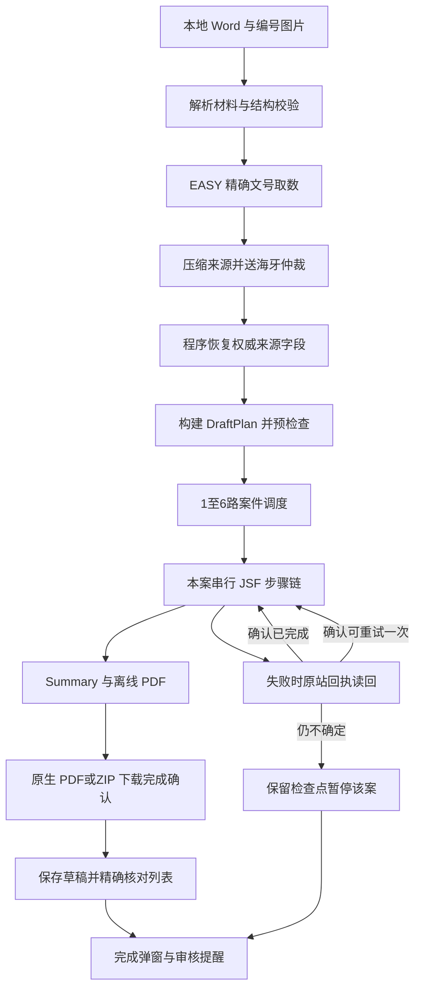

# 海牙接口链与容灾算法

更新：2026-11-16。本文负责材料解析、来源字段与 DraftPlan 预检查。并发、指纹及容灾的权威解释见[并发调度与容灾](../engineering/hague/concurrency-and-recovery.md)。HTTP/RPC 字段契约见[接口文档](../../../API/external-platforms/hague.md)，日常操作见[海牙工作流](../workflows/海牙新申请.md)。文中算法是仓库实现，不是 WIPO 业务规则的权威说明。

## 1. 全链路与职责



三类状态不能混为一谈：材料/仲裁流水线状态、单案草稿检查点状态、全批调度统计。PDF 下载完成也不能替代草稿保存成功。

源码集中在 `src/hague/`、`src/background/hague-*.ts` 与 `src/app/pages/HaguePage.vue`。下文链接相对本机制文档。

## 2. 材料和来源算法

### 2.1 案件发现与 Word 解析

[materials.ts](../../src/hague/materials.ts) 按目录归组，识别 P 前缀、HAGUE 后缀文号。每案要求一份定稿 Word 和编号图纸；材料文件名文号与目录不一致要提示，不能静默混案。

- DOCX：读取 ZIP 中 word/document.xml；Word 不超过 20 MiB、目标 XML 不超过 10 MiB。
- DOC：由 [legacy-doc.ts](../../src/hague/legacy-doc.ts) 本地解析 MS-CFB 存储链与 MS-DOC 文本，不启动 Office、不远程转换；损坏、越界、循环链等报错。
- 提取 Locarno 大类、产品表、Description、图号/视图代码/Legend。
- 产品表第 1 列为设计编号，第 2 列为图纸数量，第 3 列为产品，第 4 列为小类；不能用图纸数量代替小类。
- 文档自身的视图代码对照表优先于内置表。跨 DM/1 版本时，例如 12 的语义必须依本案文档解析。
- 图号按数值自然排序；1.10 排在 1.2 后。图号重复、缺图、无对应 Legend、数量不符都会产生问题。

### 2.2 用户确认的重复编号修正

[repairRepeatedDesignNumbers](../../src/hague/draft-repairs.ts) 不修改 Word，仅产生修正后的 Filing：

```text
前提：产品行数至少2；每行设计编号均为1；各行产品名称与小类完全相同
图纸前缀数量 = 产品行数
第 i 行必须对应图纸组 i+1，且张数等于该行声明数
替换编号为1..N后，再执行完整 validateImages
任一条件不成立 => 不提供该修正结果
条件成立且用户点击修正 => 保存新产品行及 draftCorrections
```

本批原文确有六行都写成 1，不是已证明的解析器错误。用户授权按表格顺序和图纸分组修正后才执行；不能把所有编号冲突自动“修好”。修正说明独立放在 Filing 中，不依赖可能被重新仲裁替换的 Decision；存档时并入 checkpoint.warnings，完成弹窗继续披露。

修正结果另存 `designNumberCorrection: { inputKey, note }`，其中 inputKey 根据 Locarno、原产品表、说明、视图和图纸文件元数据计算。重新导入只在检查点中批准记录的输入指纹、修正文案及严格分组校验都一致时复用（不受检查点运行状态限制，且不改变 status/next）；统一更换所有产品名、小类或材料后也不能套用旧批准。没有指纹的旧记录需显式修正或在已核实的具体材料上一次性迁移，不能仅凭通用警告文字自动修正。图片分组数量和重复设计编号在材料阶段即提示。


### 2.3 来源取数与 AI 边界

[easy.ts](../../src/hague/easy.ts) 先按我方文号精确匹配唯一案件，再读取案件、全部申请人、设计人和优先权。各明细每页 50、最多 20 页；满页达上限则报未读完整。EASY 与 WIPO 的编号用途不同，不得交叉当成目标 reference。

[source.ts](../../src/hague/source.ts) / [arbitration.ts](../../src/hague/arbitration.ts) 的权威顺序：

1. 有效明确来源字段优先。
2. 允许从本案完整英文地址提取明确国名/邮编，再做地址截取。
3. 模型用于本案转写与整理，输出后仍由程序恢复、校验来源字段。
4. 缺失、矛盾或无法识别的条件进入 warnings；不能用另一案件的信息补齐。

具体规则：

| 字段 | 算法与限制 |
|---|---|
| 申请人名称 | 英文栏优先；中文栏原本就是英文可沿用，不编造英文公司名 |
| 地址层级 | 详细地址到区；城市、省份独立；合作区不当省份；SG 无来源省份可空 |
| 邮编 | 拒绝 /、-、N/A 等占位；字段或完整地址末尾的明确值；CN/SG 六位，保留 SG 前导零 |
| 邮编缺失 | 本批原站为选填，计划允许空值、写入后提醒；当前不按城市推定邮编 |
| 国家 | 归一来源国家；来源字段与地址冲突要提示，不从指定国/优先权国家猜申请人国家 |
| 设计人 | 保留原人数/顺序；英文名有来源则沿用；中文名按授权转拼音并保留 sourceName/nameOrigin |
| 设计人地址 | 复用第一申请人的全部地址字段 |
| 指定国 | 本案注明清单，EM 表示欧盟；多清单冲突不无条件合并；另案美国同日递交不自动追加 |
| 公开时间 | 本案“公开情况/方式/时间”优先；正常12、立即0；历史公开/展会不覆盖明确要求；未知为null |
| 优先权 | 来源申请号/日期/国家/DAS；priority_id、seq 不是申请号 |

不可用的中国优先权号在已有授权范围内生成草稿占位号，保留 originalNumber/generated/requiresReview；DAS 不编造。占位号采用日期年份、类型位、七位随机数及中国编号校验位形式，校验权重为 `[2,3,4,5,6,7,8,9,2,3,4,5]`，加权和 mod 11，10 写 X。它只是待替换的草稿候选，不能当作真实在先申请号。生成值随检查点保存，续跑不重新随机。

仲裁使用独立 hague-filing-arbitration 路由，共享助手串行通道；批次最多 3 案，压缩材料约 20,000 字符控制批量；单案过长有独立上限。JSON 格式失败最多修正一次，返回按 caseVolume 唯一匹配，某案缺失/重复不应串到其他案。

### 2.4 DraftPlan 预检查

[draft-plan.ts](../../src/hague/draft-plan.ts) 在创建前检查：材料问题、英文必需字段、申请人类型/国家、设计人与来源人数、指定国格式、公开月份、优先权完整性、产品/图纸归属与格式。

当前申请人自动配置为 CN/SG 法人。SG 资格国家与 ACP 按来源形成候选，并提醒审核国籍、住所、营业所和惯常居所；不代表已证明所有资格事实。自然人及其他国家配置继续拦截。

设计编号须从 1 连续；每组图纸数须等于本行声明；所有图片须被唯一设计组覆盖。小类转换为数值字符串；大类在执行选择时正规化，保持计划指纹兼容原始 03 等格式。


## 当前技术规范与历史边界

- [并发调度、计划身份与恢复](../engineering/hague/concurrency-and-recovery.md)
- [诊断与维护](../engineering/hague/diagnostics-and-maintenance.md)
- [完整技术索引](../engineering/README.md)

原 2026-11-13 的执行层设计、故障复盘和监督回归原文完整保存在[历史版本](../archive/hague/海牙接口链与容灾算法-2026-11-13.md)。历史批次数字不是当前验收结论。本页不再重复解释执行层事实。
