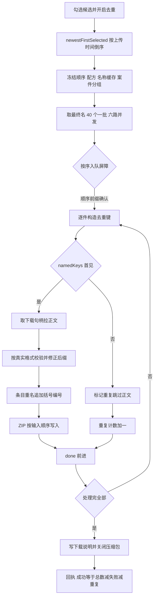
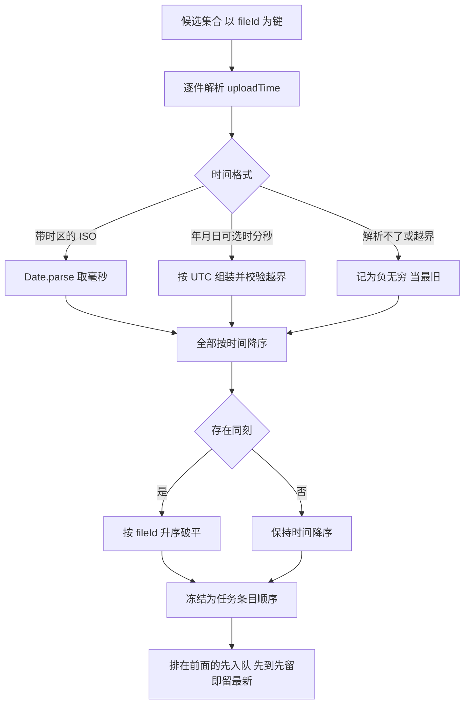
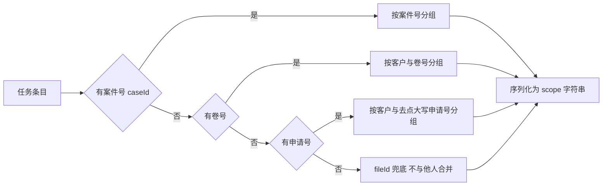
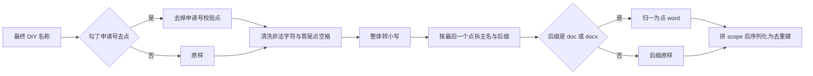
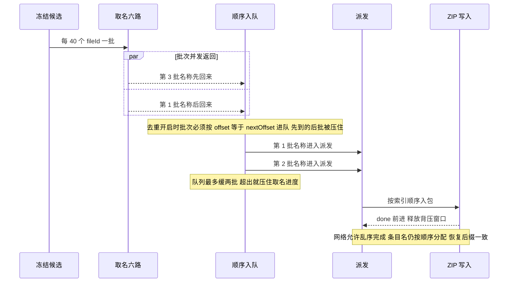
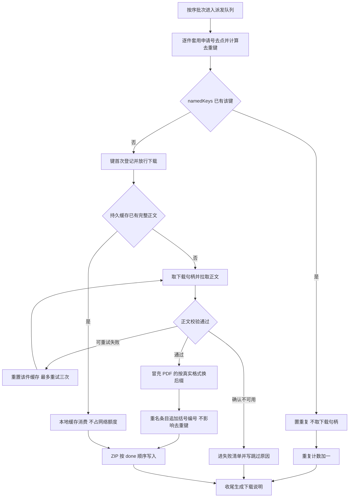
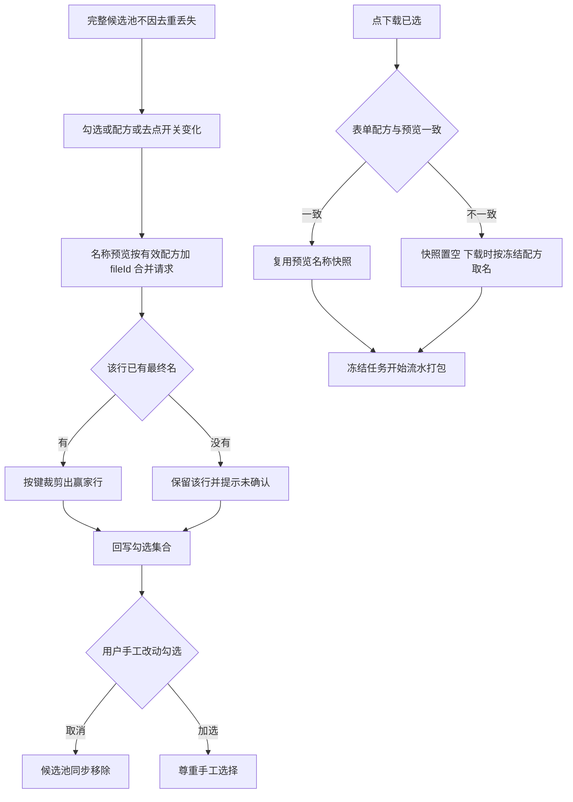
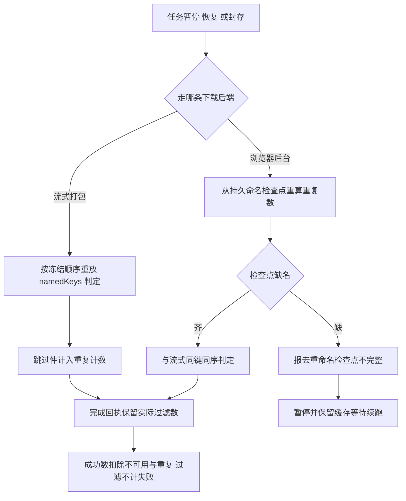

# 下载去重算法

同一个案件里按最终 DIY 下载名只保留上传时间最新的一份。本文是机制图解，供维护者核对判定规则；日常操作见 [查询模板](11-查询模板.md) 的「下载名称与下载已选」。代码依据：`src/mail/deduplicate.ts`、`src/api/stream-download.ts`、`src/background/browser-download.ts`、`src/app/components/FileSearchQuery.vue`，截至 2026-11-01。

核心规则一句话：去重键 = JSON[案件分组 scope, 归一后的最终名]；按上传时间倒序「先到先留」，等价于「留最新」；后到的同键件标为重复，跳过正文不取下载句柄。

## 1. 全链路总览

| 项目 | 说明 |
| --- | --- |
| 输入 | 勾选的候选集合、去重开关、下载名称配方、申请号去点开关 |
| 输出 | 一个 ZIP；重复件不产生条目、不占网络；包尾可能带「下载失败清单 / 源文件格式说明」 |
| 判断条件 | 去重键是否在 namedKeys 中首见；首见保留，后见跳过 |
| 停止条件 | done 前进到总数；中途取消或断线则任务封存，缓存保留待续跑 |

## 2. 冻结排序与新旧判定

| 项目 | 说明 |
| --- | --- |
| 输入 | `SelectedPatentFile.uploadTime` 与 `fileId` |
| 输出 | 降序稳定数组；界面裁剪勾选与任务冻结顺序共用同一函数 |
| 判断条件 | 时间可解析则比较毫秒；同刻用 fileId 升序稳定排序 |
| 边界 | 无效日期一律当最旧排最后；同刻破平是已知瑕疵，见第 9 节 |

## 3. 案件分组 scope 回退链

| 项目 | 说明 |
| --- | --- |
| 输入 | `caseId`、`caseVolume`、`customerName`、`applicationNo`、`fileId` |
| 输出 | `caseScope()` 返回的 JSON 字符串，冻结任务时逐件快照进 `caseScopes` |
| 判断条件 | 四级回退，前一级缺失才看下一级 |
| 边界 | 无案件身份时退化为 fileId，等于不参与去重，宁漏勿误 |

## 4. 名称归一与去重键

| 项目 | 说明 |
| --- | --- |
| 输入 | `resolveDownloadFileNames` 给出的最终名（或无配方时的附件原名）、`stripAppNoDot` 开关 |
| 输出 | `finalDownloadNameKey()` 的归一串，与 scope 一起 JSON 序列化成键 |
| 判断条件 | 后缀只有 doc 与 docx 互认；`（2）` 等字面字符是正文名一部分，永不反推剥离 |
| 边界 | PDF 与 Word 同名各留一份；ZIP 条目冲突由写包层追加括号编号，不回写键 |

## 5. 取名与按序入队

| 项目 | 说明 |
| --- | --- |
| 输入 | 冻结的 fileId 顺序、持久命名检查点、`resolvedNames` 快照 |
| 输出 | 按冻结顺序流出的名称批次（`accept` 严格顺序前缀） |
| 判断条件 | `resolveDownloadFileNames` 六路并发、40 个一批；命中检查点或快照的 ID 不再请求原站 |
| 背压 | 名称队列缓两批；`nextOffset - scheduled < 6` 时优先取名，否则优先下载，两条链共用来源页六个额度 |

## 6. 派发判定、重复跳过与失败统计

| 项目 | 说明 |
| --- | --- |
| 输入 | 顺序前缀的名称批次、`namedKeys`、`caseScopes`、持久缓存 |
| 输出 | ZIP 条目、失败清单、说明里的「过滤重名 N 个」 |
| 判断条件 | 键首见放行；重复件不取句柄不下载正文，直接占一个 done 席位 |
| 停止条件 | 三次重试后记不可用；过滤重复不当作下载失败，成功数同时扣除失败与重复 |

## 7. 界面预览与勾选联动

| 项目 | 说明 |
| --- | --- |
| 输入 | 候选池、下载名称配方、申请号去点、预览名称状态 |
| 输出 | `selected` 勾选集合（`deduplicateNamedFiles` 的赢家集） |
| 判断条件 | 未解析名的行永不裁掉；切换配方或去点重新比较，不重新查询文件 |
| 停止条件 | 过期回复不覆盖新配方；跨账号或刷新查询清空预览缓存 |

## 8. 恢复与两条下载后端的一致性

| 项目 | 说明 |
| --- | --- |
| 输入 | 封存任务的 manifest（顺序、配方、`resolvedNames`、`caseScopes`）、命名检查点 |
| 输出 | `deduplicatedCount` 与完成回执文案 |
| 判断条件 | 浏览器后台按 40 个偏移从检查点取名重算；键构造与流式逐字相同 |
| 边界 | 缺名不算重复也不算失败，报「检查点不完整」让任务留在可续跑状态 |

## 9. 边界语义

| 场景 | 行为 | 原因 |
| --- | --- | --- |
| 同案件同名、上传时间不同 | 留最新，旧的过滤 | 时间倒序先到先留 |
| 同案件同名、同一时间戳 | 留 fileId 较小的一份 | 破平按 fileId 升序，见已知瑕疵 |
| 名字带 `（2）` 等字面字符 | 原样参与比较，不剥离 | 后缀是 ZIP 避重名产物，反推不可靠 |
| ZIP 条目重名 | 写包层追加 `（2）` 编号 | 不回写去重键 |
| doc 与 docx 同名 | 合并，留一份 | 后缀归一为点 word |
| PDF 与 Word 同名 | 各留一份 | 后缀不同即不同键 |
| 跨案件同名 | 各自保留 | scope 不同即不同键 |
| 无案件身份的行 | 不参与合并 | scope 退化为 fileId |
| 最终名未解析 | 永远保留，下载时重试取名 | 不能提前误删 |
| 申请号去点开关变化 | 条目名与键同步归一，比较结果一致 | 键与实际名同源 |

## 10. 一次真实任务的计数

2026-11-01 上午「季华-新申请文档.zip」：取名 788/788、已入包 498、同名去重 290，完成通知「过滤 290 个同案件同名旧文件」（727.5MB）。对应公式：成功 498 = 总数 788 − 失败 0 − 重复 290。

## 11. 已知瑕疵与改进方向

| 瑕疵 | 现状 | 建议 |
| --- | --- | --- |
| 同刻破平按 fileId 升序 | 若 fileId 自增，同刻并列会留旧件 | 改为降序或按原站稳定次序 |
| 时间解析不认毫秒后缀与相对时间 | 解析失败一律当最旧 | 解析失败的组退回不去重 |
| 去重键构造重复三处 | `deduplicate.ts`、`stream-download.ts`、`browser-download.ts` 各拼一次 JSON | 抽 `dedupeKey()` 单点维护 |

## 12. 测试入口与代码索引

| 文件 | 覆盖点 |
| --- | --- |
| `tests/unit/mail/deduplicate.test.ts` | 时间解析、scope 回退、名称归一、留最新 13 例 |
| `tests/unit/api/stream-download.test.ts` | 顺序入队、重复跳过、统计口径 |
| `tests/unit/background/browser-download-background.test.ts` | 恢复重算与检查点缺名 |
| `tests/e2e/diy-dedupe.e2e.mjs` | 改 DIY 配方、恢复候选、ZIP 实际文件名与 CRC、名称缓存复用 |

| 符号 | 位置 | 职责 |
| --- | --- | --- |
| `newestFirstSelected` / `caseScope` / `finalDownloadNameKey` / `deduplicateNamedFiles` | `src/mail/deduplicate.ts` | 排序、分组、名称归一、赢家裁剪 |
| `accept` / `namedKeys` / `deduplicated` | `src/api/stream-download.ts` | 顺序前缀入队、首见保留、跳过计数 |
| `duplicateCount` | `src/background/browser-download.ts` | 浏览器后台恢复时按检查点重算 |
| `filterSelection` / `updateWinners` | `src/app/components/FileSearchQuery.vue` | 预览联动勾选、冻结任务快照 |
| `resolveDownloadFileNames` | `src/mail/download-name.ts` | 40 个一批六路取最终名、检查点复用 |
