# PCT提醒工作流

内置标识：`pct-reminder`。主要入口是“发文任务 → 按工作流发文”，也可以在期限监控中继续查询、勾选和提交。输入来自 `.xlsx`，邮箱最终从 EASY 发文联系人读取。一次运行的产物是已创建、已保存并提交给发文映射配置的默认审核人审核的发文，以及每个处理事项对应的结果。

返回 [工作流索引](README.md)。

## 1. 全链路总览

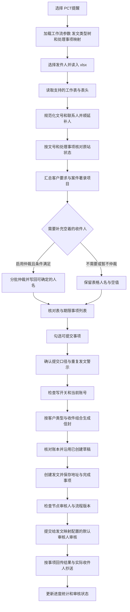

## 2. 输入和配置

| 输入 | 来源 | 用途与缺失处理 |
| --- | --- | --- |
| 我方文号 | 表格列，默认同名 | 主要案件检索键；普通提醒要求该列和可用文号 |
| 处理事项 | 已识别工作表的名称，或普通表格的同名列 | 用于选择映射、核对原站事项；同文号多条事项必须进一步区分 |
| 客户文号 | 表格列 | 决定贵方案号或我方案号类型；案件匹配时可作为补查键 |
| 客户名称 | 表格列 | 客户分块、配置关联、特例和信封分组 |
| 第一客户联系人 | 表格列 | 第一发明人特例的候选姓名；仲裁也可参考 |
| 客户联系人(IPR) | 表格列 | 普通提醒的主送候选；多个姓名按可识别分隔符拆分 |
| 发件人 | 本次选择、工作流与规则配置 | 创建后的发文缺发件邮箱时，使用有效的默认发件人编号补入 |
| 处理事项映射 | 发文映射 → 处理事项 → 发文类型 | 内置三类提醒；自定义事项按文号条件选择映射 |
| 发文类型 | 处理事项映射、EASY 类型树与普通提醒运行配置 | 必须能确定唯一叶子节点及有效内部编号 |
| 客户要求与著录项目 | 原站只读核对 | 给空行仲裁提供该案依据 |
| 表格中的邮箱 | 表格可能存在 | 不作为本轮地址写入的可信来源 |

普通提醒的默认列名可由运行参数解析。一个表格读取流程最多保留 5000 个有效行；无效行会出现在跳过提示中。重新读表或切换工作流后要重新核对，之前的仲裁、异常标记和勾选不应被当作本轮结果。

## 3. 表格读取与顺延补人

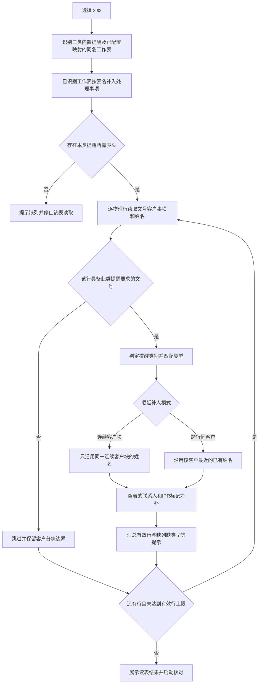

默认顺延只限连续客户块；中间出现其他客户或被跳过的物理行也会影响连续性。“同客户隔行也顺延补上”启用后改为跨块继承。核对开始后相关口径锁定，重新读表才能重新选择。页面上的“（补）”“（仲）”是来源提示，匹配姓名时会清理。

内置工作表名称为「提醒申请PCT」「PCT进国家阶段官方绝限」「提醒申请涉外外观」。已配置自定义映射的处理事项也可以作为工作表名称，读取时会用表名写入该表各行的处理事项；普通表格仍按处理事项列读取。映射配置方法见 [发文映射](../usage/10-发文映射.md)。

## 4. 处理事项映射与发文类型选择

先在「发文映射 → 处理事项 → 发文类型」核对映射表，再读入工作簿。处理事项名称用于匹配规则，发文类型名称用于定位 EASY 类型树中的具体叶子，两者不能互相代替。

### 内置映射表

| 处理事项 | 有客户文号 | 无客户文号，使用我方文号 |
| --- | --- | --- |
| 提醒申请PCT | 提醒申请PCT（贵方案号）-深圳市 | 提醒申请PCT（我方案号）-深圳市 |
| PCT进国家阶段官方绝限 | 提醒PCT申请进入国家案件（贵方案号） | 提醒PCT申请进入国家案件（我方案号） |
| 提醒申请涉外外观 | 提醒涉外外观申请（贵方案号） | 提醒外观申请（我方案号） |

内置项只读，不能删除、覆盖或通过导入修改。普通 PCT 提醒仍支持工作流运行配置中的类型编号或完整名称，上表是默认配置；进国家和涉外外观按表中的完整名称匹配。涉外外观也会区分贵方案号和我方案号，不再固定使用贵方案号。

### 自定义映射的配置与优先级

1. 在映射表中从原站处理事项树选择具体事项，分类节点不能作为映射项。
2. 选择文号条件：「有客户文号」「无客户文号，使用我方文号」或「无」。其中「无」表示不限定文号条件，不表示没有客户文号。
3. 从发文类型树选择具体叶子，保存完整树路径。同一处理事项、同一文号条件只能有一条映射；需要替换时先删除旧项。
4. 工作簿中的对应工作表用处理事项全名命名。每行先按有无客户文号找对应条件；没有对应条件的项时，才使用条件为「无」的映射。

自定义映射保存过完整路径时，按该路径和叶子全名唯一匹配，不会退回同名的其他分支。旧配置没有路径时，只接受唯一同名叶子。没有适用映射、路径失效或匹配不唯一时，该行没有有效发文类型，提交规划会阻止创建发文；不会套用普通 PCT 提醒类型。

映射表支持搜索、分页、导出和导入。导入需要「处理事项」「发文类型」列；「文号条件」缺省按「无」。整表校验成功后才保存，内置项及相同已有项跳过；同事项同条件已指向其他类型时，先删除原项再导入。配置调整后重新读表、核对，再提交。

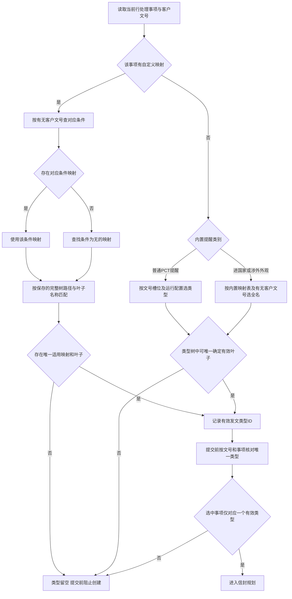

进国家、涉外外观和自定义映射事项都在本工作流中处理，不需要为每种发文类型另建一条工作流。

## 5. 案件、事项与审核状态核对

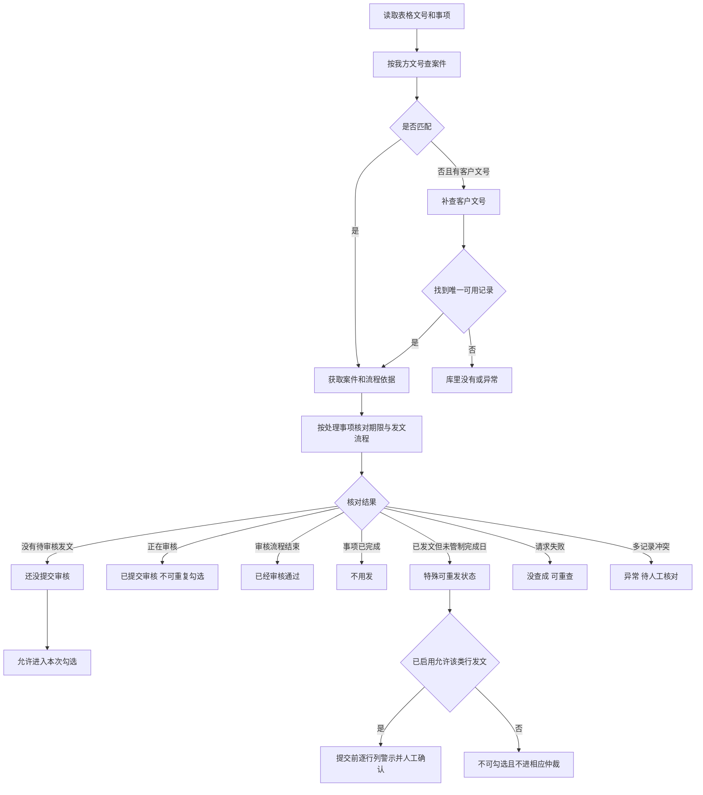

核对期间暂停勾选。期限查询只列出其查询范围内的事项，案件查询同时补充表格文号对应的案件及流程状态；不能把“期限列表没有”直接理解为“案件不存在”。核对失败和明确无结果分别显示；手动仲裁前可先重查没查成的行。

## 6. 客户要求仲裁

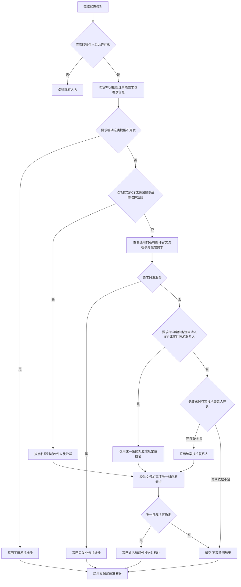

仲裁决定候选姓名或“不用发／只发业务”，最终邮箱仍需在发文页联系人核对。客户提到初稿、检索、看稿、年费、办登的要求，不自动套到 PCT 提醒。没有事项列且同文号无法唯一定位时，不写回该行。商务、登录人和密送的系统处理不由仲裁人名替代。

## 7. 提交口径与收件人选择

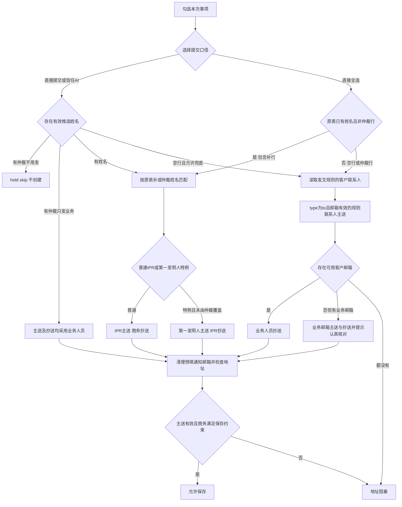

“直接全选”会放弃仲裁结论，包括仲裁写出的“不用发”和“只发业务”；原表已有的人名仍保留。选择时应以提交弹窗的口径为准。第一发明人特例要求联系人角色匹配；当前保存端还校验商务已进入抄送，如果特例计划没有带上商务，会停在已创建草稿，不能将其理解为提交成功。

## 8. 信封规划与勾选范围

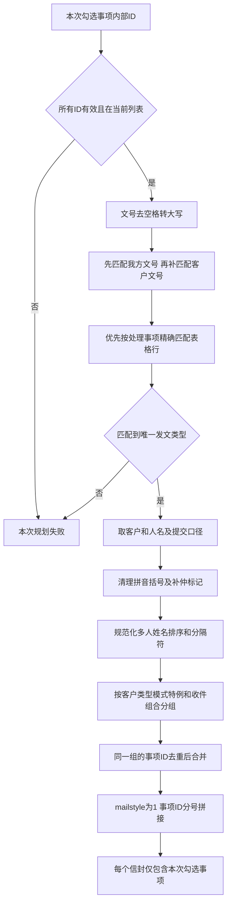

不同客户、不同发文类型、不同联系人集合以及不同提交处理方式不应被误合并。姓名顺序和“（补）／（仲）”本身不会生成另一套收件人集合。“不用发”的行保持独立跳过。

## 9. 每封信的实际接口顺序

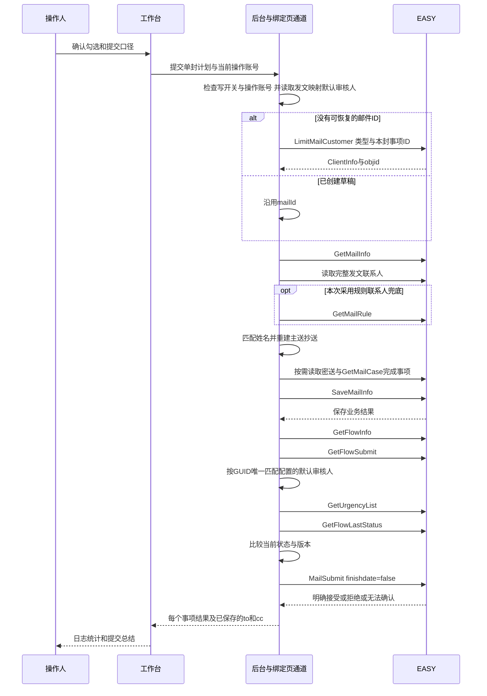

`LimitMailCustomer` 要求 `ClientInfo.Status=true` 并有有效 `objid`，不能仅按 `Result` 判断。`NeedConfirmFillAgency=true` 时停住，不自动确认。写地址使用本轮完整主送、抄送覆盖预填值，并移除原站预填通知地址 `chenjch02@pcl.ac.cn`。主体和附件等字段从已读到的草稿保持，密送通过专门读取逻辑处理；本封完成事项从发文案件读取后写入保存。

## 10. 流程提交检查

审核人统一读取当前账号的“发文映射 → 默认审核人”，操作账号仅用于会话和权限校验，两者可以不同。未配置有效默认审核人时在创建前阻止提交；已建草稿若配置人员不能在下一节点按 GUID 唯一匹配，则保留草稿并显示原因，绝不改选当前登录人或其他候选人。后台转发时以该账号保存的最新配置覆盖页面传来的审核人编号。

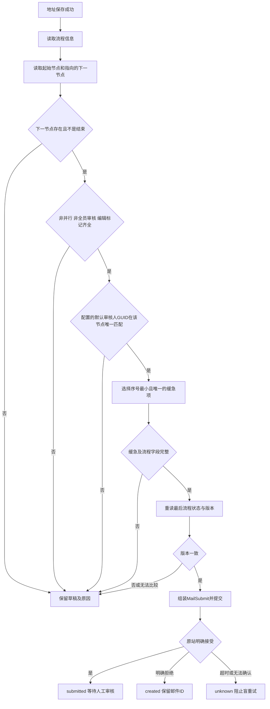

## 11. 账本与恢复状态机

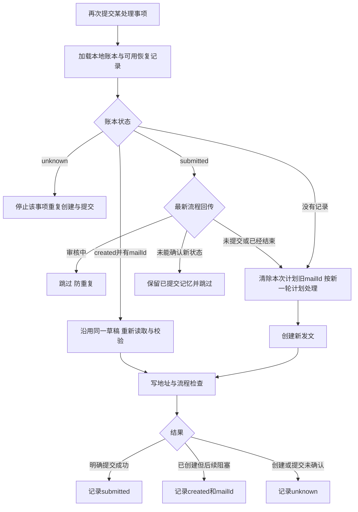

恢复按处理事项内部编号关联，不按页面行号关联。未知状态需要先核对原站，不通过连续点提交消除不确定性。已创建草稿无论之后回读显示何种开放／结束状态，恢复入口仍优先沿用该 `mailId`；这与已经确认提交过的旧发文不同。

## 12. 并发、失败与结果统计

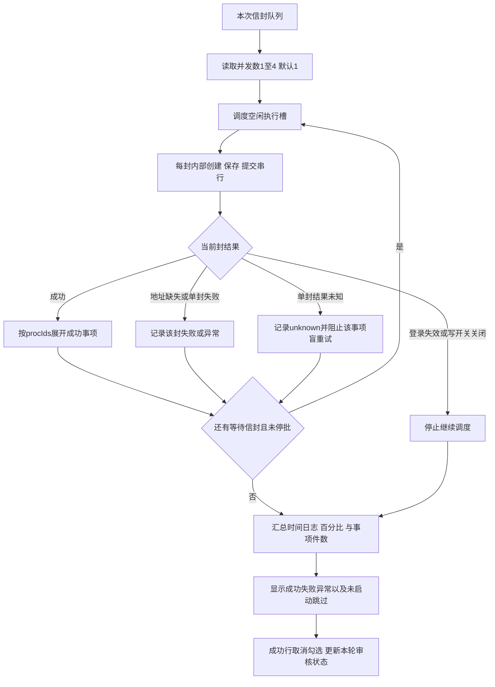

当前期限提交流程的单封失败、邮箱未匹配和单封未知不会直接停止其他事项；登录失效、写开关关闭属于会话级停批条件。已开始的请求可能继续返回。统计按处理事项件数而非信封数；一封并了三件，会回传三条事项结果。成功统计表示已交审核，不等于审核已通过或邮件已送达。

## 13. 故障定位与代码入口

| 现象 | 所处阶段 | 下一步核对 |
| --- | --- | --- |
| 缺我方文号或处理事项表头 | 读表 | 表头、工作流列映射、所选工作表 |
| 类型为空或同文号多种类型 | 信封规划 | 事项精确匹配、客户文号、类型树与配置 |
| 主送对上多个邮箱 | 联系人解析 | 原站当前发文的联系人及角色 |
| 特例缺商务抄送 | 保存前校验 | 主送特例与保存端商务约束是否同时满足 |
| 只有邮件编号没有提交 | 保存或流程阶段 | 日志中的具体字段、节点、审核人、缓急、版本原因 |
| 创建或提交结果未知 | 网络或响应核对 | 原站发文与审核记录、账本；先查再处理 |
| 某封失败后其他封继续 | 队列执行 | 属于当前按封隔离行为；查看每封结果 |

实现依据：`src/customer/pct-workbook.ts`、`pct-sheet.ts`、`pct-recipients.ts`、`limit-mail-submit.ts`、`pct-flow-status.ts`、`case-arbitration.ts`；页面入口 `WorkflowMailEntry.vue` 与 `LimitMonitorQuery.vue`；类型和参数来自 `src/workflow/catalog.ts` 与 `pct-config.ts`。图中业务分支以这些当前实现为准。
