# PCT鹏城专案工作流

内置标识：`pct-pengcheng`，页面名称为“PCT鹏城专案”。入口是“发文任务 → 按工作流发文 → PCT鹏城专案”。它与 PCT 提醒共用读表、案件核对、期限发文和审核提交通道，主要差异在于技术负责人主送、IPR 和商务抄送，以及缺人时的提交口径。

返回 [工作流索引](README.md)。普通 IPR 主送的完整路径见 [PCT提醒](PCT提醒.md)。

## 1. 完整执行总览

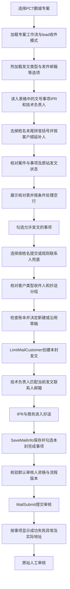

## 2. 输入、来源和输出

| 字段或对象 | 读取来源 | 专案如何使用 |
| --- | --- | --- |
| 我方文号 | 工作表 | 首选案件检索键；与处理事项共同定位原表行 |
| 客户文号 | 工作表 | 补查案件，并决定贵方案号／我方案号类型 |
| 客户名称 | 工作表 | 客户关联、联系人继承、合并范围 |
| 技术负责人 | 专案配置的列，默认技术负责人 | `lead` 模式的主送候选；匹配前清理末尾拼音 |
| 客户联系人(IPR) | 工作表 | 专案的抄送候选；不等同于主送技术负责人 |
| 第一客户联系人 | 工作表 | 保留业务信息；不能直接冒充技术负责人 |
| 处理事项 | 工作表 | 区分同文号的不同提醒和期限事项 |
| 联系人邮箱 | 当前 EASY 发文联系人 | 实际写入地址的依据；表格邮箱列不承担这个职责 |
| 商务 | 发文页业务人员 | 加入抄送，保存前要求可用商务邮箱 |
| 审核人 | 发文映射默认审核人 GUID | 必须在下一节点唯一匹配，不回退当前登录人 |
| 输出 | 原站与本机记录 | 邮件编号、保存后的地址、每个事项结果、审核状态 |

## 3. 技术负责人读取与姓名清理

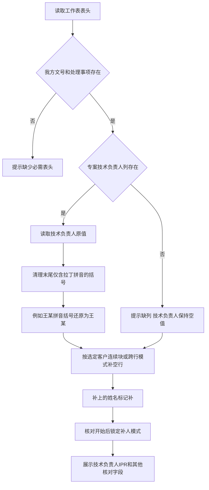

姓名示例：`张三(zhangsan)` 或 `张三（zhangsan）` 会去掉末尾拼音括号，得到 `张三`。并非任意括号内容都删除。多个姓名、重复邮箱和角色选择由后续联系人规划进一步处理。“技术负责人”和 IPR 属于不同列，不能靠抄送 IPR 的存在推导主送已齐全。

## 4. 提醒类别与发文类型决策

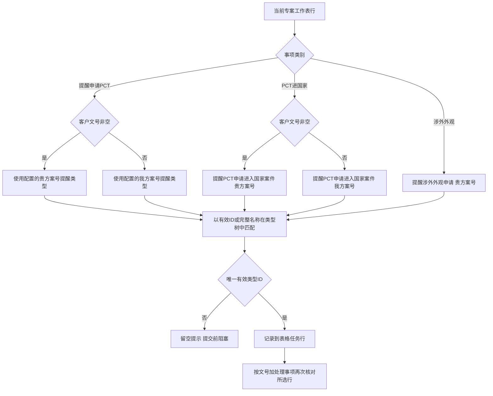

普通提醒的默认名称同 PCT 提醒；进国家也按有无客户文号分贵方案号、我方案号。类型匹配失败不会自行生成一个编号。专案不因收件方式为 `lead` 而改变事项内部编号或使用另一个创建接口。

## 5. 状态核对、空行和勾选资格

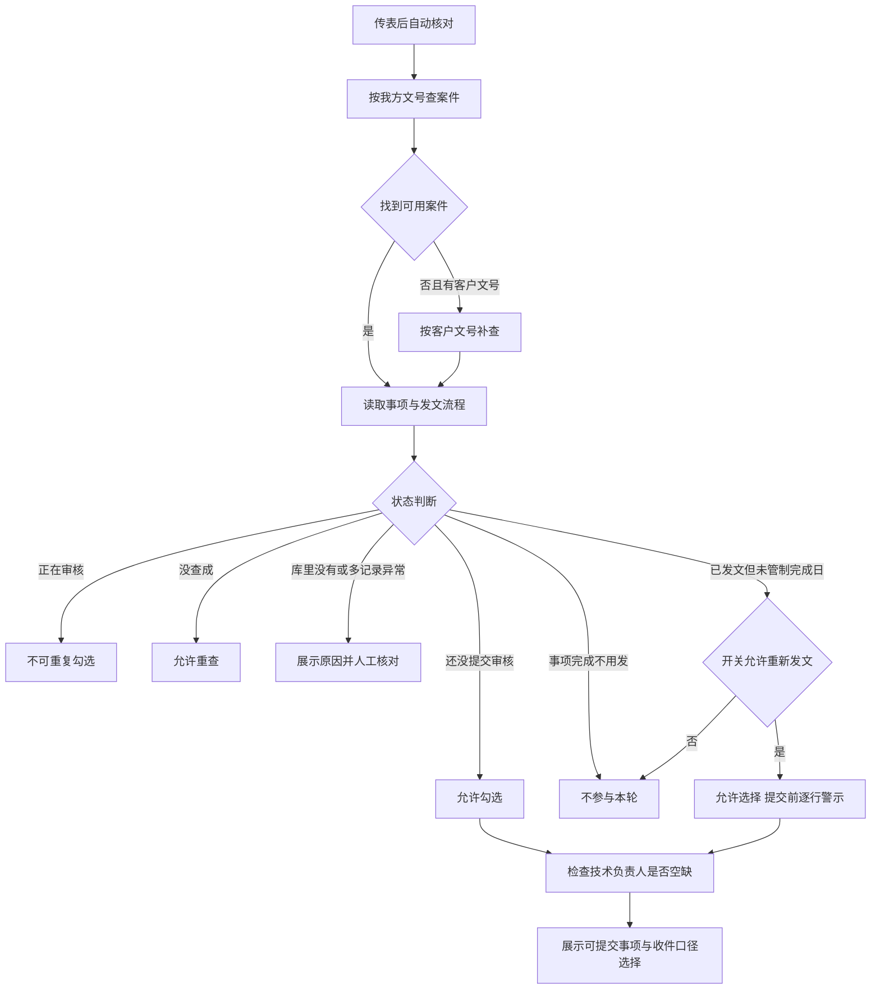

空人名是否触发双提交按钮，在 `lead` 模式主要检查技术负责人。仲裁仍属于共用的表格核对机制，其结果能否改变最终主送，需要继续看专案的 `lead` 收件规则，不能把普通 PCT 的“仲裁 IPR 等于主送”直接套过来。

## 6. 专案的提交口径

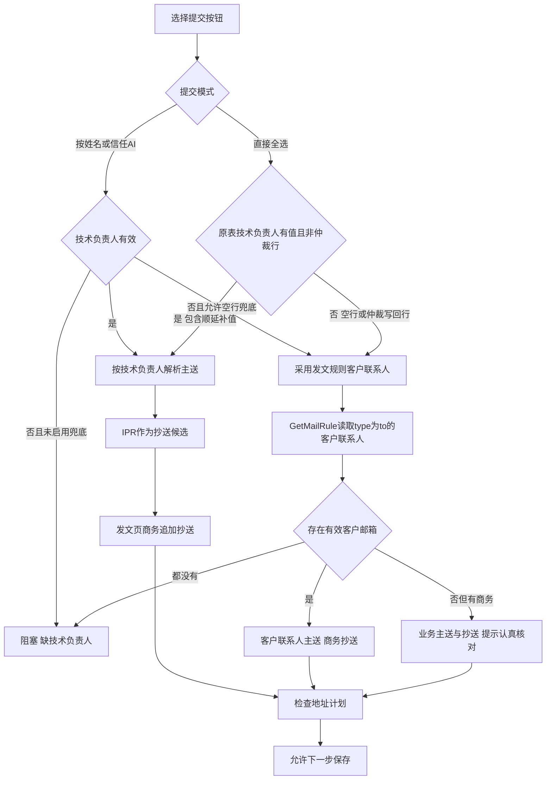

在共用执行器中，已由仲裁写成“不用发”的行仍可形成跳过结论，“只发业务”可形成专门的地址计划；“直接全选”不沿用这些仲裁结论。对正常有技术负责人姓名的专案行，主送始终走 `lead` 分支，IPR 属于抄送。额外抄送还要逐个匹配当前发文联系人。

## 7. 主送和抄送的实际邮箱解析

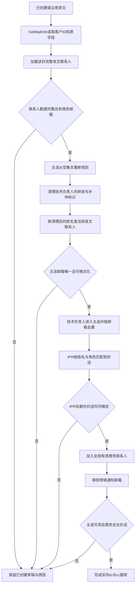

地址写成原站所需的 `姓名(邮箱);` 形式。只读到同名多个不同邮箱时会阻塞主送匹配。IPR 采用它自己的角色匹配逻辑，商务则来自发文页 `sales` 分组。原站创建时预填的档案杂值不作为本轮主送、抄送继承；密送单独处理。

## 8. 按勾选事项构建信封

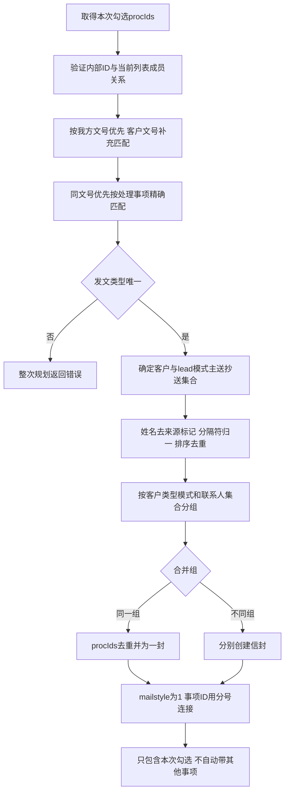

例如，同一客户的 A、B 两件，技术负责人和 IPR 相同、类型相同，可以并成一封；若 B 的技术负责人不同，应拆成两封。类型不同也应拆封。页面进度按事项计数，因此一封对应的多个 `procId` 会分别得到执行结果。

## 9. 每封的读写时序

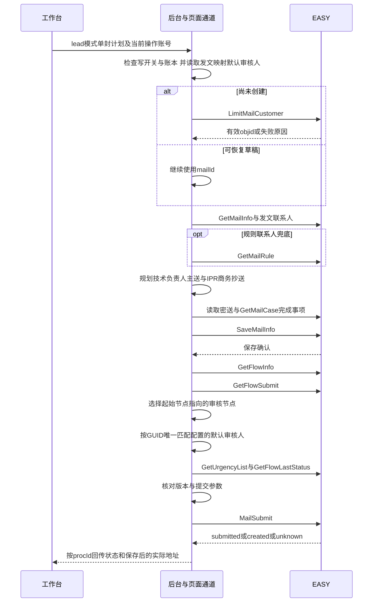

保存时保留草稿中的主题、正文及有效发件邮箱；缺邮箱时可用默认发件人编号补入。完成事项读取该封发文案件后写入。提交参数 `finishdate=false`，不会调用结束审核接口。

## 10. 流程提交的阻塞条件

审核人统一读取当前账号的“发文映射 → 默认审核人”，操作账号仅用于会话和权限校验，两者可以不同。未配置有效默认审核人时在创建前阻止提交；已建草稿若配置人员不能在下一节点按 GUID 唯一匹配，则保留草稿并显示原因，绝不改选当前登录人或其他候选人。后台转发时以该账号保存的最新配置覆盖页面传来的审核人编号。

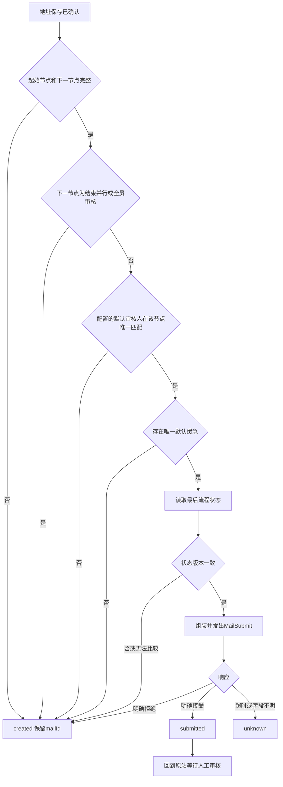

## 11. 恢复、重试与状态转移

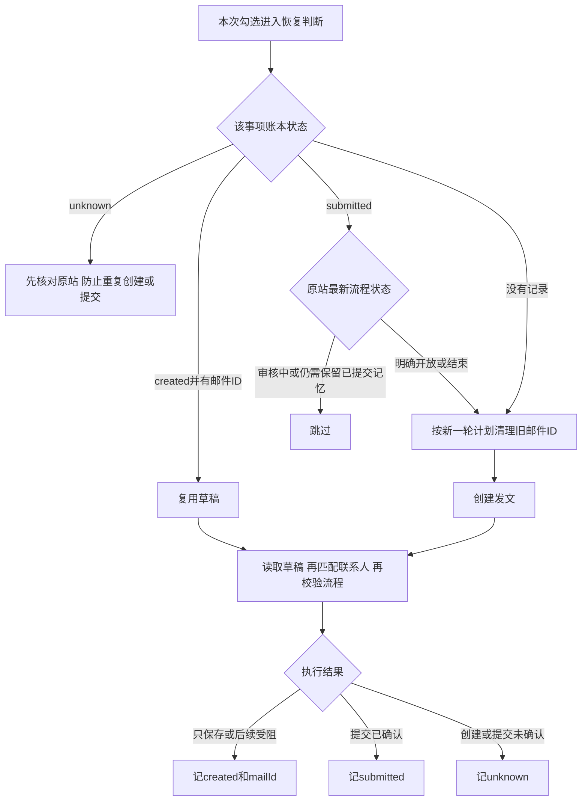

有邮件编号不等于已经提交。缺联系人、缓急或版本不匹配时，记录 `created`，恢复沿用原草稿。没有确认结果的请求不自动重放。账本按事项内部编号关联，多件合一封时多个事项可能指向同一 `mailId`。

## 12. 并发和进度输出

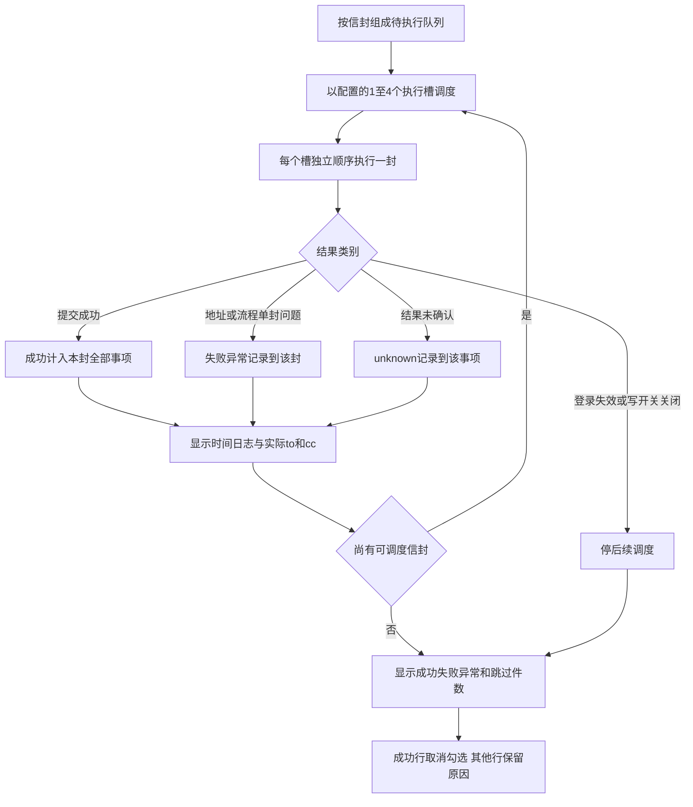

单封失败不自动阻断其他专案；未知结果只阻止对应事项的盲目重试。会话级故障会停止新封调度，已启动封仍可能返回。进度百分比表示本轮队列执行进度，最终结果须看每封业务状态。

## 13. 排错对照

| 问题 | 检查位置 | 当前结果 |
| --- | --- | --- |
| 没有技术负责人列 | 工作流列映射与表头 | 提示缺列；不能凭 IPR 推断主送 |
| 同名多个邮箱 | 当前发文联系人 | 主送匹配阻塞，草稿留存 |
| 技术负责人有值但 IPR 对不上 | 发文页角色与姓名 | 不能静默丢弃所需抄送 |
| 发文页没有商务 | 联系人完整性与sales组 | 保存前阻塞 |
| 没有发件邮箱 | 草稿mailset与默认发件人 | 有有效默认值才补入 |
| 提交给默认审核人失败 | 下一节点审核人列表 | 保留草稿和具体原因 |
| 重复点击提交 | 事项账本与原站状态 | submitted跳过、created复用、unknown先核对 |

实现依据：`src/workflow/catalog.ts` 中 `defaultPengchengWorkflow` 和 `recipientModeOf`；`src/customer/pct-sheet.ts`、`pct-recipients.ts` 的 `lead` 分支；`limit-mail-submit.ts` 的信封分组、写地址和提交；页面 `WorkflowMailEntry.vue`、`LimitMonitorQuery.vue`。
