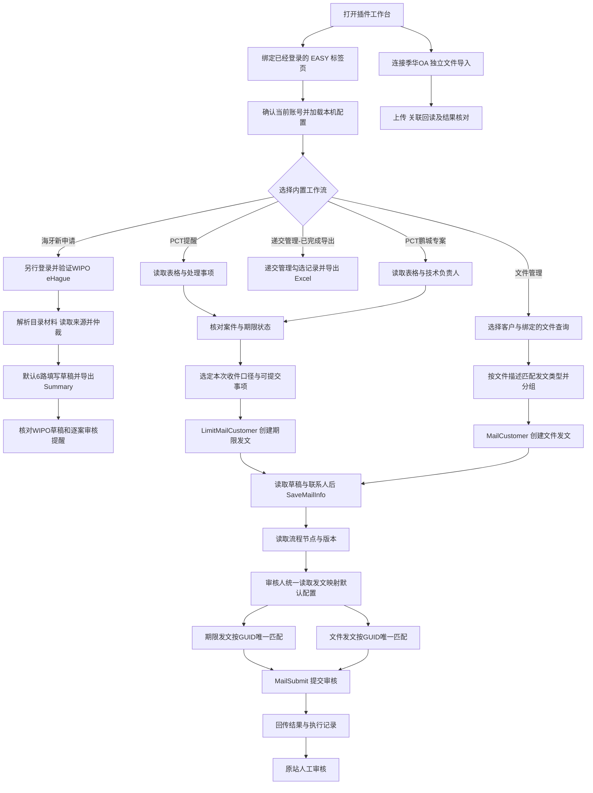
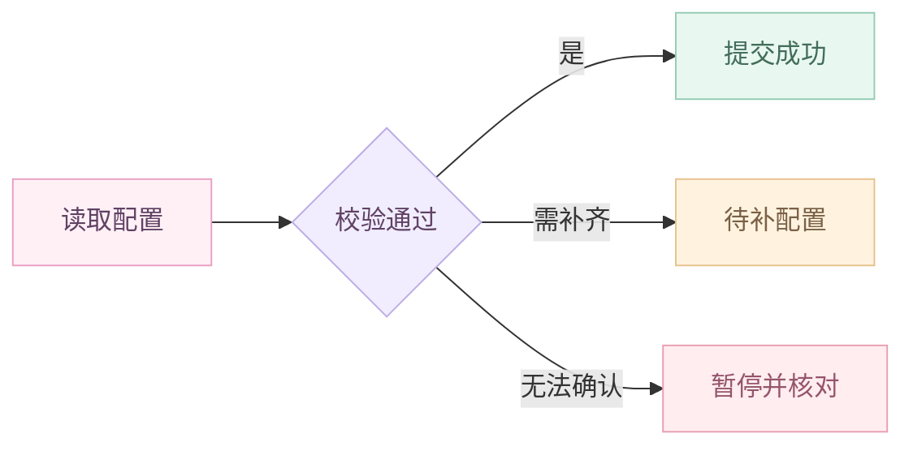

# 工作流索引

这里按插件当前内置的六条工作流组织：每条工作流的流程说明各有一篇 Markdown 文件，文件内按阶段拆成多张 Mermaid 图。图下的表格解释输入、输出、判断条件和停止原因。

| 工作流 | 详情 | 输入 | 收件人主规则 | 审核人 |
| --- | --- | --- | --- | --- |
| PCT提醒 | [PCT提醒.md](PCT提醒.md) | 提醒申请 PCT、进国家等工作表 | IPR；支持客户特例、仲裁与联系人兜底 | 发文映射配置的默认审核人 |
| PCT鹏城专案 | [PCT鹏城专案.md](PCT鹏城专案.md) | 带技术负责人和 IPR 的工作表 | 技术负责人；IPR 和商务抄送 | 发文映射配置的默认审核人 |
| 文件管理 | [文件管理.md](文件管理.md) | 客户已绑定的文件查询条件 | 案件联系人；默认发件人和商务抄送 | 发文映射配置的默认审核人 |
| 递交管理-已完成导出 | [递交管理-已完成导出.md](递交管理-已完成导出.md) | 递交管理里勾选的递交记录 | 不发文，产出带退回脉络的 Excel | 不提交审核 |
| 季华实验室-文件导入 | [季华实验室-文件导入.md](季华实验室-文件导入.md) | 本机目录中的 PDF、DOC、DOCX 文件名清单 | 不发文；按申请号唯一匹配季华台账并关联附件 | 不走 EASY 发文审核 |
| 海牙新申请 | [海牙新申请.md](海牙新申请.md) | 本地定稿 Word、编号图纸及 EASY 案件来源 | 不发文；默认6路填写 eHague 草稿并导出 Summary | WIPO 原站草稿人工审核 |
| 请款 | [请款.md](请款.md) | 先选模板智能预填：涉外（文件管理抓账单 → 费用查询第三方费用）；PCT（费用查询官费 + 我方代理费） | 不发文；实时同步人民银行汇率，按 3 套内置模板保留原公式导出 Excel | 财务人工复核导出请款单 |

四条 EASY 工作流标识分别是 `pct-reminder`、`pct-pengcheng`、`file-manage`、`filing-export`。季华实验室-文件导入使用单独的季华 OA 会话和附件流水线。海牙新申请分别管理 EASY 来源和 eHague 目标会话，产出草稿与 Summary，不属于 EASY 发文提交工作流。PCT 提醒中的第一发明人特例、进国家、涉外外观提醒是该工作流的分支，不额外占一篇工作流文档。

## 如何阅读和放大

点上表链接可以在插件文档中进入对应流程说明。各篇按自己的阶段展开；EASY 发文说明覆盖输入、查询、匹配、收件人、建单、保存、提交、结果和恢复，季华实验室-文件导入说明覆盖扫描、材料映射、附件上传、关联回读和恢复，海牙新申请说明覆盖目录材料、双系统会话、仲裁、6路草稿、自动核对、导出和人工审核。正文中的每张图默认按可用宽度展开，高度随图表比例自然增长，不再使用固定高度。每张图都有“放大查看”，在独立画布里可以滚轮连续缩放、按住拖拽平移、输入缩放百分比、恢复原始大小、适应宽度或适应窗口。画布支持方向键、加减号和 `0`；`Esc` 关闭放大图，原文档阅读位置保留。Mermaid 原文可以展开查看。

## 工作流页面与入口关系

季华实验室-文件导入的卡片主入口打开“流程说明”，另有“开始使用”按钮；两个页签共用同一工作流页面并可一键切换。切换说明和使用页时，上传组件保持挂载，任务继续保留，不会因切换而卸载或取消。该入口连接季华 OA 标签页，不依赖 EASY 登录状态或 EASY 发文写开关。

「适应窗口 / 适应宽度 / 原始大小」有粉紫选中态，选择保存在插件用户数据（`chrome.storage.local`）中；换图、关闭重开或重启插件后沿用。它是本机阅读偏好，与 EASY 登录账号无关。手动输入百分比、加减号或滚轮缩放后显示自由缩放，不再高亮固定模式，但保留最近一次选择的默认模式；拖拽只改变位置。正文图始终按可用宽度展开，不受放大窗口偏好影响。

## EASY 发文工作流的共同约定

下表仅适用于 PCT 提醒、PCT 鹏城专案和文件管理这三条 EASY 发文工作流；递交导出、季华实验室-文件导入和海牙新申请不执行邮件创建、保存和提交审核。

| 项目 | 当前实现 |
| --- | --- |
| 请求通道 | 工作台 → 扩展后台 → 已绑定 EASY 标签页 → 原站接口；沿用原站登录会话 |
| 写开关 | 系统设置控制；加载存储前按关闭处理；关闭时建单、保存和提交受阻 |
| 成功判定 | 每一步检查业务响应；HTTP 200 不单独构成成功 |
| 流程终点 | 本轮自动化完成于提交审核；原站审核仍由人处理 |
| 并发 | 页面按封排队，设置值为 1–4；同一封内部按创建、保存、提交的顺序执行 |
| 已创建草稿 | 保存或流程检查失败时保留邮件编号；恢复时优先沿用草稿 |
| 结果未知 | 不盲目重复创建或提交；核对账本和原站记录后再处理 |
| 文档依据 | 以当前 `src/customer`、`src/workflow`、`src/app/components` 实现为依据；历史阶段报告仅作背景 |

## EASY 发文图中的状态

在 EASY 发文工作流中，`created` 表示已取得邮件编号，但尚未确认提交；`submitted` 表示原站接受了提交；`unknown` 表示创建或提交结果无法确认；`failed` 表示本轮失败或明确未执行。页面显示状态还会综合案件流程、联系人核对和业务事项状态，不与这四种执行状态逐字等同。这些状态不描述季华文件上传的回执或台账关联结果。

详细差异、接口顺序、批处理停止条件和特例都放在各自工作流文件中。

## Mermaid 的代码级主题与节点样式

主题集中在 `src/app/docs/mermaid-theme.ts`：使用 Mermaid 原生 `base + themeVariables` 统一字体、粉紫配色、圆角节点、柔和曲线、时序图参与者与便笺。图内样式不是依靠外层网页 CSS 换背景；放大和正文使用同一份 SVG，配色保持一致，不调用 Mermaid AI 或外部字体服务。

| 语义类 | 用途 | 配色 |
| --- | --- | --- |
| `pmStep` | 普通步骤 | 草莓奶霜粉 |
| `pmDecision` | 条件与分支 | 香芋浅紫 |
| `pmSuccess` | 成功与就绪结果 | 薄荷奶绿 |
| `pmWarning` | 提醒、跳过和待补齐 | 奶油杏色 |
| `pmStop` | 阻塞、停止、结果未知 | 柔和莓红 |

每张流程图在 Markdown 中显式写 `class 节点ID 类名`，渲染器为流程图和状态图补齐上述 `classDef`；不会根据中文标签在运行时猜测业务含义。作者已写明的同名 `classDef` 优先保留。时序图使用独立主题变量，不混入流程图类语法。下面是可以独立复制到其他 Mermaid 编辑器的完整例子（图下「Mermaid 原文」展开就是源码，可整段复制）：

参考：[Mermaid 主题配置](https://mermaid.js.org/config/theming.html)、[原生 classDef 节点样式](https://mermaid.js.org/syntax/flowchart.html#classes)。官方最新文档还介绍 `look` 外观选项；本项目保留当前依赖版本和可控的粉紫圆角主题，不为样式升级依赖或改动流程布局。
