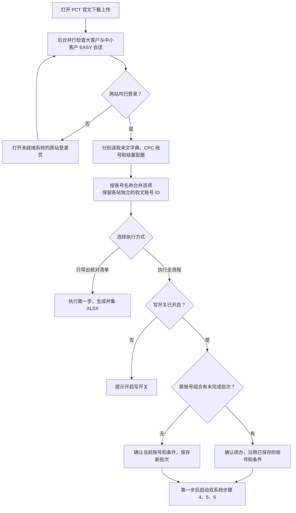
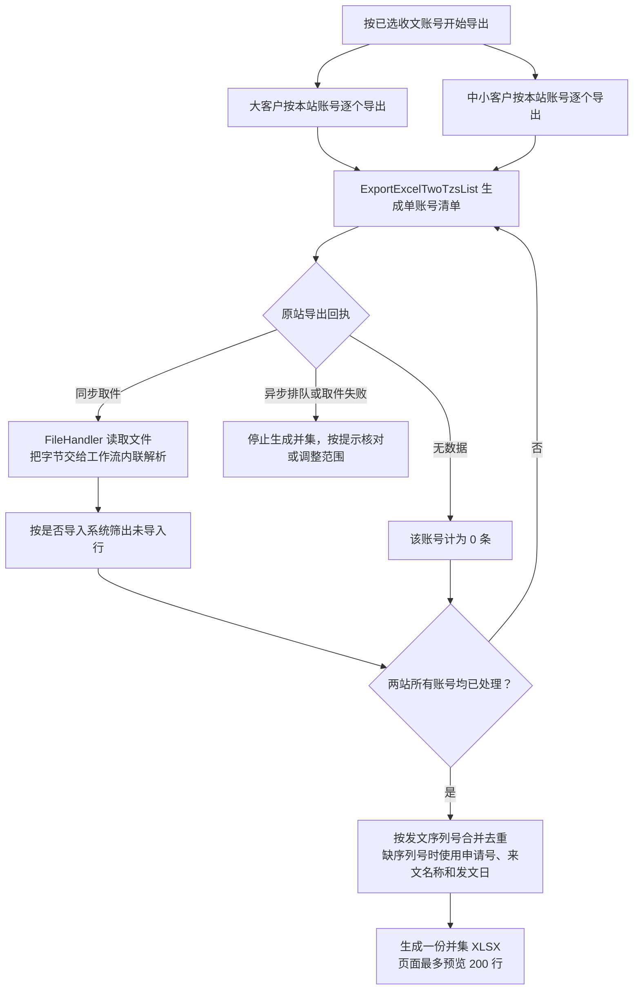
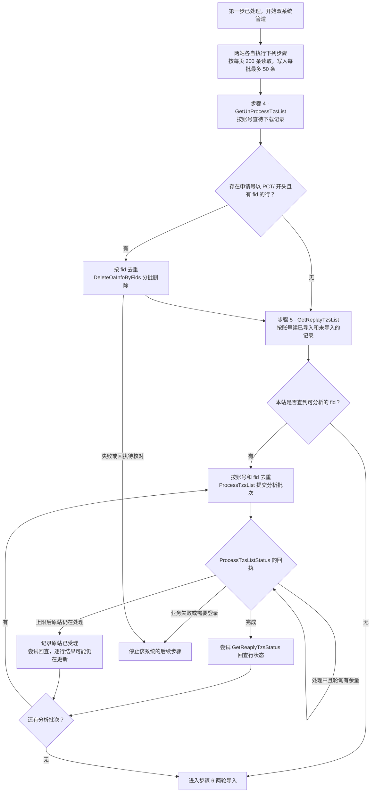
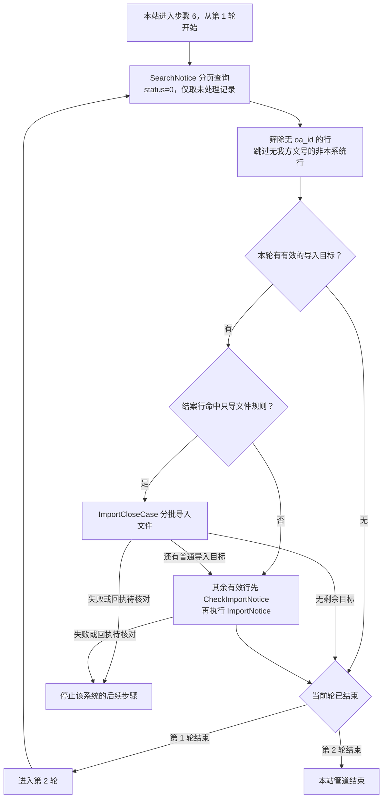
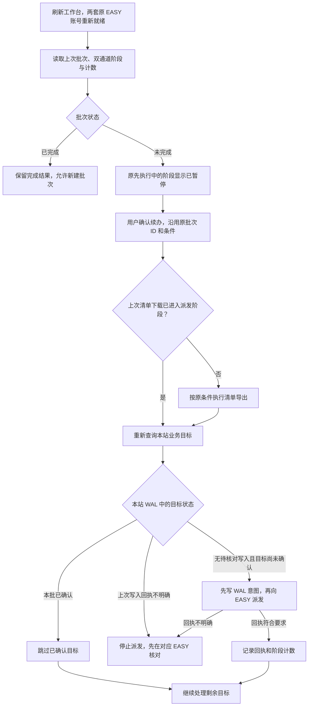

# pct官文下载上传

本工作流用于在 **大客户系统** 与 **中小客户系统** 同时在线的前提下，自动完成 PCT 官文的核对清单导出并集、清理 `PCT/` 待下载记录、全量二次分析下载以及两轮导入系统。

原站请求、响应及扩展消息字段见 [PCT 官文下载上传工作流接口](../../../API/49-PCT官文下载上传工作流接口.md)。

## 1. 前置预准备

- **双系统同时在线**：浏览器中需同时打开并登录 **大客户** 与 **中小客户** 的 EASY 页面。工作流会在后台静默检测两套系统的登录状态；若任一系统未打开、未登录或会话过期，页面会给出对应系统的一键打开登录指引。
- **写开关开启**：由于步骤 4、5、6 会执行删除待下载官文、二次下载分析及导入系统等写操作，执行全流程前需在「系统设置」开启写开关（仅导出第一步未导入并集清单时，只读即可使用）。
- **分支机构 CPC 账号**：若勾选了带 `_` 的分支机构收文账号，请确保已在原站「来文管理」完成 CPC 扫码登录，否则接口返回 401 时会中止当前账号并提示扫码。

## 2. 执行步骤说明

### 第一步 导出未导入清单

### 双系统步骤 4、5 删除与二次分析

### 步骤 6 两轮导入

1. **第一步 · 导出「来文二次下载」未导入并集清单**
   - 大客户与中小客户系统并行工作，按用户勾选的收文账号依次导出「来文二次下载」核对清单 Excel（不刷屏下载原始单账号文件）。
   - 自动解析每个清单，筛选「是否导入系统」为**未导入**的记录，将两系统结果按发文序列号（无序列号时按申请号+来文名称+发文日）去重取并集，最终自动下载一份合并后的 `.xlsx` 清单并在页面预览。
2. **双系统并行处理（大客户 ∥ 中小客户）**
   - 两个系统互不阻塞并行推进，单系统内部依次遍历所有勾选的收文账号：
   - **步骤 4 · 来文下载删 `PCT/`**：按「来文下载」查询条件全量拉取列表，筛选申请号以 `PCT/` 开头的记录并批量删除，避免旧待下载记录阻塞。
   - **步骤 5 · 来文二次下载全量分析**：按「来文二次下载」查询条件全量拉取列表，提交已导入和未导入记录进行分析。轮询到上限时原站可能仍在后台处理，逐行结果以回查状态为准。
   - **步骤 6 · 导入来文两轮全选导入**：按「导入来文」查询条件（强制未处理）拉取记录，自动跳过无我方文号的非本系统行。第 1 轮处理后重新查询，对本次仍满足条件的有效行执行第 2 轮。

## 3. 参数说明

- **收文账号（多选）**：将原站下拉框升级为复选框列表，自动合并大小客户系统的 CPC 账号，执行时依次遍历所有勾选项。
- **「来文二次下载」与「来文下载」查询条件**：支持申请类型（默认 `PCT国际阶段`）、发文日期起止（可选同步）、申请号、发明创造名称、来文名称、发文序号、下载状态等。
- **「导入来文」查询条件**：支持官方发文日、下载日期、来文分析日期、申请号、我方文号（含模糊查询）、申请类型、来文类型及全部高级筛选条件；大客户字典选项在发往中小客户时会自动按名称匹配对应的中小客户字典项。

## 4. 刷新恢复与安全续办

