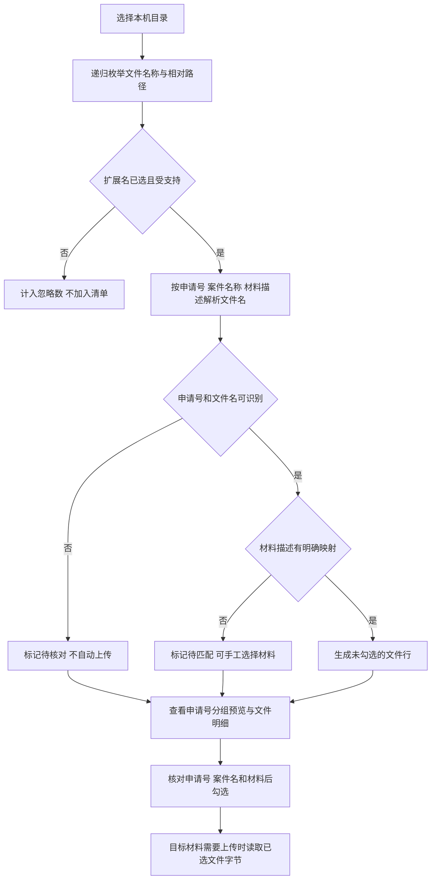
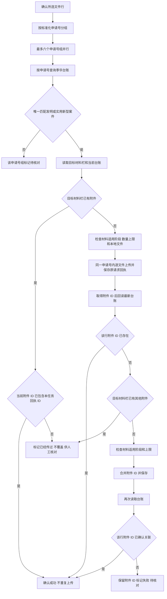
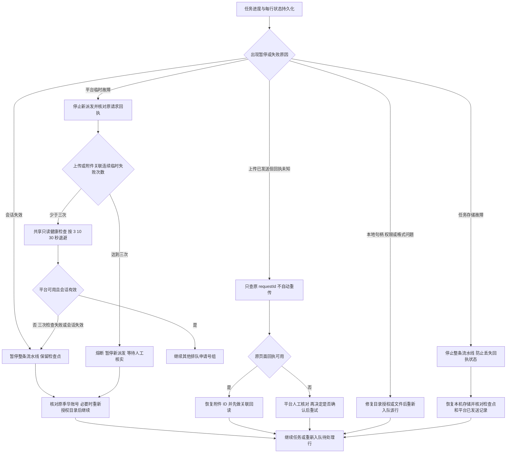

# 季华实验室-文件导入

工作流页的主入口打开“流程说明”，“开始使用”按钮进入文件上传页；两个页签在同一页面一键切换。切换说明和使用页不会卸载上传组件或取消任务。季华传文使用已登录的季华 OA 标签页，不依赖 EASY 登录或 EASY 发文写开关，也不创建 EASY 邮件或提交发文审核。

## 1. 扫描目录、预览和材料映射

扫描只读取文件名和相对路径，不调用文件读取接口，不打开正文。默认扫描 PDF、DOC、DOCX；ZIP、MAL、XML 等其他扩展名会忽略。文件名按“申请号-案件名称-材料描述.扩展名”拆分，案件名称可以包含连字符。自动传文目前只支持 13 位中国专利申请号；PCT 国际申请号、旧式号码和无法识别的名称会标为待核对，不会改写成中国号码。

材料描述按登记名称和明确别名匹配，不猜测未知描述。当前关键别名如下：

| 文件描述 | 目标材料 |
| --- | --- |
| 递交合并档、递交文件合并档 | 专利请求书 |
| 新申请文档 | 申请文件 |

扫描结果先按申请号汇总，文件行默认不勾选。可在预览和明细中核对或取消选择；有明确材料类型但文件描述未匹配的行，可手动选择目标材料。PCT 申请号仍不支持自动传文，手工改材料不能绕过申请号校验。重扫同一目录会保留已有选择、材料映射和回执；缩小扫描范围时旧记录保留但取消选择。

## 2. 申请号流水线：核案、跳过、上传和关联回读

同一申请号由一个流水线顺序处理，最多 6 个不同申请号组并行。文件暂存有独立的字节预算，大文件会占用更多预算并降低实际同时传输的文件数。台账按申请号精确匹配唯一记录；缺失、重复或不支持的记录不会选取模糊结果。材料还要适用于该案件类型和当前业务阶段，平台业务开关需要由操作人核实，工作流不会自动修改。

上传前先读目标材料栏。已有该类附件时整类跳过，不读取对应本地文件、不覆盖平台附件；若栏内已含本任务保存的附件 ID，则回执核对成功，否则显示“已经传过”并留待人工确认。没有现存附件时才读取已选文件并上传。同一申请号同一材料逐个处理；附件 ID 到手后先持久化，再回读最新台账合并保存，最后再读一次确认 ID。只有确认附件 ID 已关联才标记成功，其他材料栏和已有业务字段会保留。

普通材料栏每类最多 10 份，需平台识别的材料栏每类最多 1 份；超过限制会要求调整选择。目标材料不适用于当前案件、平台阶段未启用、文件句柄失效、格式校验不符等情况会显示对应行错误，其他可处理文件仍可继续。这里的结束状态是季华台账附件关联结果，不包含邮件收件人、EASY 审核人或发文审核步骤。

## 3. 暂停、恢复和人工重新入队

任务检查点、选择和回执保存在扩展自己的本机存储中。刷新或关闭工作台后任务会恢复为暂停；继续前重新授权原目录并连接任务绑定的季华账号。已发送记录属于原账号会话，不会跨账号上传或关联。

平台 408、429、5xx 或网络不可用时，流水线先停止派发并集中做只读健康检查；默认等待 3、10、30 秒。检查成功后可继续队列中的其他申请号组；三次健康检查仍失败或季华会话失效时保留检查点并暂停。上传和附件关联分别累计连续临时写入失败次数，达到三次会熔断新派发。用户核实原因后可点击“继续上传”重新尝试待处理工作。

如果上传请求已经发送但结果未知，系统只查询原 requestId 的回执，不会因为超时或 HTTP 524 自动重传；524 不能证明服务端没有收到文件。原页面回执不可用时先在季华平台核对附件。只有操作人确认平台未生成附件，或明确接受重复附件风险后，才能使用“核实后重试”创建新请求。

普通“重新入队”只处理失败或待匹配行，且不会丢弃原有发送意图和附件 ID：带有效附件 ID 的行先尝试关联并回读；已发送但未确认的行先查原回执，不会直接重传。材料映射只可在未发送、没有回执的行上更改。运行中的任务会把新行追加到六路申请号流水线；任务暂停时则先保存队列，点击“继续上传”后处理。取消会停止本地等待和后续派发，但已到达平台的请求可能稍后完成，仍需按原回执核对。

## 状态判断

| 页面状态 | 含义 |
| --- | --- |
| 正在核对 / 正在上传 / 正在关联 / 正在回读 | 当前行所处阶段 |
| 上传成功 | 回读季华台账后确认附件 ID 已关联 |
| 已经传过 | 目标材料栏已有附件，但无法确认它就是本任务的附件 ID；未覆盖现有附件 |
| 没匹配到 | 申请号、案件类型、材料描述或适用范围不能自动匹配 |
| 上传失败 | 本地读取、请求、关联或回读没有达到成功条件；查看详细原因和回执状态 |

实现依据：`src/jihua/inventory.ts`、`src/jihua/materials.ts`、`src/jihua/runner.ts`、`src/jihua/transport.ts` 和 `src/jihua/types.ts`。
