# 文件管理工作流

内置标识：`file-manage`。从“发文任务 → 按工作流发文 → 文件管理”进入，选择已保存文件查询配置的客户，查询文件、按描述映射成发文类型、生成每封计划，再创建并提交给默认审核人。

返回 [工作流索引](README.md)。该流程以文件为输入，实际创建接口为 `MailCustomer`；两条 PCT 工作流以处理事项为输入，使用 `LimitMailCustomer`。

## 1. 全链路总览

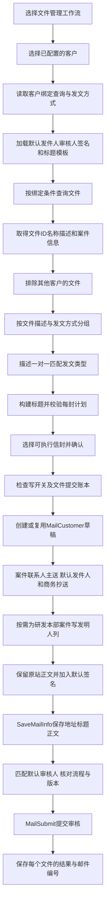

## 2. 前置配置和输入字段

| 对象 | 来源 | 如何使用 |
| --- | --- | --- |
| 客户 | 客户管理 | 选择保存了文件入口配置的客户 |
| 查询条件 | 客户绑定的文件查询 | 形成实际查询；文件管理和期限监控条件分开 |
| 发文方式 | 客户配置 | 同客户同描述合并，或单个来文；单个来文逐文件建封，每封使用 HAR 已确认的 mailstyle=2 |
| 文件ID | 原站文件查询 | 作为建单和恢复键，必须是有效内部GUID |
| 文件名 | 查询结果 | 创建参数的一部分；不能空、不能含分号、长度不能超过180 |
| 文件描述 | 查询结果 | 和启用的描述映射精确匹配 |
| 案件文号与客户文号等 | 查询结果 | 标题模板、邮件正文和发明人列关联 |
| 默认发件人 | 发文映射 | 需要有效发件编号，并能解析姓名和邮箱 |
| 默认审核人 | 发文映射 | 在下一审核节点按GUID唯一匹配 |
| 默认签名 | 发文映射 | 原站签名编号或受支持的签名正文 |
| 标题模板 | 发文映射 | 用分组信息构建本封主题 |

文件管理工作流无需读取 PCT 表格。模板、描述映射、默认人选和签名的缺失都应在计划阶段暴露，避免创建一封明知无法继续的发文。

## 3. 客户查询到文件集合

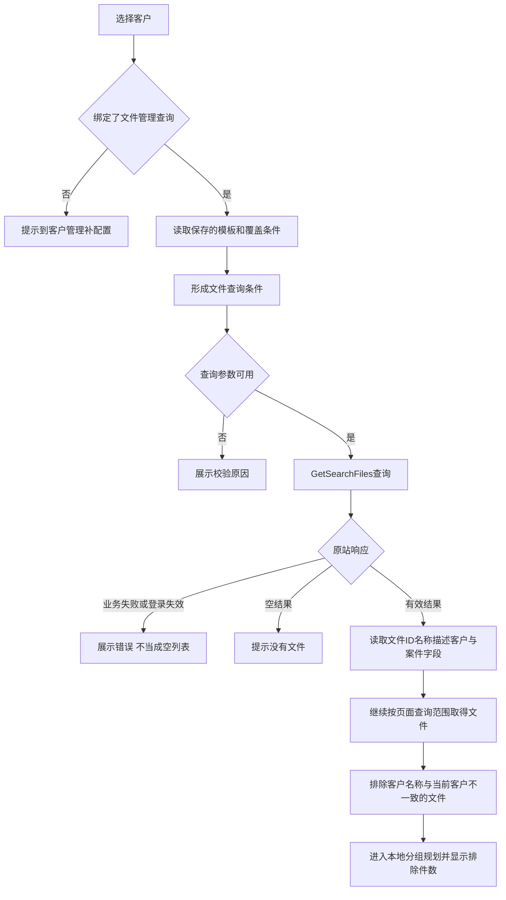

客户名称比较会清理空白。来源客户名非空且与所选客户不一致时，文件会被排除并留下提示。空客户名不会在这个过滤函数里自动被认作其他客户，后续仍以绑定客户与原站草稿实际客户为准。

## 4. 分组和发文类型映射

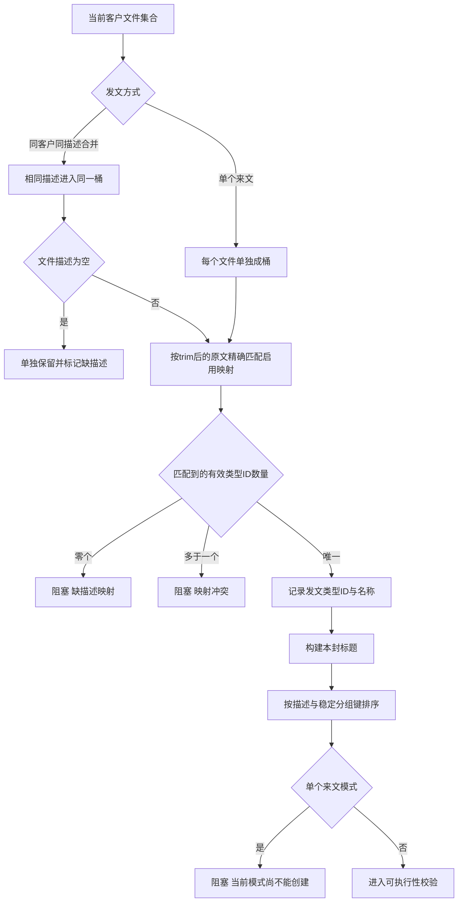

映射比较文件描述原文，不使用模糊关键词匹配。多个映射记录指向同一个有效类型仍可视为唯一类型；指向不同类型则冲突。描述为空会明确阻塞，不能随意取一个模板代替。

## 5. 每封计划的校验顺序

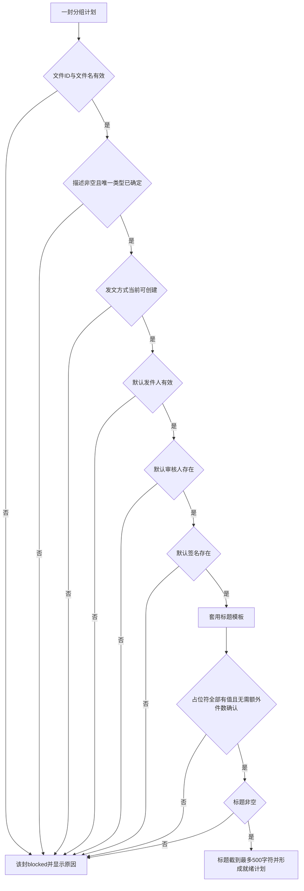

默认发件人的地址需要能够写成 `姓名(邮箱);`。标签形式 `姓名<邮箱>` 可被解析为姓名与邮箱。标题模板如果还留有未解析占位符，或者要求件数确认但未满足，会阻止该封创建。阻塞原因保留在预览中，不能只靠“总件数大于零”判断可执行。

## 6. 文件账本和恢复决策

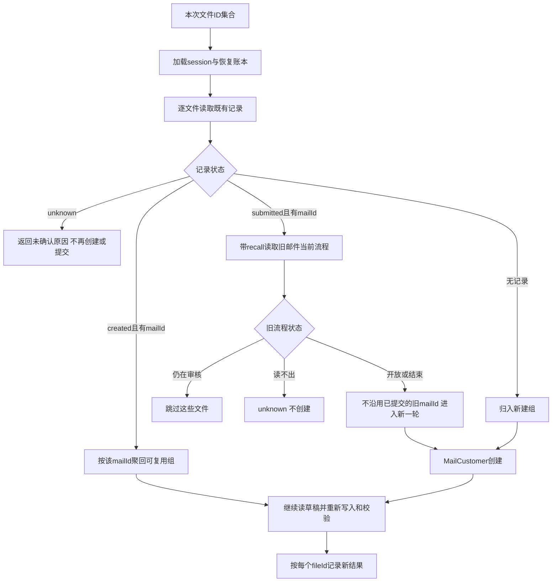

同一个分组中可能同时存在新文件和可恢复的旧草稿，执行前会拆为不同组。这样不会把已有草稿的文件再次当作新文件全量建单。已提交邮件会读取最新流程后决定跳过或进入新一轮，不能只根据页面行仍显示就认定需要重建。

## 7. 地址与签名保存

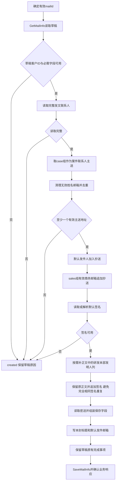

文件管理使用案件联系人主送，不从 PCT 表里的 IPR 或技术负责人获取主送。商务邮箱按当前发文联系人加入抄送；这一条实现不套用期限发文保存端的“所有商务必须出现在抄送”的同一判断式。`finish_ctrl_proc` 保留草稿原值，不像 PCT 路径读取本封事项后主动勾上。

## 8. 研发本部的发明人列

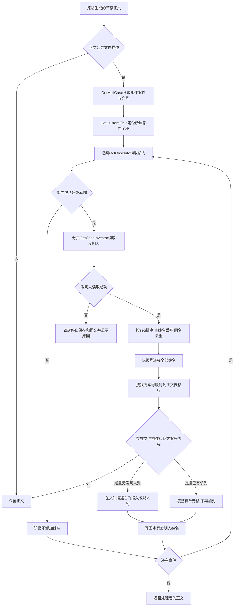

发明人每页 10 条，最多读取 20 页；邮件案件列表也有分页上限，因此“全部”指当前实现成功取得的范围。普通部门或不含所需表头的正文保持原样。邮件案件、部门字段或部门值的非登录读取失败可能保留原正文并带提示继续；登录失效会阻塞。已确认是研发本部后，发明人读取失败会阻塞该封提交。

## 9. 创建、保存和提交流程时序

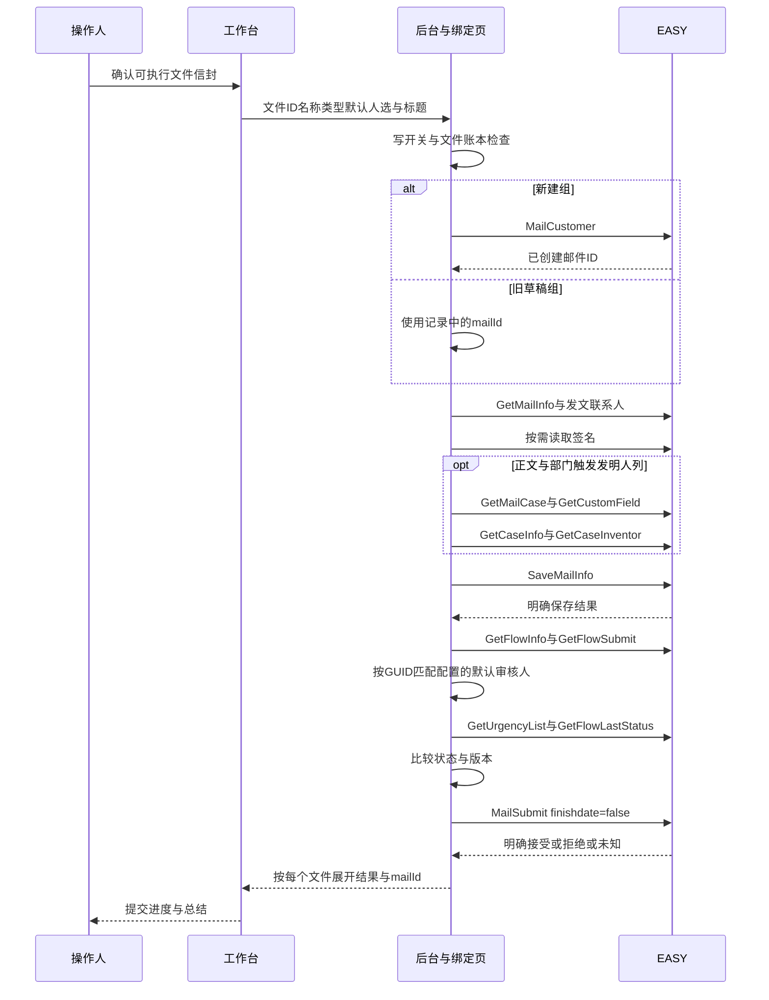

## 10. 默认审核人和版本检查

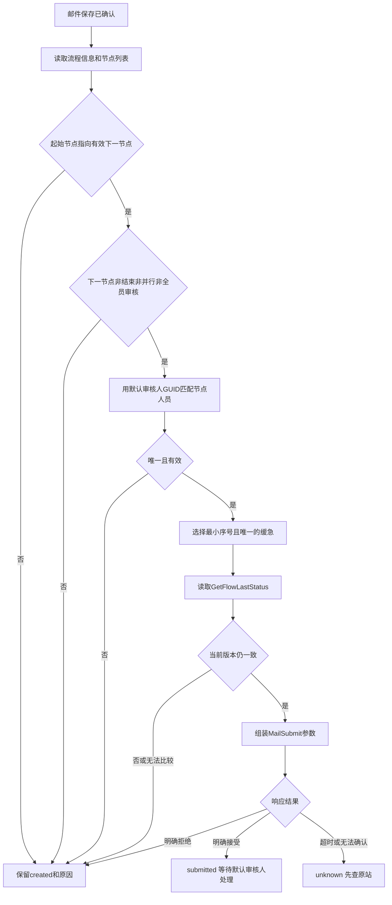

文件管理的审核人来自发文映射默认配置，不强制等于当前登录人。匹配按 GUID，不能只依赖显示名同名。提交只推进到审核节点，原站最终审核是后续人工步骤。

## 11. 批次、并发与停止策略

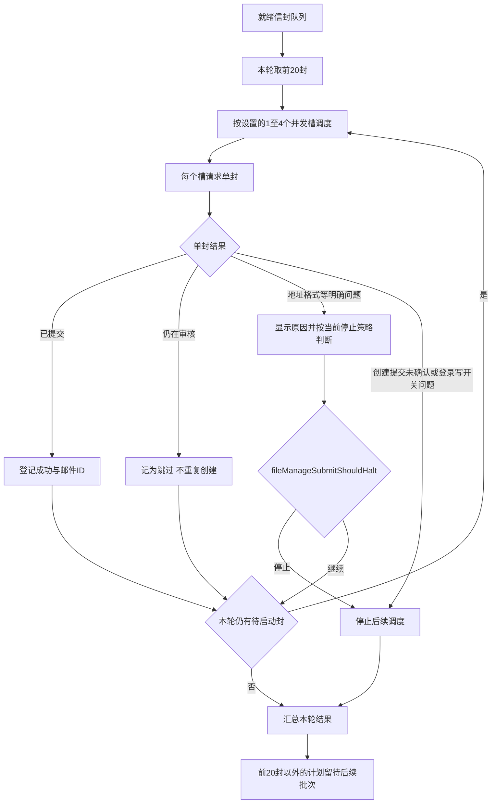

当前 UI 每轮取前 20 封，使用共用信封池并发；后台批次函数在非提交且非“还在审核”的结果时返回停止。页面单封模式还会结合 `fileManageSubmitShouldHalt` 解释明确的地址格式问题、暂时故障和未知结果，不能照搬 PCT 的“仅会话级故障停批”规则。

## 12. 执行状态和故障恢复

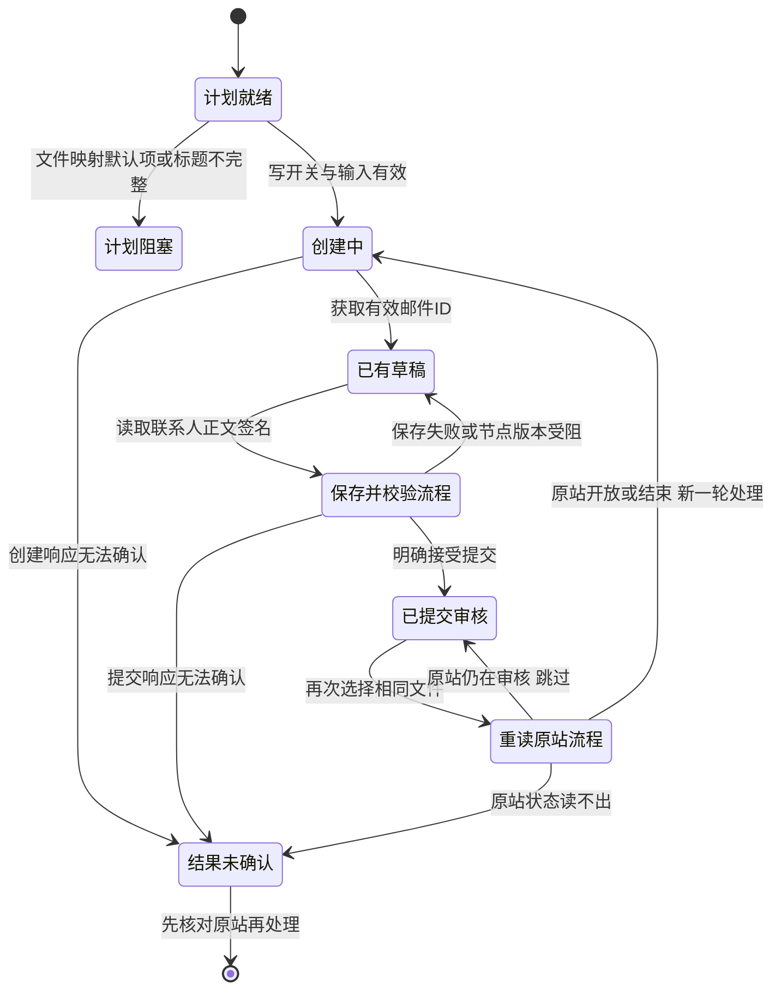

| 现象 | 已知结果 | 处理重点 |
| --- | --- | --- |
| 描述没映射、映射冲突 | 尚未建单 | 修复发文映射后重新规划 |
| 单个来文模式 | 每个文件单独创建一封 | 每次仅提交本封文件，使用 mailstyle=2 |
| 没有案件联系人邮箱 | 可能已建草稿 | 补全原站联系人后沿用该mailId |
| 签名编号在原站不存在 | 已创建但无法保存 | 检查默认发件邮箱与该邮箱的签名列表 |
| 研发本部发明人读取失败 | 已创建但本封未提交 | 核对案件资料接口与日志 |
| 默认审核人不在下一节点 | 已保存但未提交 | 检查配置GUID与原站节点人员 |
| 创建或提交结果未知 | 原站可能已执行 | 先查邮件与流程，防止重复 |

实现依据：`src/app/components/FileManageMail.vue`；`src/customer/file-manage-plan.ts`、`file-manage-submit.ts`、`mail-inventor-column.ts`；`src/mail/easy/contracts.ts` 与 `mail-contacts.ts`；`src/workflow/contracts.ts`。其中创建、地址、完成事项、审核人和停批条件都与 PCT 分支分别描述。

## 客户专属发文设置

在客户管理选择“文件管理”后，可直接编辑六项配置：追加收件人、抄送、发件人、审核人、标题模板、签名。保存到这条客户工作流记录，编辑可回填；未修改、留空或选择“使用默认”时逐项继承原有默认，不改变全局发文映射。

- 发文类型固定使用发文映射中的“文件描述 → 发文类型”，不提供客户覆盖，历史覆盖也不再生效。
- 收件人始终保留本封案件联系人，可以从客户联系人目录下拉追加，也可以填写 `姓名(邮箱);` 或 `邮箱;`，按邮箱去重。
- 抄送可分别勾选“发件人”“商务”。发件人下拉留空即抄送本封最终发件人，也可选另一发件邮箱。商务下拉留空即使用本封原站商务，也可从客户联系人目录选人覆盖该项。后面可继续追加抄送地址。显式取消两个来源且不追加表示不抄送；两个来源均启用、下拉留空且无追加地址时自动恢复默认发件人加商务。
- 发件人、审核人、签名下拉按需从原站读取，支持重新读取。签名只保存选择编号，执行时读取原站 HTML 格式写入正文。
- 标题模板沿用现有变量和校验方式。显式选择失效时停止并提示，不静默换用另一发件人、审核人或签名。

客户设置通过保存校验、配置包持久化、消息校验进入真实创建和 SaveMailInfo 保存请求，最终按解析后的审核人提交。切换客户会清空上一客户的查询计划，避免套用另一客户的发文设置。

客户编辑采用左右两栏：左侧客户与查询信息，右侧发文设置；窄屏自动改为上下排列。下拉首次展开读取，成功后在当前编辑器缓存，重新读取按钮可强制刷新。加载提示占位固定，菜单只在列表内部滚动，避免带动页面。
