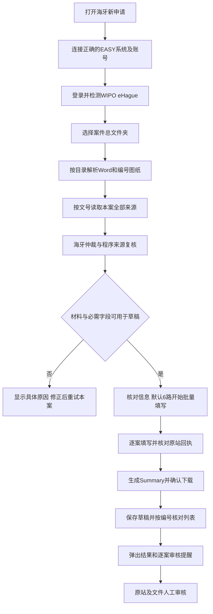
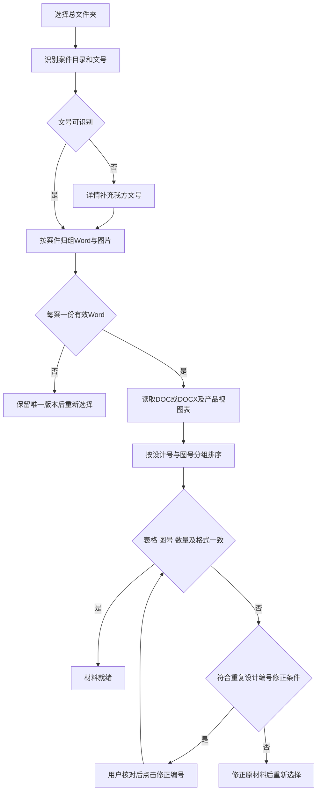
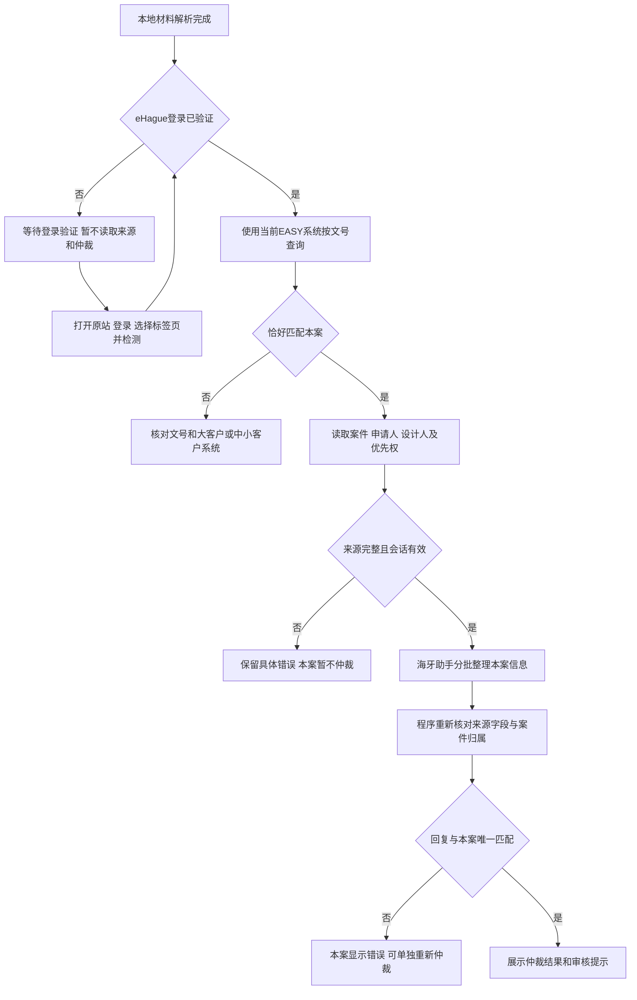
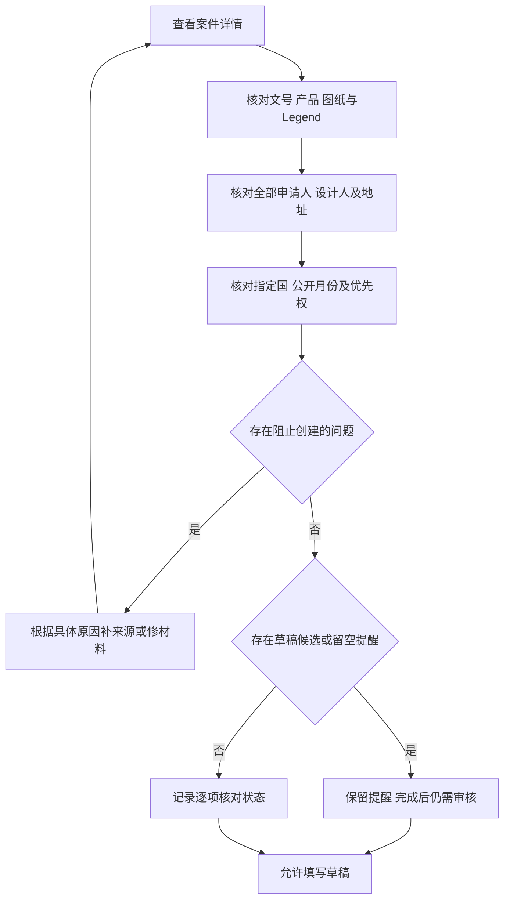
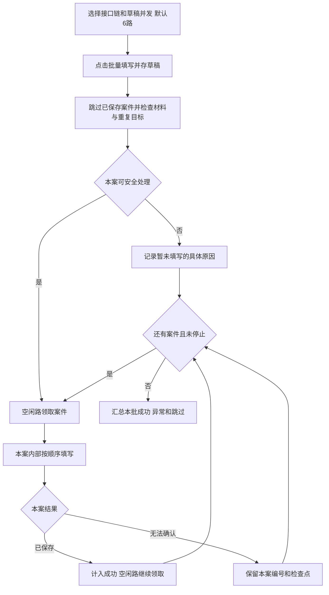
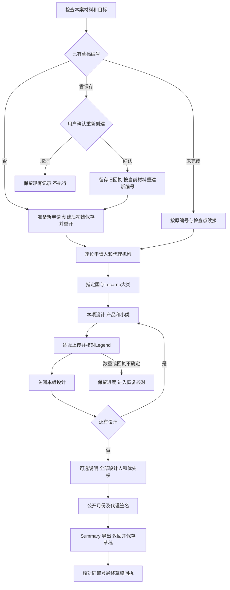
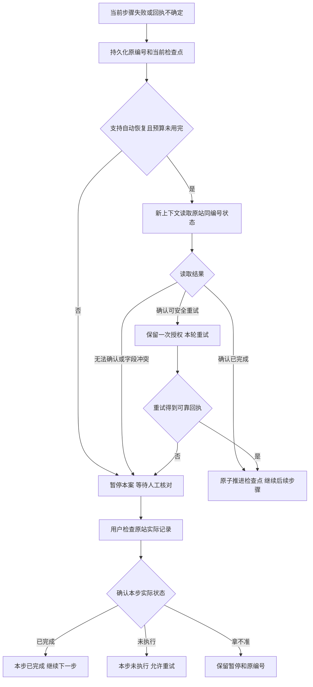
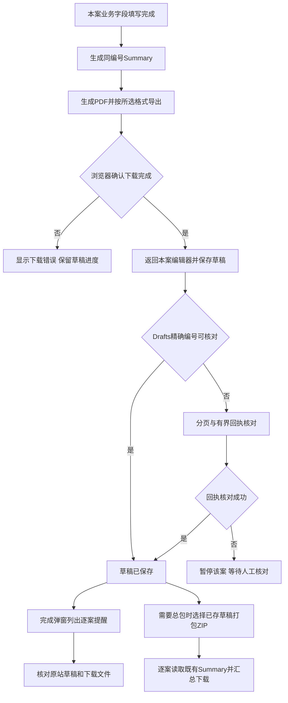

# 海牙新申请工作流

入口：工作流 → 海牙新申请。页面默认进入“开始使用”，可切换到“流程说明”查看本文。默认填写方式为**接口链**，批量草稿默认 **6 路并发**，可选择 1–6 路。

本流程读取本地定稿 Word、编号图纸及 EASY 案件来源，完成材料核对、AI 仲裁、eHague 草稿填写、Summary 导出和草稿保存。终点是**草稿已保存、导出已确认，等待人工审核**；正式递交和付款由用户在原站另行处理。

返回 [工作流索引](README.md)。开发细节见 [接口契约](../../../API/external-platforms/hague.md) 和 [技术算法与容灾](../mechanisms/海牙接口链与容灾算法.md)。

## 1. 全链路总览



| 阶段 | 输入 | 输出与通过条件 | 停止或待处理原因 |
|---|---|---|---|
| 连接 | EASY账号、官方WIPO页面 | 当前来源系统明确、eHague登录验证通过 | 账号/系统错误、未登录、文档或标签页变化 |
| 材料 | 每案一份定稿和图纸 | 案件分组、产品、小类、视图与数量一致 | 缺图、重复图号、多版本、Word损坏 |
| 来源与仲裁 | 精确文号、解析材料 | 本案申请人、设计人、优先权及指定/公开要求 | 查询不到、来源不完整、冲突或回复无法匹配 |
| 草稿 | 核对后的本案计划 | 原WIPO编号、逐步确认的检查点 | 字段校验、记录数冲突、回执未知 |
| 导出与保存 | 本案Summary、原编号 | 下载完成且Draft(s)找到同编号草稿 | 下载中断、最终保存无法确认 |
| 审核 | 草稿、文件、提醒 | 用户逐项确认 | 留空、转写、占位号及条件仍待审核 |

EASY用于读取来源，eHague用于保存草稿，两者会话独立管理。本工作流不创建EASY邮件，也不走EASY发文审核人和提交审核流程。

## 2. 输入、目录分组与材料校验

### 2.1 推荐目录

```text
本批海牙材料/
├─ 客户甲/
│  └─ PO0000001HAGUE-产品名称/
│     ├─ 定稿.docx
│     ├─ 1.1.jpg
│     └─ 1.2.jpg
└─ 客户乙/
   └─ PA0000002CN-HAGUE-产品名称/
      ├─ 定稿.doc
      ├─ 1.1.jpg
      ├─ 1.2.jpg
      ├─ 2.1.jpg
      └─ 2.2.jpg
```

文号与材料为格式示意。总目录可嵌套多层客户目录；每案须只有一份有效定稿，不能把多个版本当同一案一起填写。



| 项目 | 规则 |
|---|---|
| 我方文号 | 从最近有效案件目录识别P前缀、HAGUE后缀文号；可回退Word文件名，未识别时手工补充 |
| 目录与文件名冲突 | 提示核对，不拿另一案件文号覆盖来源 |
| 嵌套目录 | 同文号FIGS图纸目录归入外层；不同文号、独立Word和版本继续隔离 |
| 定稿 | 支持DOC/DOCX，单份不超过20 MiB；忽略以 ~$ 开头的临时文件 |
| 产品表 | 设计编号、图纸数、产品名称、小类分别读取；设计编号应从1连续排列 |
| Description | 来源没有时留空并跳过，不自动编造说明 |
| 视图表 | 图号、代码、Legend对应；本案代码表优先，自定义代码00须有说明 |
| 图纸 | 设计号.图号命名；1.x与2.x独立；自然排序保证1.10排在1.2后 |
| 上传格式 | JPG/JPEG、TIF/TIFF，单张不超过2 MiB；PNG可预览但不作为当前自动上传格式 |
| 数量与归属 | 产品表、视图表、实际文件一一对应；缺图、多图、重复编号必须处理 |

“按图纸分组修正重复设计编号”只在多行编号均为1、产品与小类相同、各组图纸数匹配等条件同时成立时出现。用户确认后只修正草稿材料中的编号，Word原文件不变；修正记录保留并在完成时提醒。无法确认对应关系的情况应修改原材料。

## 3. 登录、来源读取与仲裁



### 登录操作

1. 在工作台顶部连接正确的EASY大客户或中小客户系统，确认账号。
2. 在海牙页右上角点击“打开平台”，在WIPO原站完成登录及必要的二次验证。
3. 回到工作台，点击“查找标签页”，选择正确的WIPO页面。
4. 点击“连接并检测登录”，通过后继续处理。

存在标签页或看到某个原站页面，不等于验证通过。EASY与WIPO的验证分别管理；检测过期、页面导航或关闭时需重新确认。若先选择材料，系统可以先本地解析，随后显示“等待 eHague 登录验证”。

### 来源与仲裁边界

- 只在当前连接的EASY系统内按文号精确匹配。查询不到时先检查系统、账号和文号，不自动借用其他案件。
- 读取全部申请人、设计人和优先权，再送海牙专用仲裁；某案失败不会把其结果套到别案。
- 系统先解析和核对明确来源，模型用于本案整理、转写和提示；关键字段还会被程序复核。
- 仲裁助手按自己的队列串行处理，6路草稿并发不等于同时运行6个AI任务。
- 选中案件可用“读取并仲裁本案”或“重新读取并仲裁本案”；已有草稿时重新仲裁可能改变材料指纹，应先核对旧草稿。

## 4. 核对结果与进入草稿的条件



| 核对内容 | 当前处理与需要用户确认的部分 |
|---|---|
| 申请人 | 当前自动配置支持CN/SG法人；其他国家、自然人或资格来源不足会显示原因 |
| 英文名称和地址 | 保留可靠来源；详细地址到区，城市、省份、邮编、国家分开展示；关键来源不足先补来源 |
| 邮编 | 本批原站为选填，缺失留空并提醒；非空仍校验，不按城市编造 |
| 新加坡资格 | 无来源省份可空；资格国家与ACP按本案来源形成候选，须审核国籍、住所、营业所和惯常居所 |
| 设计人 | 保留全部人数和顺序；有英文名沿用来源，中文转拼音保留来源标记，地址复用第一申请人 |
| 姓名补充 | 草稿开始前可展开“补充设计人英文姓名”修改名和姓；已有草稿后输入锁定 |
| 指定国 | 核对本案完整清单；EM为欧盟；另案同日递交和按款式排除等条件不能无条件追加 |
| 公开时间 | 正常公开12个月、立即公开0个月，其他明确月份按要求选择；待核对不是立即公开 |
| 优先权 | 核对真实申请号、日期、国家和DAS；数据库ID/序号不作申请号 |
| 占位号与DAS | 草稿占位号必须审核替换，原值保留；DAS格式不符时留空并提醒 |
| 日期 | 以来源和原站实际回执核对，不能只凭日历显示范围修改或省略优先权 |

点击图片可放大查看，支持缩放、上一张/下一张、方向键和Esc。案件列表与详情分别滚动，切换案件不会混用图片。

“已逐项核对材料、视图、地址和仲裁结果”用于记录核对状态，有提醒时可能无法勾选。能否进入创建，以“eHague 草稿”区域的具体预检查原因与按钮状态为准；有提醒不等于所有草稿都被禁止。

## 5. 默认6路调度与单案执行



接口链的读取 New 表单、准备新申请、新编号分配、初始保存和重开全部在创建队列内按一案一案完成，减少同会话创建握手并发；后续填表仍按所选路数并发。默认同时处理最多6个案件，可选择1–6路，1路为串行。少于6个可处理案件时实际路数更少；单案按钮只处理当前一案，不额外创建其他案件。

| 填写方式 | 页面与并发行为 | 异常处理 |
|---|---|---|
| 接口链（默认） | 共享已验证的传输标签页，各案状态独立，单案步骤串行 | 对支持步骤自动核对回执，无法确认则暂停该案 |
| 页面填写 | 批量时每路独立工作标签页；单案使用选中的标签页 | 保留异常页供人工检查 |

空闲路完成后立即补案，不等待整组同时结束。已保存案件经弹窗确认可重新创建新编号；同文号多版本、多个案件指向同一WIPO编号等冲突会拦截。登录失效停止领取后续案件，用户停止时等待已发步骤的回执。

已有进度需沿原填写方式和WIPO编号继续，不要靠切换模式、改文号或重复选版本绕过异常。

## 6. 单案草稿步骤与回执



续接只执行检查点之后的步骤；图中列出完整阶段，不表示已有进度会重复填写前面的申请人或设计。

| 关键动作 | 必须确认 |
|---|---|
| 创建 | 获得本案WIPO编号并保留可恢复草稿；初始编号存在不代表整案完成 |
| 申请人 | 逐位添加，保存前后数量正确，不能一次覆盖多人 |
| 指定国 | 原站选择集合与本案清单一致；每次操作等待对应回执 |
| 设计与图纸 | 每组独立，上传前后数量正确，Legend按含义匹配；完成本组才进入下一组 |
| 设计人/优先权 | 保留本案数量与字段，优先权添加前检查当前记录数 |
| Summary | 编号、内容和图纸对应当前草稿 |
| 导出 | 浏览器确认下载完成，文件可打开 |
| 最终保存 | 回到草稿列表，按精确WIPO编号核对，必要时翻页 |

顶部进度条显示本批处理数量、成功/异常/跳过、运行路数和确认步骤数。不同案件设计和图纸数量不同，步骤数不同；运行路数降为0时要结合结束提示判断，不只看百分比。

## 7. 不确定回执、自动恢复与人工确认



接口链对指定国、大类、优先权及最终保存提供有条件的自动核对。每步最多自动恢复一次，次数保留，刷新不会重置；创建、上传、打印等无法充分证明是否已执行的动作，不做泛化自动重放。

| 情况 | 系统处理 | 用户处理 |
|---|---|---|
| 同编号优先权的号、日期、国家和记录数均吻合 | 确认为完成，不重复添加 | 核对原始号、日期、国家及DAS |
| 确认尚未新增下一条优先权 | 允许本轮重试一次 | 再次失败时检查原站 |
| 已确认保存响应但列表未命中 | 精确编号分页复核 | 不新建替代草稿 |
| 材料指纹变化、编号冲突或旧检查点缺指纹 | 停止自动恢复 | 核对旧草稿与当前材料差异 |
| 原站结构无法识别或仍未知 | 保留暂停 | 提供发生时间、阶段和错误供排查 |
| 用户中途停止或恢复中刷新 | 保留检查点及恢复预算 | 按原站事实继续，不假定请求未执行 |

人工接管顺序：记录详情中的reference和阶段 → 打开原站同编号 → 检查字段/数量 → 确认已完整执行才点击“本步已完成，继续下一步”，确认未执行才点击“本步未执行，允许重试” → 再继续当前草稿。拿不准时保留暂停，不反复切换确认按钮。

“已存在编号”和“HTTP请求成功”都不能单独证明当前步骤已经保存。恢复完成记录会进入完成弹窗。

## 8. Summary、PDF、ZIP与最终保存



分页与回执核对有边界；仍无法确认时进入第7节的暂停分支，不无限循环。

| 导出入口 | 输出与范围 |
|---|---|
| 创建时“单个PDF”（默认） | 每案Summary各自导出 |
| 创建时“流式ZIP” | 该案本次Summary导出ZIP，不是整个批次总包 |
| 已存草稿打包ZIP | 当前列表中已保存且有编号的案件，汇总多份PDF为一个ZIP，不新建草稿 |
| 导出核对结果 | “海牙申请核对结果.json”，用于留存解析、仲裁、提醒与草稿状态 |

重新导入同文号材料时，工作台会恢复本机检查点，并显示恢复数量。“曾保存草稿”仅表示之前取得保存回执，不代表原站当前仍存在；原站可能已删除、修改，或当前登录账号不同。

已保存案件仍可点击“批量填写并存草稿”或“再次创建本案草稿”。弹窗会说明本次重新创建数量，确认后按当前材料从头创建新编号，旧编号与检查点另行留存，不修改或删除原站旧草稿；取消不改变任何记录。批次内未保存案件按原规则正常填写或恢复，结果不确定的步骤仍须核对。材料不合格、登录失败或校验期间停止时，不开始新建。

ZIP 包含当前列表中最新保存编号对应的原站 Summary，可能包含本机恢复的历史记录；不扫描账号全部历史，也不包含尚未保存的案件。历史编号已被原站删除、当前账号不可访问或无法精确定位时，打包会报错，不会拿其他草稿替代。重新创建成功后打包使用新编号，旧编号保留在本机历史记录中。材料修改不会自动更新已有草稿，可选择重新创建。填写和打包均须有效登录；点击后先显示登录验证提示，验证失败显示具体原因。

文件保存到浏览器下载目录，具体位置以下载记录或“打开导出文件所在位置”为准。JSON不是Word/图纸备份，也不是当前已提供的自动导入续跑文件。

PDF队列与案件并发分开，尾段可能等待生成或下载；下载完成与草稿保存完成也分别确认。打包中断不表示完整总包已交付，应查看错误和下载状态。

## 9. 前端操作与状态对照

| 控件/状态 | 含义 |
|---|---|
| 选择总文件夹 | 导入整批材料，重新选择会重建案件列表 |
| 读取知易通并批量仲裁 | 处理尚未得到仲裁结果的案件 |
| 继续处理剩余案件 | 停止后处理尚未完成的前置阶段 |
| 停止后续处理 | 停止后续取数/仲裁；已发查询可能仍返回 |
| 填写方式 / 草稿并发 | 默认接口链和6路，开始前可调整，运行时锁定 |
| 批量填写并存草稿 | 创建或续接当前可处理、尚未保存案件 |
| 填写并保存本案草稿 | 仅当前案件 |
| 继续当前草稿 | 从已确认进度续接原编号 |
| 核对并恢复当前草稿 | 接口链不确定状态先核对再决定如何继续 |
| 停止后续写入 | 不领取新案，等待当前已发步骤回执，不撤销服务端写入 |
| 曾保存草稿 · 原站当前状态未核验 | 保留上次保存回执，可经弹窗确认重新创建；不保证原站当前仍有此草稿 |
| 暂未填写，查看原因 | 预检查或安全条件未通过，先看具体原因，不等于登录失败 |
| 草稿执行失败 / 草稿步骤待核对 | 查看reference、阶段、错误与原站实际状态 |
| 我知道了 | 关闭完成弹窗，详情和检查点继续保留 |

左侧案件列表显示文号、目录、状态和问题数；右侧详情显示当前案材料、图纸、来源与草稿。运行中按钮按状态禁用，不应通过刷新或改目录绕过禁用状态。

## 10. 完成审核、停止与后续批次

完成弹窗列出成功、异常、跳过及逐案提醒。邮编留空、SG资格候选、拼音转写、编号修正、优先权占位号、条件冲突和自动恢复说明都须核对。

最终核对：我方文号与WIPO编号对应、全部申请人/设计人、地址与资格、指定国及款式条件、设计与全部图纸、Legend、Description、原始优先权、DAS、公开月份、签名、Summary和原站草稿。部分案件成功时按案分别交接，不能把全批有异常理解为所有案件都未保存。

运行中保留工作台、原WIPO标签页及登录账号。停止不是回滚；刷新后File对象和列表可能丢失，本地检查点不等于材料备份。需续接时重新选择原材料、使用原账号与原模式，并核对已有编号；材料或目标变化可能要求人工处理。

下一批开始前先保存核对结果、记录未完成编号、确认下载状态。新版应在当前批次完成后重新加载扩展启用。日常排查提供发生时间、文号、reference、阶段和错误即可，不发送Cookie、密码或下载令牌。

开发维护的证据范围、接口限制、自动恢复算法和测试入口，以本文开头链接的接口与技术算法文档为准。默认6路是产品设置，不能替代所有材料组合与长期负载的验证。

已确认的重复设计编号修正会绑定材料指纹保存；重新导入相同材料可恢复。旧记录只有提示文字、没有指纹时，仍可点击“按图纸分组修正重复设计编号”（曾保存案件也可用），核实后再创建。材料分组数量不符或设计编号重复在解析阶段即显示，不再等到填草稿时才跳过。

选择总文件夹使用浏览器文件选择，选中后显示网站统一的“导入海牙申请材料”确认框；取消不读取 Word、不取数仲裁。也可直接把总文件夹拖入页面，拖拽不经过系统确认。不使用浏览器的目录访问接口（showDirectoryPicker）：它会触发无法抑制的“允许此网站查看和复制文件”授权弹窗；浏览器文件选择自身可能弹出的“上传 N 个文件”等系统级确认也无法用网站样式替换或关闭。

保活与自动续检：插件后台复用既有保活闹钟，每分钟至多选择一个已打开的 eHague 官方受保护标签页，只读探测案件列表。不会打开标签页或代为登录。工作台手动连接验证成功后，每分钟静默复核并更新原有五分钟验证凭证；检测中保留仍有效状态，避免无故闪成“已过期”。实际验证失败则取消有效状态、显示原因，并停止后续材料处理或草稿写入。切换/关闭标签页和工作台卸载会丢弃旧验证结果；原站强制登出或要求二次验证时仍需用户登录。后台代码更新后需在扩展管理页重新加载插件。

结果未知与另建：默认继续操作仍只在能核对回执时恢复，创建无编号的旧检查点不会被静默重发。明确需要重做时可选“将异常另建草稿”或“另建本案新草稿（保留旧记录）”。封装弹窗会说明旧操作结果尚未确认、原站可能已有草稿；确认后先归档旧检查点（无编号记录用唯一键），再以当前材料创建新任务。新草稿检查点及完成弹窗保留重复风险提醒；取消、停止或预检失败不发起创建，归档失败也不继续写入。该操作不是认定旧请求未执行，原站旧草稿不会被修改或删除。

同一材料已经批准的编号修正可从待核对、停止、运行、失败或已保存的检查点恢复，仍需批准文案、输入指纹和严格图纸分组一致。恢复材料修正不推进旧步骤，不解除待核对状态。

已连接验证过的同一标签页刷新时，会先使旧凭证失效，加载完成后重新只读复核；临时网络失败会显示原因，并按分钟继续复核。切换所选标签页、关闭标签页或卸载工作台会清除旧资格，不会替用户验证新选择。重新复核成功也不会自动重启已停止的草稿任务。

保活探测的失败分类：网络超时、临时通道不可用和服务端 5xx 不等于确认登出；最近一次验证仍在有效期内时保留原凭证并继续复核，不因单次辅助探测失败中止批次，也不会延长原凭证有效期。明确 401/403、跳转登录页、密码页或目标失效仍会撤销验证。持续无法复核超过原有效期时仍会安全停止。停止弹窗会列出手动停止、会话验证中断或业务请求登录失败等具体原因。


### 协议诊断与回放

海牙页面提供默认折叠的“协议诊断”，应用采集默认关闭；独立于业务运行和CDP深度授权。排查异常时可以查看真实HTTP状态、JSF校验结果、ViewState摘要、DOM结构变化和步骤回执，再导出脱敏JSONL/JSON/Markdown。无CDP时仍可查看应用Trace，并明确显示缺少CDP证据。

详细入口：[Trace与状态](../hague-tracing-and-status.md)、[21种动作与状态传递审计](../hague-code-audit.md)、[AST协议分析](../hague-ast-analysis.md)、[CDP深度观察](../hague-cdp-reverse-engineering.md)、[专项验收](../hague-diagnostics-acceptance.md)。诊断不改变检查点和防重复规则，不确定写入仍须核对原站Draft(s)。
