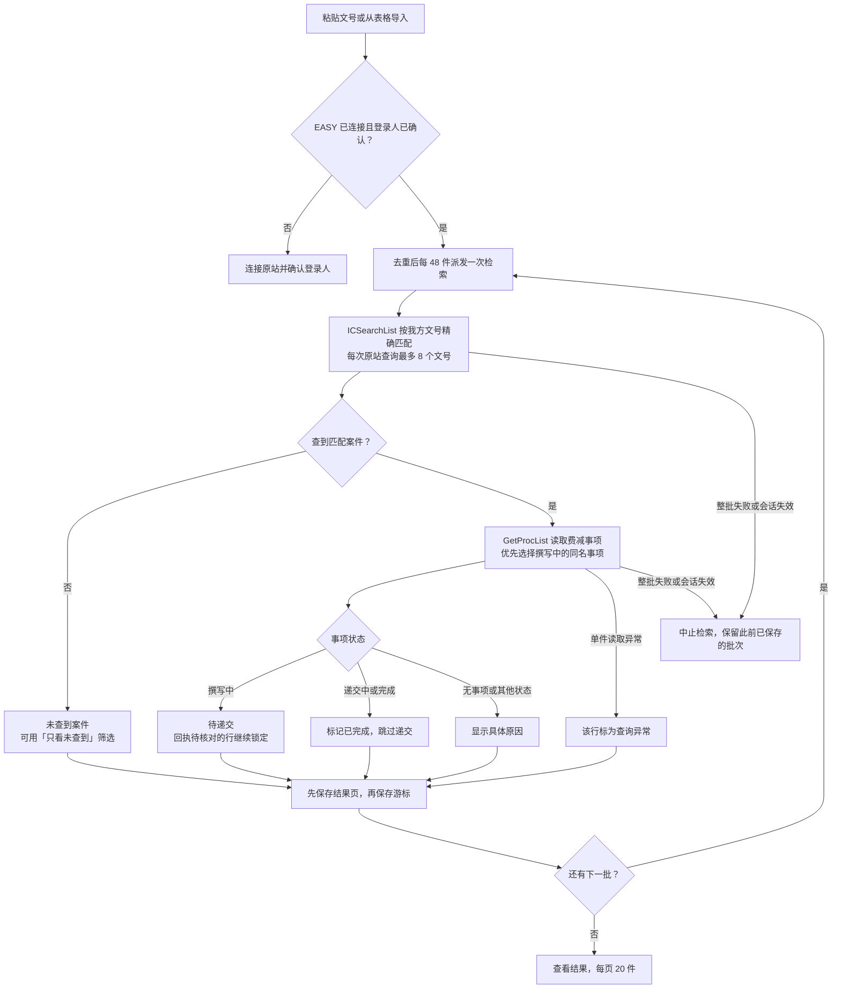
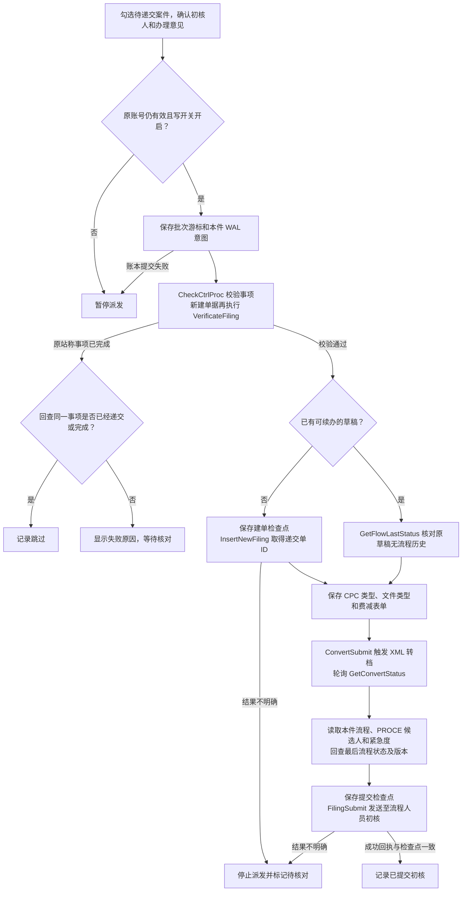
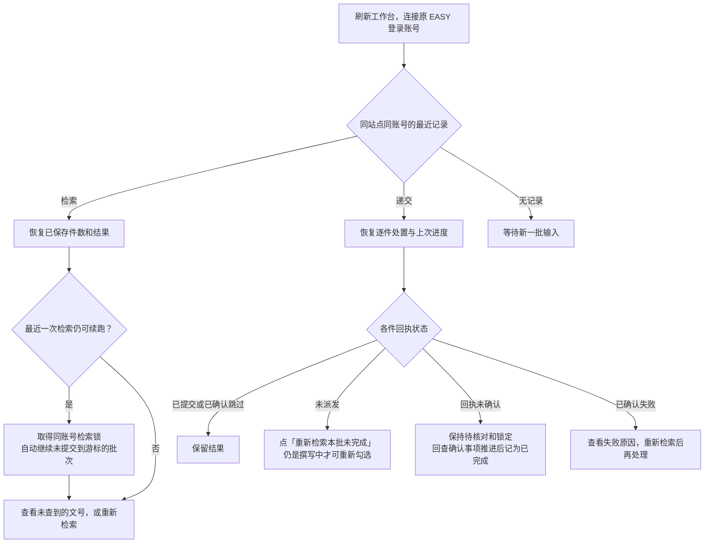

# 请求费用减缓

按我方文号批量检索案件中「请求费用减缓」处理事项的当前状态：对处于「撰写中」的案件自动发起电子递交（费用减缴请求书）、完成 XML 转档，并提交至「流程人员初核」节点；对处于「递交中」或「完成」的案件自动判定为已完成并跳过。

原站请求、响应及扩展消息字段见 [费减工作流接口](../../../API/48-费减工作流接口.md)。

---

## 1. 批量检索与结果筛选

---

### 状态判定规则

- **已完成（自动跳过）**：处理事项 `请求费用减缓` 的处理状态为 `递交中` 或 `完成`。
- **待递交（自动勾选）**：处理事项 `请求费用减缓` 的处理状态为 `撰写中`。
- **其他 / 未找到**：案件中无 `请求费用减缓` 事项、未查到我方文号或状态为其他值时，仅提示原因，不自动提交。

---

## 2. 递交、转档与提交初核

- 支持三种初核人策略：**默认首位候选人**、**待办件数最少**、**指定初核人**，也支持在检索结果表中针对单个案件单独覆盖。
- 执行递交前需开启**写开关**（工作台顶部可直接切换，或前往「系统设置」）；仅检索状态时只读即可使用。
- 检索侧默认 6 路并发；批量递交默认 6 路，可在界面切换为 1 / 2 / 4 / 6 路。
- 校验接口（如 `CheckFirstInventor` 返回「第一发明人国别信息未填写!」）仅作非阻断提示展示，不阻断费用减缴请求书的转档与提交流程。
- 批次以检索时的 EASY 账号和确认时的递交参数为准。切换账号后请重新检索。
- 校验阶段失败可以重试。若递交单已经建好，重试会从 WAL 中找到同一张单并核对状态后续办。若建单或最终提交的结果不明确，系统会拦截重发，请在 EASY 人工核对。

## 3. 刷新后恢复与核对

刷新后，费减会在确认原账号且取得检索锁后继续未完成的只读检索。已提交到 WAL 的结果页直接复用，刷新时尚未确认的那一小批会重新查询。含历史结果的批次可以查看和筛选，重新检索并确认后才能递交。

检索期间若 EASY 登录失效，保留检查点，原账号重新确认后续跑。普通业务失败保留错误和已查结果。待核对的递交仍需按原回执和流程状态处理，刷新不会补发写请求。
