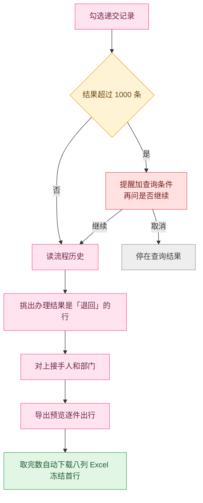

# 递交管理-已完成导出

内置标识：`filing-export`。查询表单就是递交管理那一套（同一封装组件），两个入口都现场查现场导：「递交管理」页；「发文任务 → 按工作流发文」里选这条工作流，表单直接带出来。查询出递交记录后勾选（逐行、全选本页、全选所有都行），点「导出 Excel」，取完数自动下载，不用再点第二次。这条工作流不发文，产物是一张带退回脉络的 Excel：谁退回、退回原因、谁接手、接手人部门。每件递交只打两个主接口：`Common.ashx Call=GetFlowHistory`（obj_id 传递交编号）和 `Common.ashx Call=ShowUserInfo`（人员浮窗的部门）；我方文号、申请日、案件流向、案件状态直接用查询结果行，不再查案件详情。

| 阶段 | 输入 | 输出 | 判断 | 停止原因 |
|---|---|---|---|---|
| 勾选递交记录 | 递交管理查询结果 | 勾选集 | 总数是否超过 1000 | 用户在提醒弹窗里取消 |
| 读流程历史 | 每件的 filing_id | GetFlowHistory 的行 | 办理结果是否「退回」 | 一件读不到就记问题行，整批不停 |
| 对上接手人和部门 | 退回行之后的流程行 | 接手人姓名和部门 | 先找「启动流程」行，没有就取下一位办理人 | 部门读不到留空 |
| 导出预览 | 每件的导出行 | 下表预览（分页行级刷新） | 一次退回一行 | — |
| 下载 Excel | 预览行 | 八列表格，冻结首行，取完数自动下载 | — | 没有可导出的行 |

## 导出列口径

| 列 | 来源 |
|---|---|
| 我方文号 | 查询结果行的我方文号。同一份多行时只写第一行，之后留空 |
| 申请日 | 查询结果行的申请日；没有申请日就用申请事项的完成日（这次递交的完成时间） |
| 案件流向 | 查询结果行的案件流向，II/IO/OI/OO 翻成案件页上的中文名（内-外 这类），认不出就原样写 |
| 流程专员（退回者） | 流程历史里办理结果是「退回」的行的办理人员 |
| 代理师（接受者） | 退回发生后下面第一个「启动流程」的行的办理人员；没有这样的行就取再下面一位办理人 |
| 代理师所属部门 | 接手人悬停浮窗里的部门（`ShowUserInfo` 的 dept_full_name），按人去重后取 |
| 退回的原因 | 退回那一行的办理意见 |
| 案件状态 | 查询结果行的案件状态 |

一件递交有几次退回就导出几行；一次都没有退回的也出一行（退回相关三列留空），免得导出里悄悄少件。

## 进度与性能

- 进度条复用 PCT 的彩虹条（`check-progress`）：全选所有翻页时按「已翻页 X/Y 页」报进度，导出取数时按「已取数 X/Y 件」报进度。
- 「全选所有」只翻页拉列表行（6 页并行），不会自动取数；点「导出 Excel」才开始取数，取完自动下载。
- 上表是查询结果（服务端分页），下表是导出预览（客户端分页），都按行刷新：预览表按件写入，行内容不变就不重绘（`v-memo`）。
- 取数并行 4 件；人员部门跨件去重，同一个人只查一次。

实现依据：`src/workflow/filing-export.ts`、`src/api/filing-export.ts`、`src/app/components/FilingExportPreview.vue`、`src/app/components/FilingSearchQuery.vue`。
